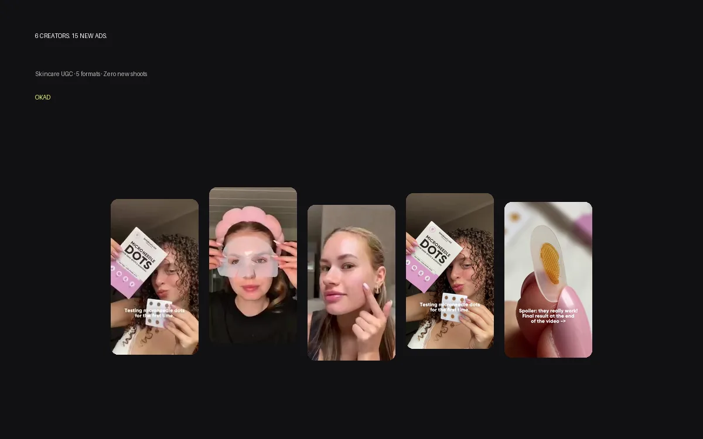

A salon network with 160 locations needs content for every single one. Different neighborhoods, different demographics, different seasonal offers. Traditional production math says: 160 locations times one shoot each equals a budget that nobody signs off on and a timeline that stretches past the point where any of it is still relevant.

This is the problem every multi-location beauty brand, franchise network, and salon chain hits eventually. The answer is not to do fewer shoots. The answer is to change how content gets produced entirely.

AI-generated creative and strategic UGC let you produce hundreds of localized ad variations from a handful of real assets. Here is how it works, what it costs, and which formats actually drive bookings.

## The Multi-Location Content Problem

Every salon location serves a slightly different audience. A downtown Manhattan salon and a suburban New Jersey location share a brand, but their clients look different, respond to different offers, and scroll past different content.

Running the same generic brand ad across all locations ignores this. Running unique creative per location using traditional production is financially impossible at scale. And doing nothing means every location competes for the same generic audience with the same tired stock-photo ads.

The math that breaks most beauty brands:

| Approach | Cost per location | 160 locations | Timeline |
|---|---|---|---|
| Individual photo shoot | $500-$2,000 | $80,000-$320,000 | 3-6 months |
| Stock photos + templates | $50-$100 | $8,000-$16,000 | 2-4 weeks |
| AI + UGC hub-and-spoke | $15-$30 per variation | $2,400-$4,800/month | Ongoing |

The third option is what scales. Here is how to build it.

## Three Content Types That Work for Beauty Services

Not all ad formats perform equally for salons and beauty services. These three consistently drive the lowest cost per booking across Meta and TikTok.

### 1. Before/After Transformation Ads

The single most powerful format in beauty advertising. A side-by-side showing what the client looked like before and after a treatment, color service, or styling session. No copy needed — the visual does the selling.

**Why it works:** The transformation IS the value proposition. The viewer does not need to imagine what the service does. They see it.

**How to produce at scale:**
- Collect client permission photos at every location (phone photos are fine)
- Use AI enhancement to standardize lighting and framing across different photo qualities
- Build a template with your brand frame: logo, location name, offer text
- Generate 3-5 variations per transformation: different crops, different text overlays, different aspect ratios

One real transformation can produce 5-10 ad variations. Ten transformations from across your network give you 50-100 ads — enough to test for months.

**Production tip:** Train your stylists to take "before" photos at check-in and "after" photos at checkout. Make it part of the service flow, not an afterthought. The salons that do this consistently have a permanent content pipeline.

### 2. Client Experience UGC

A real client walks through their experience at the salon — what they came in for, what happened during the visit, and how they feel about the result. Filmed on a phone, in the salon, by the client or a staff member.

**Why it works:** People trust other people. A 30-second genuine reaction from a real client outperforms a polished brand video in almost every A/B test we have run for beauty brands. The imperfection IS the trust signal.

**How to produce at scale:**
- Give each location a simple brief: "Ask happy clients if they'd like to film a 30-second video about their experience"
- Provide a script framework (not a word-for-word script): "What did you come in for? What was your favorite part? Would you recommend it?"
- Collect raw footage centrally via a shared drive or upload link
- Edit centrally: add captions, brand bumper, CTA, and location-specific offer

One UGC video from one location becomes a template that other locations replicate. The central team handles editing and quality control, so every ad looks professional regardless of which salon filmed it.

### 3. Educational and Ingredient Content

How-to videos, technique explainers, and ingredient breakdowns. "Why balayage works better than highlights for low-maintenance color." "What hyaluronic acid actually does for your skin." "Three signs your hair needs protein, not moisture."

**Why it works:** [Educational content earns saves and shares](/blog/blog-ai-content-creation-brands-guide/), which the algorithm rewards with extended reach. It positions the salon as an authority, not just a service provider. And it attracts people who are researching — the highest-intent audience for booking.

**How AI helps:** AI animation and illustration tools can visualize what happens beneath the surface — how a chemical peel works on skin layers, how hair follicles respond to different treatments. These visuals are impossible to photograph but easy to generate with AI image tools. They stand out in a feed full of selfies and flat-lays.

## The Hub-and-Spoke Production Model

This is the framework that makes multi-location content production affordable and consistent.

**The hub** is your central creative team (in-house or agency). They handle:
- Brand guidelines and template creation
- AI asset generation (product shots, backgrounds, educational animations)
- Video editing, captioning, and final quality control
- Performance tracking and creative optimization

**The spokes** are your individual locations. They contribute:
- Raw UGC footage from real clients (before/after photos, testimonial videos)
- Location-specific details (offers, staff names, neighborhood context)
- Content requests based on what services they want to promote

The flow: locations capture raw content → hub processes and adapts it → locations run the finished ads against their local audience.

This model works because 80% of the creative work is centralized and reusable. The 20% that varies per location is the cheapest part: headlines, offers, and geographic targeting.

### Template System for Localization

Build a set of 5-10 ad templates that can be customized per location:

| Template | What changes per location | What stays the same |
|---|---|---|
| Before/after static | Client photo, location name, offer | Brand frame, layout, CTA format |
| UGC testimonial video | Creator, location mention, specific service | Edit style, music, brand bumper, CTA |
| Educational reel | Location-specific hook | Core educational content, AI visuals |
| Seasonal promo static | Offer details, dates | Design template, brand colors |
| Staff spotlight | Staff member, their specialty | Video format, interview questions |

One template set can produce thousands of location-specific variations. The initial investment in template creation pays for itself within the first month of multi-location deployment.

## AI Tools for Beauty Content

AI is not replacing your content — it is filling the gaps that traditional production cannot reach.

**Product visualization:** Tools like Midjourney and Flux generate realistic product shots in any setting. A bottle of serum on a marble counter, surrounded by fresh ingredients, in soft morning light — rendered in minutes, no photographer needed. These work as static ad backgrounds and carousel slides.

**Before/after enhancement:** AI tools standardize the lighting, color, and framing of phone-captured before/after photos. A photo taken under fluorescent salon lights and a photo taken in natural light at a different location can be adjusted to match — making your before/after ads look consistent across all locations.

**Hair and skin visualization:** AI can generate realistic try-on mockups: "What would I look like with this hair color?" These interactive-style ads drive extremely high engagement because they invite the viewer to imagine themselves with the result.

**Animated explainers:** AI illustration tools [create educational content](/blog/blog-ai-animation-for-marketing/) that shows internal processes — how a facial treatment affects skin layers, how keratin bonds reform during a treatment. These stand out because no competitor is producing them. They look scientific and authoritative in a market dominated by selfies.

## Scaling Without Losing Authenticity

The biggest risk in multi-location content production is making everything look corporate. The salon industry thrives on personal connection — clients choose their stylist, not the brand. Content that feels mass-produced loses the trust advantage that makes UGC work.

Rules for maintaining authenticity at scale:

**Keep UGC raw.** Do not over-edit client testimonials. Add captions and a brand bumper, but leave the shaky camera and the genuine reactions. The imperfection is the point.

**Feature real staff.** Show the actual people who work at each location. Name them. Let them talk about their specialty. This personalizes the brand at the location level in a way that corporate content cannot.

**Localize the hook, not just the offer.** "Best balayage in Williamsburg" hits differently than "Best balayage near you." Specificity earns trust because it signals that the ad was made for THIS viewer, not everyone.

**Rotate creative by location.** Do not run the same 5 ads everywhere for months. Each location should get fresh creative every 2-3 weeks, pulled from the central template system. This prevents fatigue and keeps the [creative pipeline healthy](/blog/blog-how-to-scale-ad-creative-without-shoots/).

## What This Costs

A realistic budget for multi-location beauty content production:

| Component | Monthly cost | What you get |
|---|---|---|
| Central creative production (agency) | $2,500-$5,000 | 20-40 ad variations, templates, editing |
| AI asset generation | Included or $100-$300 | Product shots, backgrounds, animations |
| Per-location UGC collection | $0 (staff-captured) | Raw footage from real clients |
| Ad spend per location | $500-$2,000 | Local targeting and distribution |

Compare this to traditional production: one professional shoot per location at $1,000 each would cost $160,000 for the network — and produce static assets that fatigue in weeks. The AI + UGC model costs $30,000-$60,000 annually and produces fresh creative continuously.

The [localization approach](/blog/blog-localizing-ad-creatives/) scales linearly: adding a new location costs the price of adapting existing templates, not producing new content from scratch.

*OKAD produces ad creative systems for beauty and wellness brands — templated for multi-location scaling, personalized enough to feel local. [See the approach in action](/cases/breakout-aid-skincare-ugc-ads/).*

## Work With OKAD

OKAD builds ad creative systems for multi-location beauty brands — UGC collection frameworks, AI-generated assets, template libraries, and ongoing production under one retainer. No per-location pricing surprises.

**[See pricing and book a call](/pricing)** · Or email [olga@okad.agency](mailto:olga@okad.agency) with your number of locations and monthly ad budget — we will reply with a specific production plan.
