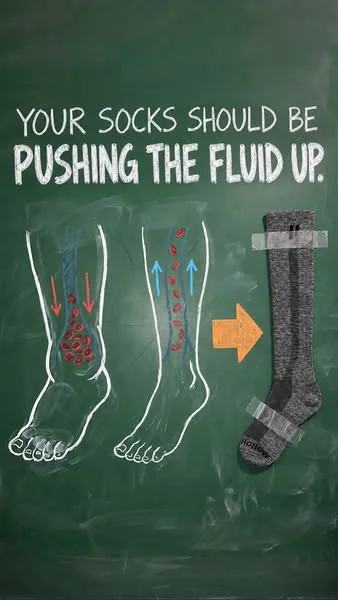
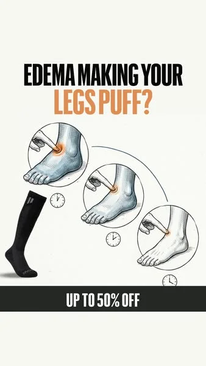
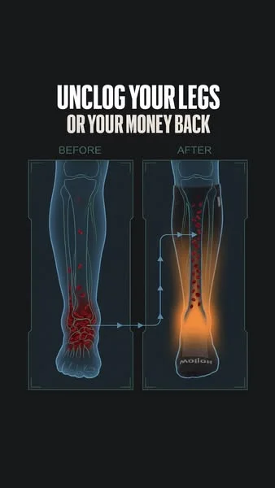

Every ad in a social feed looks the same. UGC talking heads, product demos, lifestyle shots — the formats have converged to the point where nothing stands out. Then a cartoon ad appears: bold colors, exaggerated motion, a character that could not exist in reality. The thumb stops.

That pattern interrupt is why cartoon and animated ads are gaining traction on Meta, TikTok, and YouTube. They look different from everything else in the feed, which earns the first 3 seconds of attention that every other format fights for.

The problem used to be cost. Traditional animation runs $5,000-$50,000 per spot. AI tools have collapsed that to $100-$500 — and the production timeline from weeks to hours. Here is how to produce cartoon ads that convert, when to use them, and how to test them against your existing formats.

## Why Cartoon Ads Work

Three structural advantages explain why animated ads outperform expectations:

**Pattern interrupt.** Social feeds are 90% real-world footage. A cartoon character in that feed triggers a novelty response — the brain registers something different and pauses to process it. This is the same mechanism that made illustrated Instagram posts outperform photos in 2023-2024. The format itself earns attention before the message even lands.

**Brand safety.** No creator faces means no creator risk. A cartoon mascot cannot have a scandal, miss a deadline, or demand a rate increase. The character is yours forever. For regulated industries — finance, healthcare, alcohol — where showing real people using the product requires compliance review, cartoon characters sidestep the entire issue.

**Infinite iteration.** The same character can deliver 50 different hooks in 50 different settings without a single reshoot. Change the background, change the dialogue, change the scenario — the production cost per variation approaches zero once the character exists. This is the same principle that drove [Skribly's 1,257-video campaign](/cases/high-roas-ugc-ads/) to 8%+ retention rates: modular production that makes each new variation nearly free.

**Algorithm diversity.** After Meta's Andromeda update in late 2025, the ad delivery system groups visually similar creatives and learns on them as if they were one ad. Ten photos of the same product with different text overlays? The algorithm treats them as one ad. This means brands need visually distinct creatives to get genuine creative diversification in the auction. Illustration is the fastest way to produce creatives that look fundamentally different from each other — and from everything else in the account. One text, six illustration styles: anatomy diagram, pencil sketch, chalkboard, flat cartoon, 3D claymation, comic strip. Each one registers as a separate ad in Meta's system. That is six independent learning cycles instead of one.

## The Production Workflow

### Step 1: Character Design (2-3 Hours First Time)

Your character needs to be distinctive, simple enough to animate consistently, and aligned with your brand personality. Generate 20-30 variations in Midjourney or Flux, refine the best ones, and lock a final design with multiple angles (front, side, three-quarter).

Key decisions:
- **Style:** Flat illustration, 3D rendered, sketch-style, or pixel art
- **Complexity:** Simpler characters animate more consistently
- **Expressions:** Design 4-6 core expressions (neutral, happy, surprised, concerned, excited, thinking)

Save the final character as reference images. These become your consistency anchor for every future scene.

### Step 2: Scene Generation (30-60 Minutes)

For each ad concept, generate the background environments and key scenes. Use your character reference images to maintain consistency. Most teams produce 3-5 scene variations per concept to test different visual contexts.

Prompt structure that works: describe the environment first, the character's pose and expression second, the camera angle third, and the style keywords last. Specificity beats creativity — "cartoon character sitting at a desk with laptop, morning light through window, side view, flat illustration style" produces more usable output than vague prompts.

### Step 3: Animation (1-2 Hours)

This is where the AI tools diverge in capability:

| Tool | Best For | Duration Limit | Quality |
|---|---|---|---|
| Runway Gen-4 | Smooth motion, camera moves | 10-16 seconds | Highest |
| Kling 2.0 | Character movement, gestures | 5-10 seconds | High |
| Pika 2.0 | Simple motion effects, loops | 3-5 seconds | Good for loops |
| Luma Dream Machine | Cinematic shots | 5-10 seconds | High realism |

For a 15-30 second ad, you typically generate 3-5 animated clips and combine them in editing. Each clip covers one beat of the story: hook, problem, solution, CTA.

### Step 4: Voiceover and Sound

AI voiceover (ElevenLabs, PlayHT) adds narration without talent costs. Match the voice to the character — a playful character needs a warm, energetic voice. A professional character needs a clear, authoritative one. Generate 3-5 voiceover variations per script to test pacing and tone.

Add background music and sound effects last. Trending audio on TikTok, upbeat music on Meta Reels, and clean voiceover-only on YouTube pre-roll.

### Step 5: Editing and Export

Combine animated clips, voiceover, text overlays, and music in your editor. Export in the correct aspect ratio for each placement:

| Placement | Aspect Ratio | Duration |
|---|---|---|
| TikTok / Reels / Stories | 9:16 | 15-30 seconds |
| Meta Feed | 1:1 or 4:5 | 15-30 seconds |
| YouTube Pre-roll | 16:9 | 15-30 seconds |
| YouTube Shorts | 9:16 | 15-60 seconds |

## When to Use Cartoon vs Live-Action vs UGC

The format should match the product, audience, and campaign objective:

| Factor | Cartoon | Live-Action | UGC |
|---|---|---|---|
| Best for | Apps, SaaS, finance, kids, supplements | Fashion, beauty, food, lifestyle | Physical products, DTC, social proof |
| Trust signal | Low (not real) | Medium | High (real person) |
| Scroll-stop power | Very high | Medium | Medium-high |
| Production cost per ad | $100-$500 | $500-$5,000 | $200-$1,000 |
| Iteration speed | Very fast | Slow (reshoot) | Medium (new creator) |
| Brand control | Total | High | Low-medium |
| Compliance risk | Very low | Medium | Higher |

The highest-performing accounts do not pick one format. They test all three and let the data determine the mix. A common winning pattern: cartoon hook (first 3 seconds for scroll-stop) grafted onto a UGC body (for trust and social proof). This hybrid approach combines the pattern interrupt of animation with the authenticity of a real person.

## Illustration Styles to Test

Not all cartoon ads look the same. The most effective approach is testing one piece of ad copy across multiple illustration styles — each style reads as a distinct ad to the algorithm and appeals to different audience segments. Here are the eight styles that work for static and animated ad creatives:

**1. Anatomy and blood flow diagrams.** Medical-poster style illustrations that show internal mechanisms — blood circulation, muscle compression, ingredient absorption. Almost scientific, but without the repulsive medical photography that gets flagged by ad review. Works for compression wear, supplements, skincare, and any product where the benefit happens inside the body.

**2. Pencil sketch (textbook style).** Engraving and crosshatching give an educational, authoritative feel. The illustration looks like it belongs in a science textbook, not a social ad — which is exactly why it stops the scroll. The "expertise" aesthetic works for health, wellness, and technical products.

**3. Chalkboard drawings.** Green or black board with chalk-style arrows, diagrams, and product illustrations. The "let me explain this simply" format. Works well for problem-solution angles — draw the problem, draw the mechanism, draw the solution. Each frame carries one message.

**4. Flat cartoon characters and progression sequences.** Simple illustrated people showing a before-during-after progression in 3-4 frames. Swelling goes down, energy goes up, pain disappears. The style reads instantly — a viewer understands the transformation in under two seconds. Flat characters are also the easiest to generate consistently with AI tools.

**5. 3D claymation and toy scenes.** Volumetric renders that look like stop-motion clay figures or product displays on miniature stages. Soft lighting, physical materials, tactile textures. This style feels premium — like an expensive product shoot — but costs a fraction of real 3D rendering. Works for product-focused ads where you want shelf appeal.

**6. Four-panel comic strips.** Sequential storytelling: panel 1 shows the problem, panel 2 the failed solution, panel 3 the product, panel 4 the result. The comic format is inherently engaging because the viewer wants to see how the story ends. Each panel builds on the last, which keeps attention through the full ad.

**7. Carousel: photo plus illustration hybrid.** Real product photos or lifestyle shots in the first and last frames, with illustrated explanation cards in the middle. The photos establish credibility. The illustrations explain the mechanism or benefit that photos cannot show. This hybrid format works in carousel ads where the middle slides need to educate without boring.

**8. Product schematics and cross-sections.** Technical drawings showing the inside of a product — layers, materials, construction details. The "how it works" format for physical products. A cross-section of a shoe sole, a cutaway of a mattress, a diagram of a supplement capsule. These convert engineers, researchers, and skeptical buyers who want to understand what they are buying.

The testing approach: take your single best-performing ad copy and produce it in 4-6 of these styles. Launch all variants simultaneously with the same budget. After $50-$100 per variant, you will know which visual style resonates with your audience — and you will have 4-6 genuinely different ads in rotation instead of one.

## When Illustration Beats Photography

Cartoon and illustrated ads have a specific structural advantage for products with invisible benefits. If your product's value cannot be photographed — compression, blood flow, nutrient absorption, pain relief, energy levels, mental clarity — illustration is not just a creative choice. It is the only way to show what the product actually does.

A compression sock brand cannot photograph improved circulation. But an anatomy-style illustration showing blood flow being pushed upward, with arrows and color gradients, communicates the mechanism in a single frame. A supplement brand cannot photograph bioavailability. But a cutaway illustration of a capsule releasing ingredients into the bloodstream makes the concept tangible.

This applies beyond health and wellness. Any product category where the core benefit is a process, a mechanism, or an internal change:

- **Compression and support products:** Show blood flow, pressure gradients, swelling reduction
- **Supplements and vitamins:** Show absorption pathways, ingredient mechanisms, before-after cellular states
- **Skincare:** Show penetration layers, ingredient delivery, cellular repair
- **Mattresses and ergonomic products:** Show spine alignment, pressure distribution, support zones
- **Software and apps:** Show data flows, workflow improvements, time savings as visual metaphors

For these categories, illustration is not competing with photography — it is filling a gap photography cannot cover. The ad review advantage is significant too: real photos of swollen ankles, varicose veins, or inflamed skin often get flagged or rejected by platform moderation. An illustrated version of the same condition communicates the pain point without triggering a policy violation.

## Cartoon vs UGC: Longevity in Rotation

One question brands ask before investing in illustrated creative: how long do cartoon ads last in rotation compared to UGC and raw phone photos?

The data is still early — illustrated ads at scale are a late-2026 phenomenon — but initial patterns are emerging from brands testing both formats:

| Format | Typical Rotation Life | Notes |
|---|---|---|
| Illustrated statics (new test) | 9-19 days | Fresh format, winners not yet proven |
| UGC photos in context (proven) | Up to 40 days (median ~40) | The longest-running ads in most accounts |
| Raw phone photos with long narrative | 100-200 days | Low-production lifestyle content with authentic stories |
| Illustrated statics (long-running) | 60-360+ days | Early data from brands with 100+ active illustrated ads |

The takeaway: illustrated ads are not replacing UGC. Strong brands add illustration as a new visual type alongside working UGC and photos — so the algorithm sees more genuinely different ads and distributes budget across a wider creative pool. The goal is not "cartoon vs UGC" but "cartoon plus UGC" — more visual diversity means more independent learning cycles in the ad account.

## Animated Characters for Older Audiences

One counterintuitive finding: Pixar-style animated characters perform well with audiences over 55. Brands targeting older demographics — health supplements, compression products, mobility aids — are testing animated video ads featuring relatable older characters rendered in a warm, cinematic 3D style.

The logic: the target audience recognizes themselves in the character without the fatigue or authenticity skepticism that comes with seeing a real spokesperson. An animated grandmother running errands, gardening, or walking pain-free communicates the product benefit through a character the viewer identifies with — but in a format that feels like content rather than advertising.

This approach requires animated video, not just static illustration. The character needs to move, emote, and tell a story. AI animation tools like Runway Gen-4 and Kling 2.0 can produce Pixar-adjacent quality for short clips, making this format accessible without a Pixar-level budget.

## Testing Cartoon Ads

Apply the same [creative testing methodology](/blog/blog-creative-testing-methodology/) you use for any format. Isolate one variable at a time:

**Round 1: Format test.** Run the same message as a cartoon ad, a UGC video, and a live-action product demo. Same hook concept, same CTA, different format. This tells you whether your audience responds to cartoon format at all.

**Round 2: Character test.** If cartoon wins or ties, test different character styles — realistic vs exaggerated, human vs animal, single character vs duo. Character appeal varies dramatically by audience.

**Round 3: Hook test.** Test 3-5 different opening scenes for the winning character. Same body and CTA, different first 3 seconds. This is where cartoon ads shine — you can test wildly different visual hooks without any additional production cost.

**Round 4: Body and CTA test.** Once you have a winning character and hook, test different story structures in the body and different CTAs.

Allocate $50-$100 per variant with a 3-day minimum run time. If your cartoon ad beats the control on CPA after $200 in spend, you have a format worth scaling.

## Common Mistakes

**Overcomplicating the character.** Detailed characters with realistic proportions are harder to animate consistently. Simple, distinctive characters with exaggerated features (big eyes, bold colors, clear silhouette) perform better in feeds and animate more reliably.

**Ignoring the first frame.** The static thumbnail matters as much as the animation. If your first frame looks generic, the ad gets scrolled past before the animation even plays. Design the opening frame as a standalone visual that earns attention even without motion.

**Using cartoon for the wrong product.** If your customer needs to see the real product before buying — clothing fit, food texture, makeup shade — cartoon format actively hurts conversion. Use cartoon for products where the concept matters more than the physical appearance.

**No voiceover.** Silent cartoon ads underperform because the format lacks the human connection of a face on camera. Voiceover adds the human element that cartoon visuals remove. Always test with and without voiceover, but most teams find voiceover versions win.

**Inconsistent style across ads.** If every cartoon ad looks different — different character style, different color palette, different animation quality — you lose the brand recognition benefit. Lock a style and character early, then iterate within that framework.

## The Cost Advantage

The economics of AI cartoon ads compound over time:

| Production Stage | First Ad | Each Additional Variant |
|---|---|---|
| Character design | $150-$300 (2-3 hours) | $0 (reuse) |
| Scene generation | $50-$100 (1 hour) | $50-$100 |
| Animation | $100-$200 (1-2 hours) | $100-$200 |
| Voiceover | $20-$50 | $20-$50 |
| Editing | $50-$100 | $50-$100 |
| **Total** | **$370-$750** | **$220-$450** |

After the initial character investment, each new cartoon ad costs roughly the same as a UGC edit — but without creator fees, briefing time, or revision cycles. At scale, a team producing 20 cartoon ad variants per week spends less than one producing 5 UGC videos.

For brands already running [AI video production](/blog/blog-how-to-make-ai-video-ads/), adding cartoon format to the creative mix is a natural extension. The same tools and workflow apply — only the visual style changes. If you are comparing AI-generated formats to traditional UGC, our [AI vs UGC comparison](/blog/blog-ai-video-ads-vs-ugc/) covers the performance data across different product categories. And for examples of AI ad creatives across styles, see our [AI ad creative gallery](/blog/blog-ai-ad-creatives-examples/).

## Work With OKAD

OKAD produces AI-generated video ads, animated content, and UGC — strategy and production as one service. No retainer lock-in. Results-based pricing available.

**[See pricing](/pricing)** · Email [olga@okad.agency](mailto:olga@okad.agency) with your product and goals — we reply with a specific plan and cost estimate.
