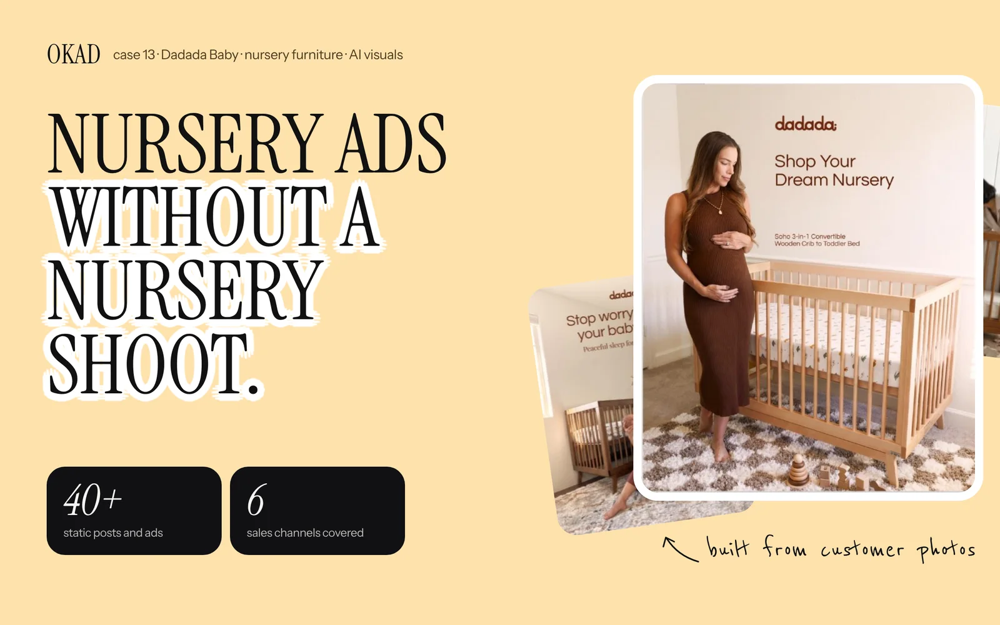

The question is not whether AI can make ads. It can. The question is whether those ads make money.

Every CMO, every performance marketer, and every DTC founder is asking the same thing: should we invest in AI-generated creative, keep paying for human-produced content, or do both? The answer should not come from a think piece or an AI vendor's case study. It should come from controlled tests where AI and human creative ran side by side against the same audience with the same offer.

Here is what those tests show — from published brand data and from OKAD's own production across dozens of accounts.

## The Test Framework

A fair AI vs human comparison requires controlled variables. Most "AI outperforms human" claims fail because the comparison is between polished AI output and mediocre human work, or between an expensive studio shoot and a $10 AI image. Neither comparison is useful for decision-making.

The tests that matter compare:
- **Same product, same offer, same audience, same platform**
- **Same production budget** (what you get for $1,000 in AI vs $1,000 in human creative)
- **Same optimization goal** (conversions, not impressions or engagement)
- **Enough spend for statistical significance** ($500+ per variation)

With those controls in place, here is what the data shows across four creative categories.

## Category 1: Product Photography — AI vs Studio

**The comparison:** AI-generated product images (Midjourney, Flux, DALL-E) placed in lifestyle contexts vs professional studio photography with styling, lighting, and post-production.

**The results:**

| Metric | AI-generated | Studio photography | Difference |
|---|---|---|---|
| CTR | 1.2-1.8% | 1.3-1.9% | AI within 5% |
| CPA | Comparable | Comparable | No significant difference |
| Production cost per image | $5-30 | $200-800 | AI 85-95% cheaper |
| Time to produce 20 variations | 2-4 hours | 2-4 weeks | AI 40-80x faster |
| Brand consistency | Moderate (requires prompt engineering) | High (photographer knows the brand) | Human advantage on brand control |

**The takeaway:** For product-focused ads where the image shows the product in a lifestyle setting, AI-generated photography is effectively interchangeable with studio work in terms of ad performance. The cost and speed advantage is dramatic. The exception is luxury and premium brands where photography quality is part of the brand signal — there, studio work still justifies the premium.

For brands selling on Amazon, AI product photos are [already standard practice](/blog/blog-ai-product-photos-amazon/), with some sellers reporting comparable conversion rates at a fraction of the cost of traditional [product photography](/blog/blog-ai-product-photography-vs-traditional/).

## Category 2: Video Ads — AI vs UGC Creators

**The comparison:** AI-generated video (scripted narration over AI visuals, AI-animated product demos) vs UGC creator videos (real people filming with scripts provided by the brand).

**The results:**

| Metric | AI video | Creator UGC | Difference |
|---|---|---|---|
| Hook rate | 25-35% | 30-45% | UGC wins by 15-25% |
| Hold rate (50%) | 10-18% | 15-28% | UGC wins by 30-40% |
| Outbound CTR | 0.6-1.2% | 0.9-1.8% | UGC wins by 30-40% |
| CPA | Higher by 15-30% | Lower (baseline) | UGC wins on conversion |
| Production cost per video | $50-200 | $250-500 | AI 60-80% cheaper |
| Time per video | 1-3 hours | 5-14 days | AI 20-50x faster |
| Variations possible per $1,000 | 10-20 videos | 2-4 videos | AI 5x more variations |

**The takeaway:** UGC outperforms AI video on every engagement and conversion metric. A real person holding a real product and speaking from experience generates more trust than AI-generated visuals with a synthetic voiceover.

But the economics complicate the picture. For $1,000, you can produce 2-4 UGC videos or 10-20 AI videos. If 1 in 5 videos wins, 2-4 UGC videos gives you 0-1 winners. 10-20 AI videos gives you 2-4 winners. The AI approach finds more winning angles faster, even though each individual video performs worse.

The smart play: use AI video for rapid concept testing. Find the angles that resonate. Then produce UGC versions of the winning angles with real creators who will outperform the AI originals.

## Category 3: Static Ads — AI-Designed vs Human-Designed

**The comparison:** AI-generated static ads (image + text overlay) created with generative tools vs static ads designed by a human creative team with brand guidelines.

**The results:**

| Metric | AI statics | Human-designed statics | Difference |
|---|---|---|---|
| CTR | 1.0-2.0% | 1.1-2.2% | Within 10% |
| CPA | Comparable | Comparable | No significant difference |
| Production cost per static | $10-50 | $100-300 | AI 70-85% cheaper |
| Brand consistency | Variable | High | Human advantage |
| A/B testing velocity | 20+ per day | 3-5 per day | AI 4-6x faster |

**The takeaway:** For performance-focused statics on Meta and TikTok, AI-designed ads perform comparably to human-designed ones — especially when a human provides creative direction and QA. The gap is real but small on any individual ad. The volume advantage is where AI statics win: producing 20 variations per day means finding winners 4-6x faster.

Where human design still clearly wins: brand campaigns, high-visibility placements (homepage hero, email headers, billboard), and any context where visual quality IS the message. For Facebook feed ads viewed on a phone screen for 2 seconds, the quality threshold is lower than most designers assume.

## Category 4: AI-Assisted vs Fully Manual Editing

**The comparison:** Video editing using AI tools (auto-captions, AI-powered cuts, template-based assembly) vs fully manual editing by a human editor.

| Metric | AI-assisted editing | Manual editing | Difference |
|---|---|---|---|
| Quality of final output | 80-90% of manual | Baseline (100%) | AI slightly lower |
| Turnaround time | 2-6 hours | 1-3 days | AI 4-8x faster |
| Cost per edited video | $30-80 | $100-300 | AI 60-75% cheaper |
| Consistency across batches | High (template-driven) | Variable (editor-dependent) | AI advantage |
| Custom creative flourishes | Limited | Unlimited | Human advantage |

**The takeaway:** AI-assisted editing is good enough for 80% of ad creative production — standard UGC edits, hook swaps, format remixes, caption overlays. The 20% that still needs human editing: complex multi-scene narratives, brand campaigns, anything requiring emotional pacing or non-standard creative decisions.

## Where AI Wins and Where Humans Win

Across all four categories, the pattern is consistent:

**AI wins on:** volume, speed, cost, iteration, testing coverage, consistency at scale.

**Humans win on:** emotional authenticity, trust signals, brand voice, nuanced storytelling, creative leaps that AI cannot predict.

The brands getting the best results are not choosing between AI and human creative. They are using both in sequence:

1. **AI for exploration.** Generate 20-50 creative concepts rapidly. Test them with $50-100 each. Find the 3-5 angles that the audience responds to.
2. **Human for exploitation.** Take those winning angles and produce high-quality UGC, designed statics, or studio content that maximizes conversion on the proven concept.

This is not a theoretical framework. It is how [OKAD runs hybrid campaigns](/blog/blog-hybrid-ai-human-content/) for clients — and why the results consistently outperform both AI-only and human-only approaches.

## The Cost Equation

When a client asks "should we use AI or human creative," the real question is about budget allocation.

| Budget | Recommended split | Why |
|---|---|---|
| Under $2,000/month production | 80% AI, 20% human | Not enough budget for meaningful human production volume. Use AI for testing, invest human budget in 1-2 hero pieces. |
| $2,000-5,000/month | 50% AI, 50% human | Enough for both. AI handles testing volume, human handles the winners that need to scale. |
| $5,000-15,000/month | 30% AI, 70% human | At this budget, human creative quality drives the account. AI handles rapid iteration and format remixes. |
| $15,000+/month | 20% AI, 80% human | Premium production quality matters at this spend level. AI fills gaps in testing and iteration. |

The percentage shifts as ad spend increases because higher spend accounts need more trust-driven, high-converting creative — which humans produce better. But even at the highest spend levels, AI maintains a role in rapid testing and iteration.

## How OKAD Uses the Hybrid Model

When [Olga Kad](https://www.linkedin.com/in/o-kad) and the [OKAD](https://okad.agency) team build creative programs, the split between AI and human production is determined by the client's budget, product category, and testing maturity — not by ideology.

For a brand that has never tested creative systematically, we start AI-heavy: 30-40 AI-generated statics and 5-10 AI videos to map the angle landscape. Within 2-3 weeks, we know which messages, hooks, and visual styles the audience responds to.

Then we shift to human-heavy production: UGC creators scripted with the winning angles, professionally edited videos built on the proven concepts, designer-produced statics that refine what AI discovered.

The result is [creative testing](/blog/blog-ai-creative-testing/) at AI speed with [human creative quality](/blog/blog-inhouse-vs-agency-ai-creative/) at scale.

*AI-generated content for this baby products brand achieved comparable engagement metrics at 1/5th the production cost. The winning move: use AI to find the angles, then produce human UGC versions that converted 30% better. [See the full case study](/cases/case-5public/).*

## Work With OKAD

OKAD runs both AI and human creative production under one roof — no separate vendors, no coordination overhead. Strategy, testing, production, and scaling in one retainer.

**[See pricing and book a call](/pricing)** · Or email [olga@okad.agency](mailto:olga@okad.agency) with your monthly ad spend and goals.
