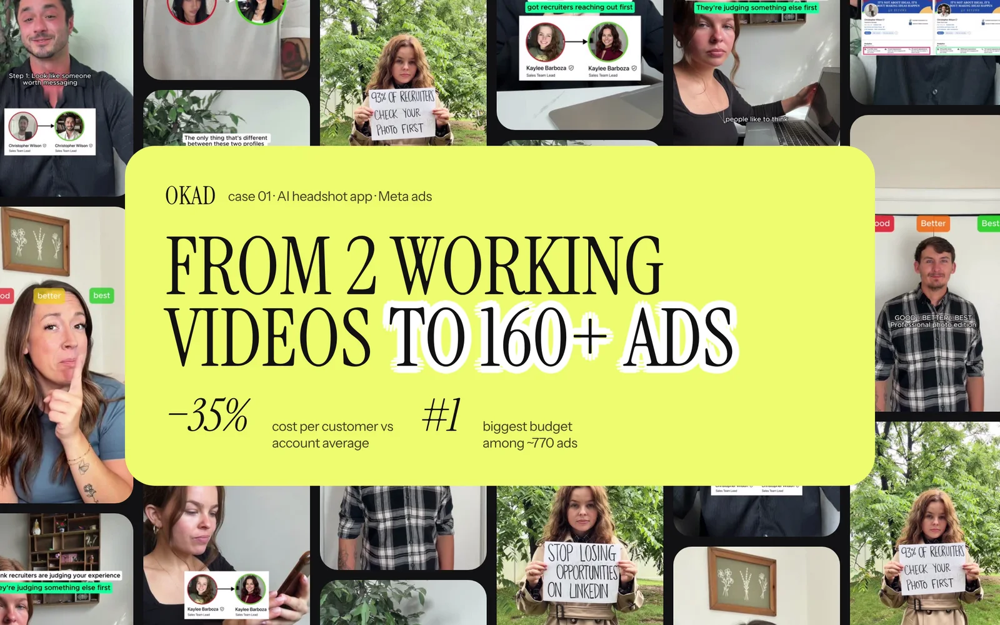
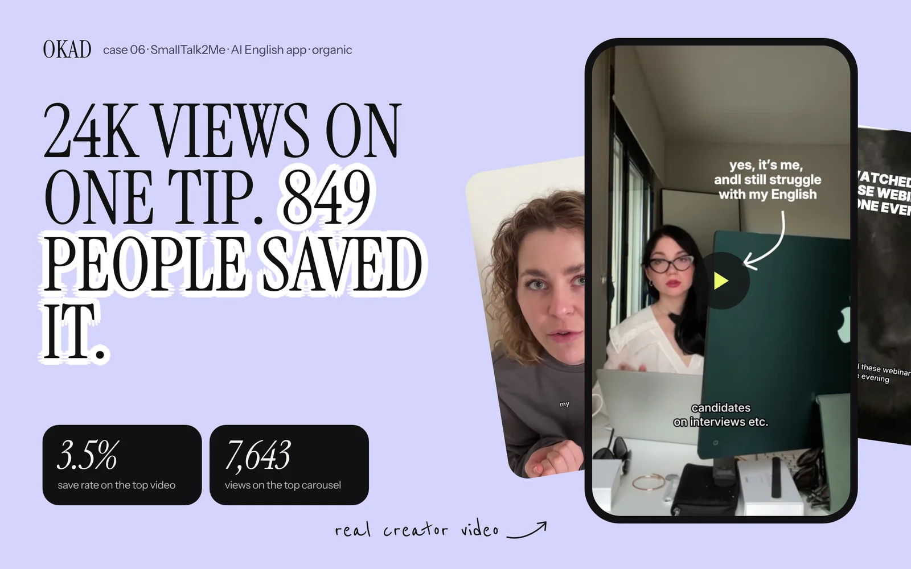

Apps have a visibility problem that physical products do not. You cannot hold an app. You cannot photograph it on a shelf. You cannot show someone wearing it or unboxing it. The product is an experience that lives inside a screen — and if your ads do not show that experience clearly in the first three seconds, the viewer scrolls past without understanding what you built.

This is why most app install campaigns underperform. They run talking-head UGC where a creator says "I love this app" for 30 seconds without ever showing the product. The viewer hears a testimonial but never sees the experience. They have no reason to install.

The solution is demo-first creative — ads that lead with the app in action and layer the human element on top. Here are the three formats that consistently drive the lowest cost per install across Meta and TikTok, with production details, cost breakdowns, and data from real campaigns.

## Format 1: Screen Recording With Voiceover

This is the workhorse of app advertising. A screen recording captures the actual product experience — swiping, tapping, scrolling through results — while a voiceover narrates what the viewer is seeing.

**Why it works:** The viewer sees exactly what they will get after installing. There is no gap between the ad's promise and the product's reality. This builds confidence and reduces post-install churn because users arrive knowing what to expect.

**Production process:**
1. Record the screen on a real device (not a simulator — users can tell)
2. Script a voiceover that narrates the key actions: "Watch what happens when I upload my photo" or "This is what your dashboard looks like after day one"
3. Edit the recording to show only the compelling moments — cut loading screens, skip onboarding, jump straight to value
4. Add captions for sound-off viewing (80%+ of Meta feed browsing is without sound)

**The magic moment rule:** Every app has a moment where the user sees the value — the AI generates the headshot, the match appears, the score improves, the meal plan loads. Your screen recording must reach that moment within the first 3-5 seconds. Everything before it is a reason to scroll away.

**Cost:** $50-150 per variation including recording, voiceover, and editing. You can produce 10 variations in a day by changing the hook, the voiceover script, or the specific feature shown.

### What makes a good screen recording ad

The best screen recording ads feel like a friend showing you something on their phone. They are not polished product demos — they are quick, informal walkthroughs that communicate one specific value proposition per ad.

**Do:** Use natural scrolling speed. Show real data or realistic dummy data. Include the "wow" moment early. Cut to 15-30 seconds total.

**Do not:** Use slow zooms or artificial animations. Show empty states or placeholder content. Record on a desktop browser pretending it is mobile. Start with the app icon or splash screen.

## Format 2: Hands-On Phone Demo

The creator holds their phone toward the camera while demonstrating the app. The viewer sees real hands interacting with a real device. This format adds a human element that pure screen recordings lack — you see the context of someone using the app in their daily life.

**Why it works:** The physical phone in someone's hands signals authenticity. It bridges the gap between "this is an app ad" and "this is a real person showing me something useful." For products where trust matters — financial tools, health tracking, education — the hands-on format outperforms screen recordings because the human presence builds credibility.

**Production process:**
1. The creator films with a second device (tripod-mounted) capturing an over-the-shoulder or POV angle
2. Script the interaction: what screens to show, what to tap, what to say while demonstrating
3. The creator narrates while using the app — "So I just open the app, tap here, and watch this..."
4. Edit to tighten pacing and add captions

**Cost:** $150-300 per variation. Higher than screen recordings because it requires a creator with decent filming equipment and the ability to demonstrate and narrate simultaneously.

### When to use hands-on over screen recording

Hands-on demos earn their higher cost in three scenarios:

**Physical context matters.** A fitness app shown while someone is at the gym. A recipe app shown while someone is cooking. The environment reinforces the use case.

**The target audience is skeptical.** Older demographics or professional audiences respond better to seeing a real person's hands than to a disembodied screen capture. It feels less like an ad and more like a recommendation.

**The app involves a physical product.** Apps that connect to devices, scan objects, or interact with the real world need the hands-on format to show the full experience.

## Format 3: Split-Screen (Creator Face + App Screen)

The screen is divided — creator's face on one side (or top), app demo on the other. The viewer gets both the trust signal of a human face and the information density of a product demo simultaneously.

**Why it works:** Split-screen combines the engagement of talking-head UGC with the clarity of a screen recording. The creator's reactions to the app — surprise, satisfaction, excitement — provide emotional context that a screen recording alone cannot deliver. This format consistently earns the highest [hook rates](/blog/blog-hook-rate-explained/) of the three demo formats because the human face captures attention while the screen provides the reason to keep watching.

**Production process:**
1. Creator records themselves reacting to or narrating the app experience
2. Simultaneously (or separately) record the screen showing the app
3. Edit both into a split-screen layout — creator on top or left, app on bottom or right
4. Sync the creator's narration with the on-screen actions

**Cost:** $200-400 per variation. The highest cost of the three formats because it requires a creator performance, screen capture, and editing to sync both elements.

## Format Comparison

| Format | Cost per variation | Production time | Best CPI performance | Best for |
|---|---|---|---|---|
| Screen recording + voiceover | $50-150 | 2-4 hours | Lowest CPI for utility apps | Productivity, AI tools, fintech |
| Hands-on phone demo | $150-300 | 1-2 days | Moderate CPI, highest trust | Health, education, mature audiences |
| Split-screen | $200-400 | 1-2 days | Best hook rate, moderate CPI | Social apps, entertainment, gaming |

## The First 3 Seconds Decide Everything

Across all three formats, one principle dominates: show the product doing its core thing immediately. Do not open with a problem statement. Do not open with "Have you ever wished..." Do not open with a creator's face talking about how they found this app.

Open with the result.

"Look what this app just did to my photo." Cut to the AI-generated headshot.
"My English score went from B1 to C1 in three months." Cut to the progress dashboard.
"I matched with someone in my city within 10 minutes." Cut to the match screen.

Ads that show the core value proposition in the first 3 seconds consistently achieve 30-40% lower cost per install compared to ads that open with a talking head or lifestyle footage. The viewer needs to see *what the app does* before they decide if the rest of the ad is worth their time.

## The Hook Library Approach

Once you find a winning demo format, multiply it through hooks. Record one complete app walkthrough, then create 5-10 versions with different opening lines:

- **Curiosity hook:** "I can't believe this app is free"
- **Result hook:** "This replaced my $200/month subscription"
- **Social proof hook:** "2 million people use this and I just found out why"
- **Problem hook:** "I was wasting 3 hours a day until I found this"
- **Comparison hook:** "I tested this against [competitor] and it wasn't even close"

Each hook creates a functionally new ad for the algorithm while reusing the same demo footage. This is the same [hook swap methodology](/blog/blog-hook-rate-explained/) that works for any ad format — applied specifically to app demos.

## Platform-Specific Considerations

**Meta (Facebook and Instagram):** Square (1:1) and vertical (9:16) formats both work. Screen recordings perform well in feed placements. Split-screen works best in Stories and Reels where vertical real estate is limited. Keep to 15-30 seconds.

**TikTok:** Native vertical only. The demo should feel like organic content, not an ad. Hands-on phone and split-screen formats blend better with the feed than polished screen recordings. TikTok's algorithm rewards content that keeps viewers watching — front-load the [hook](/blog/blog-hook-rate-explained/) and the demo payoff.

**Google App Campaigns:** Google's machine learning optimizes delivery across placements (Search, Display, YouTube, Play Store). Provide both horizontal and vertical versions. Screen recordings perform best here because the format works across all placements.

## Testing Framework for App Demo Ads

Start with this testing structure:

**Week 1:** Produce 4 screen recording ads, each showing a different feature or use case. Spend $50 per ad. Measure CPI and hook rate.

**Week 2:** Take the winning feature and produce it in hands-on and split-screen formats. Test format as the variable while keeping the feature constant. Spend $50 per ad.

**Week 3:** Take the winning format and produce 5 hook variations. Spend $50 per hook. Your best-performing combination of format + feature + hook becomes the control.

**Ongoing:** Produce 3-5 new hook variations per week on the winning format. Test a new feature or use case every two weeks. Replace fatigued creatives based on [ad fatigue signals](/blog/blog-ad-fatigue-prevention/) — rising CPI, declining hook rate, frequency above 3.

This systematic approach is exactly how OKAD runs [creative testing cycles](/blog/blog-creative-testing-methodology/) for app clients — isolating one variable at a time so every test produces actionable data. For mobile games specifically, our [mobile game ad creative guide](/blog/blog-mobile-game-ad-creative/) covers the faster-paced testing cadence that gaming requires. Understanding [what counts as a winning ad](/blog/blog-what-counts-as-winning-ad/) at your price point helps you set the right CPI thresholds for kill/scale decisions.

## How OKAD Produces App Demo Ads

*For this AI headshot app, screen recording ads showing the before/after transformation drove 3x lower CPI than talking-head testimonials. The winning format: 2-second result hook → 10-second screen demo → CTA.*

*SmallTalk2Me's app demo ads with split-screen format drove organic installs alongside paid — the demo itself became shareable content that users reposted.*

When [Olga Kad](https://www.linkedin.com/in/o-kad) and the [OKAD](https://okad.agency) team produce app demo ads, the process starts with identifying the magic moment — the one screen or interaction that communicates the app's value instantly. Everything else in the ad exists to get the viewer to that moment as fast as possible.

For [SaaS and tech products](/blog/blog-saas-ad-creatives/), the approach is similar: identify the core screen, build the demo around it, and test hooks to find the fastest path to comprehension.

## Work With OKAD

OKAD produces app demo ads across all three formats — screen recording, hands-on, and split-screen — as part of a full creative strategy service. We handle scripting, creator matching, recording, editing, and testing. No per-asset pricing. No retainer lock-in.

**[See pricing and book a call](/pricing)** · Or email [olga@okad.agency](mailto:olga@okad.agency) with your app, your current CPI, and your target market — we reply with a specific plan.
