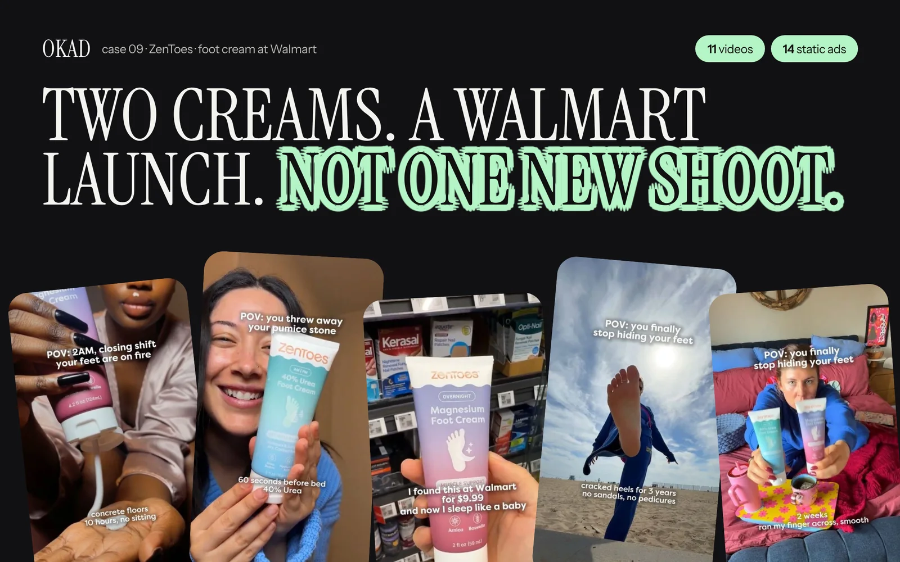

Biddyco is a UGC marketplace that connects brands with creators for video ad production. It works on a straightforward model: you post a brief, creators apply, you select one, and they deliver a video. No subscription required, pay per video.

For brands producing a handful of UGC videos per quarter, Biddyco does the job. The problems show up when you need more: more volume, more strategic direction, more consistency, or more control over quality.

If you are looking at alternatives — whether because you have outgrown the marketplace model, need better creative strategy, or want more predictable quality — here are the five options worth evaluating.

## Quick Comparison Table

| Feature | Biddyco | OKAD | Insense | Billo | Trend | Collabstr |
|---|---|---|---|---|---|---|
| **Model** | Marketplace | Full-service agency | Subscription platform | Marketplace | Managed platform | Marketplace |
| **Strategy included** | No | Yes | No | No | Limited | No |
| **Creator management** | Self-serve | Fully managed | Self-serve + tools | Self-serve | Managed | Self-serve |
| **Price per video** | $150-$400 | $100-$500 | $200-$600 + sub | $99-$300 | $200-$500 | $100-$500 |
| **Monthly minimum** | None | None (retainer optional) | $400/mo platform fee | None | $500+ | None |
| **Editing included** | Basic | Full professional | Creator-edited | Basic | Full | Creator-edited |
| **Usage rights** | Negotiated | Perpetual included | Negotiated | Included | Included | Negotiated |
| **Scripts provided** | No | Yes | No | Brief templates | Brief support | No |
| **Revision rounds** | 1-2 | 2+ included | 1-2 | 1 | 1-2 | 1-2 |
| **Best for** | Low volume, simple UGC | Strategy + production at scale | TikTok Spark Ads | Budget-conscious testing | Hands-off production | Quick one-off videos |

## OKAD: Full-Service Agency With Strategy

**What it is:** [OKAD](https://okad.agency) is a creative agency that handles the entire pipeline from competitor research and creative strategy through scripting, creator casting, production, editing, and performance analysis. UGC is one format in a broader creative toolkit that includes AI-generated content, illustrated ads, and static design.

**Where it fits:** Brands that want someone to own the creative strategy, not just produce videos. OKAD's model means you are not just buying content — you are buying a system that gets better over time because every creative decision is informed by performance data.

**Pricing:** Per-video from $100 (statics) to $500 (full UGC production). Monthly retainers from $2,500 (10 creatives) to $5,000+ (30+ creatives with full strategy). No subscription fee.

**Key difference from Biddyco:** OKAD writes the scripts, casts the creators, manages revisions, and optimizes based on what is working. Biddyco expects you to handle all of that yourself. For brands spending $5K+/month on ads, the strategy layer typically pays for itself through lower CPAs.

**Limitations:** Minimum engagement makes more sense at $2,500+/month. Not ideal for brands that just need one quick video with no strategy attached.

For a deeper comparison of full-service agencies versus self-serve platforms, see our [UGC agency vs freelancers guide](/blog/blog-ugc-agency-vs-freelancers/).

## Insense: Subscription Platform With TikTok Integration

**What it is:** A subscription-based UGC and influencer management platform. You pay a monthly fee for access to creator search tools, campaign management features, and — critically — native TikTok Spark Ads integration.

**Where it fits:** Brands running TikTok as a primary channel who need whitelisting and Spark Ads access. Insense's TikTok integration is its strongest feature and the main reason brands choose it over simpler marketplaces.

**Pricing:** Platform fee from $400/month (Self-Service) to $1,200+/month (Managed). Creator costs are additional, typically $200-$600 per video depending on the creator.

**Key difference from Biddyco:** Better creator management tools, TikTok integration, and a more structured workflow. But you still provide strategy and briefs yourself. The platform manages the process, not the thinking.

**Limitations:** The subscription fee adds up quickly when combined with per-video creator costs. At 10+ videos per month, total costs can exceed full-service agency pricing without the strategy component.

We have written a detailed [Billo vs Insense comparison](/blog/blog-billo-vs-insense/) that covers the platform differences in depth.

## Billo: Budget-Friendly Marketplace

**What it is:** A pay-per-video UGC marketplace with the lowest entry price in the category. Post a brief, creators apply, select and pay. No subscription, no platform fee.

**Where it fits:** Brands testing UGC for the first time, or brands with tight budgets that need a few simple videos quickly. Billo's $99 starting price makes it accessible for almost any business.

**Pricing:** $99-$300 per video, no subscription. You pay the listed price, and the creator delivers.

**Key difference from Biddyco:** Lower per-video costs and a simpler interface. Billo is more transactional — designed for quick, no-frills UGC production.

**Limitations:** Creator quality varies more widely than other platforms. No strategic input, limited revision rounds, and the cheapest tier tends to produce generic content. Brands often need 2-3 attempts per brief to get usable footage, which erodes the cost advantage.

## Trend: Managed Production Platform

**What it is:** A platform that sits between self-serve marketplaces and full-service agencies. You submit a brief, Trend matches you with creators, and they manage the production process including some editing.

**Where it fits:** Brands that want more hands-off production than a marketplace but do not need (or cannot afford) full agency service. Trend handles the creator management that eats time on self-serve platforms.

**Pricing:** Starting at $500+ per project. Per-video costs are $200-$500 depending on complexity and creator tier.

**Key difference from Biddyco:** Managed creator matching and production oversight. You do not need to evaluate individual creator applications. Trend also provides more polished editing than marketplace-level output.

**Limitations:** Still limited on strategic direction. The "managed" layer handles logistics, not creative strategy. At Trend's price point, a full-service agency often delivers more value because strategy is included.

## Collabstr: Quick Creator Marketplace

**What it is:** A creator marketplace where you browse profiles, contact creators directly, and hire for UGC, influencer posts, or content creation. Straightforward search-and-hire model.

**Where it fits:** Brands that want to hand-pick specific creators based on their profile and past work. Collabstr's browsing experience is strong — you can see creator portfolios before engaging.

**Pricing:** $100-$500 per deliverable, no platform fee. Pricing is set by individual creators.

**Key difference from Biddyco:** Better creator discovery and portfolio browsing. You can evaluate a creator's actual past work before hiring, which reduces the quality gamble.

**Limitations:** Fully self-serve. You handle the brief, direction, feedback, and quality control. No editing, no strategy, no performance optimization.

## When to Stay on a Marketplace vs Switch to an Agency

Marketplaces and platforms work well in specific situations. They stop working in others.

**Stay on a marketplace when:**
- You produce fewer than 10 videos per month
- You have an in-house creative strategist who writes briefs and reviews content
- Your ad spend is under $5,000/month (limited testing budget means limited creative volume needed)
- You are experimenting with UGC for the first time and want to validate the format cheaply

**Switch to an agency when:**
- You produce 10+ videos per month and the management overhead is consuming your team's time
- Your ads are not improving because nobody is analyzing what works and adjusting the creative direction
- You need consistent quality across a high volume of deliverables
- You are spending $5K+/month on ads and the cost of bad creative (wasted ad spend) exceeds the agency fee
- You need creative strategy, not just content production — someone to tell you WHAT to make, not just make what you ask for

The transition point for most brands is around 10-15 videos per month. Below that, marketplace savings outweigh the convenience of an agency. Above that, the time cost of managing creators, writing briefs, reviewing content, and requesting revisions on a self-serve platform exceeds what an agency charges to handle everything.

### What the Switch Looks Like

Moving from Biddyco (or any marketplace) to an agency is straightforward:

1. **Share your existing creative and data.** An agency audits what you have — which creators worked, which hooks performed, what your audience responds to.
2. **Strategy phase (Week 1).** The agency builds a creative roadmap based on your data, not guesswork. Competitor audit, angle mapping, format recommendations.
3. **First production batch (Weeks 2-3).** New creative that builds on your proven elements while testing new directions.
4. **Ongoing optimization.** Performance data from each batch informs the next one. The creative gets better over time — which is the fundamental advantage an agency has over a marketplace.

*ZenToes moved from self-serve UGC production to OKAD for their Walmart launch. The difference was not better creators — it was a [creative testing framework](/blog/blog-creative-testing-for-dtc/) that turned 30+ static variations into a data-driven scaling strategy. [See the case study](/cases/zentoes-walmart-launch-ads/).*

## How to Choose

If you are reading this, you have probably outgrown Biddyco or are hitting its limitations. The right alternative depends on what you need most:

| Your biggest need | Best option |
|---|---|
| Lower per-video cost | Billo |
| TikTok Spark Ads and whitelisting | Insense |
| More hands-off production | Trend |
| Better creator discovery | Collabstr |
| Strategy + production + testing | OKAD |

The brands that scale fastest are usually the ones that stop treating UGC as a commodity (cheapest video wins) and start treating it as a performance channel (best-performing creative wins). That shift is what moves a brand from a marketplace to an agency.

## Work With OKAD

OKAD handles UGC production as part of a full [creative strategy](/blog/blog-what-is-ugc-agency/) service — research, scripting, creator matching, production, editing, and performance optimization in one retainer. No per-video surprises. No platform fees.

**[See pricing and book a call](/pricing)** · Or email [olga@okad.agency](mailto:olga@okad.agency) with your current monthly video volume and ad spend — we will reply with a specific plan and pricing.
