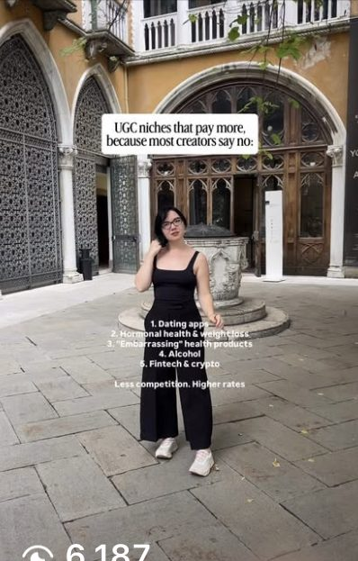
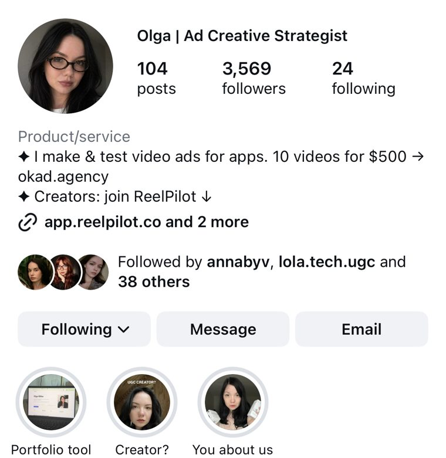
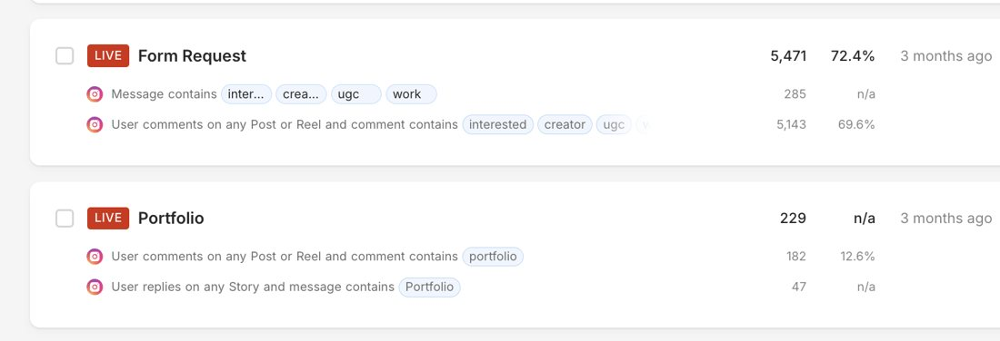
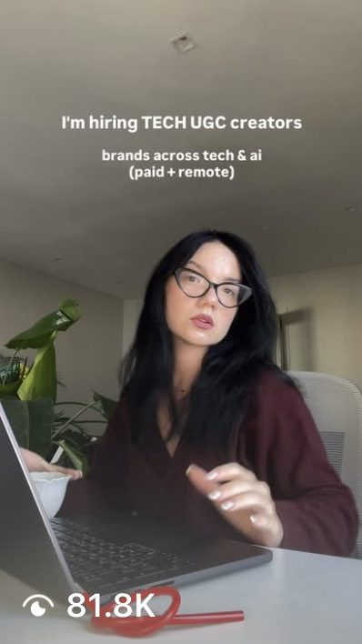

Creative strategy is the highest-leverage role in performance marketing. The right strategist turns ad spend into profitable growth. The wrong one burns budget on content that looks good and converts nobody.

The problem: compensation varies wildly. A "creative strategist" job title covers everything from junior social media coordinators to senior performance leads managing seven-figure monthly ad budgets. If you are hiring one — or becoming one — you need to know what the market actually pays in 2026.

Here is the full breakdown by experience level, engagement model, and what drives the differences.

## Full-Time Salary Ranges (US Market, 2026)

| Level | Experience | Salary Range | Typical Employer |
|---|---|---|---|
| Junior | 0-2 years | $55K-$80K | Agencies, startups |
| Mid-Level | 2-5 years | $80K-$120K | DTC brands, growth agencies |
| Senior | 5+ years | $120K-$150K | Scaled DTC brands, performance agencies |
| Head of Creative / VP | 7+ years | $150K-$200K+ | Brands spending $500K+/month on ads |

These numbers reflect performance-focused creative strategist roles — the people deciding what ads to make, what to test, and why. Brand strategy roles at traditional agencies or Fortune 500 companies follow different compensation structures.

**What shifts salary within each band:**

- **Industry:** DTC beauty, supplements, and dating apps pay at the top of ranges because creative velocity directly drives revenue. B2B and enterprise brands pay less for the same title.
- **Ad spend under management:** A strategist responsible for creative feeding a $50K/month ad account earns less than one feeding $500K/month. The stakes and complexity are different.
- **Proven track record:** Specific metrics move compensation more than years of experience. A 3-year strategist who can show a 40% CPA reduction across a portfolio of campaigns out-earns a 7-year strategist with no documented results.

## Freelance Rates

| Model | Range (US) | Range (UK) | Best For |
|---|---|---|---|
| Hourly | $75-$150/hr | £40-£80/hr | Ad-hoc strategy sessions, audits |
| Day rate | $600-$1,200/day | £300-£600/day | Intensive sprint work, workshops |
| Monthly retainer | $2,000-$5,000/month | £1,500-£3,500/month | Ongoing creative strategy |
| Project-based | $3,000-$15,000 | £2,000-£10,000 | Campaign launches, creative audits |

Freelance rates are higher per hour than full-time equivalents because freelancers cover their own benefits, tools, taxes, and downtime between clients. A freelancer charging $100/hr and working 30 billable hours per week earns roughly $150K/year — comparable to a senior full-time salary once you account for the overhead they absorb.

**What pushes freelance rates higher:**

- Niche specialization (Meta ads for supplements, TikTok for dating apps)
- A portfolio of recognizable brand names
- Availability scarcity — the best freelancers are booked months ahead
- Speed of delivery — brands pay premiums for strategists who ship briefs in 24 hours instead of a week

## Agency Retainer Model

The third option — and the one that often delivers the most value per dollar — is working with a creative strategy agency.

| Agency Tier | Monthly Retainer | What You Get |
|---|---|---|
| Boutique / specialist | $3,000-$8,000 | Creative strategist + limited production |
| Mid-market | $8,000-$15,000 | Strategy + full production (UGC, editing, AI) |
| Full-service | $15,000-$30,000+ | Strategy + production + media buying |

The agency model bundles what would otherwise require three to five separate hires: a strategist, a UGC coordinator, video editors, a designer, and potentially a media buyer. For brands that need all of these functions but cannot justify the headcount, an agency retainer is typically 40-60% cheaper than building the same capability in-house.

When [Olga Kad](https://www.linkedin.com/in/o-kad) started [OKAD](https://okad.agency), she priced creative strategy at zero — it was bundled free with production work because nobody knew to ask for it separately. Three years later, creative strategy is the most valuable line item in every retainer. The market shifted, and pricing followed. Today, OKAD's model puts the strategist who writes the brief in the same room as the team that produces the ads. No handoff friction, no lost context, no separate vendor management.

For a drawing app, this integrated model scaled to [1.5M organic views through faceless UGC](/cases/drawing-app-faceless-ugc/) — zero faces on camera, starting from 100 downloads per week — a volume that would require a full-time strategist plus a 4-5 person production team if built in-house. For a pet supplement brand, the same team produced [story-format ads](/cases/tipaw-dog-supplement-story-ads/) converting dog owners with 3-habit narratives — proving that the agency model works across verticals, not just high-volume e-commerce.

## Full-Time vs Freelance vs Agency: The Real Cost Comparison

| Factor | Full-Time Hire | Freelance | Agency (e.g. OKAD) |
|---|---|---|---|
| Annual cost | $130K-$180K (loaded) | $36K-$60K/year (retainer) | $60K-$180K/year |
| Production included | No — separate budget needed | No — strategy only | Yes — strategy + production |
| Total cost with production | $200K-$350K/year | $80K-$150K/year | $60K-$180K/year |
| Dedicated attention | 100% | Shared across 3-5 clients | Shared across 3-8 clients |
| Ramp-up time | 2-3 months | 1-2 weeks | 1-2 weeks |
| Risk if it fails | High (severance, rehiring) | Low (end contract) | Low (end contract) |
| Creative diversity | Limited to one person's POV | One perspective, varied clients | Team perspective + creator network |

The "total cost with production" row is where the real difference shows. A full-time creative strategist still needs someone to produce the ads they strategize. Most brands spending $10K-$50K/month on ads underestimate this — they hire a strategist at $120K and then realize they also need $80K-$150K in production costs.

## Which Model Fits Your Ad Spend

| Monthly Ad Spend | Recommended Model | Why |
|---|---|---|
| Under $10K | DIY + freelance audits | Volume does not justify dedicated strategy |
| $10K-$30K | Freelance strategist or boutique agency | Need consistent creative flow, not a full team |
| $30K-$100K | Agency retainer | Strategy + production bundle delivers best ROI |
| $100K-$300K | Agency + in-house strategist | Internal strategist for speed, agency for volume |
| $300K+ | Full in-house team + agency overflow | Internal team handles core, agency handles scale |

The $30K-$100K range is where most growing DTC brands land, and it is where the agency model is strongest. You need 10-20 new ad variations per week to keep campaigns fresh, but the budget does not support a $150K strategist, a $60K editor, and a $40K UGC coordinator. An agency like OKAD delivers all three functions for $8K-$15K/month.

When [ZenToes prepared for their Walmart launch](/cases/zentoes-walmart-launch-ads/), they needed 60+ ad variations fast. Building an internal team for a single launch would have been absurd. The agency model delivered the volume in weeks.

## What Drives a Creative Strategist's Value

Not all creative strategists are worth the same. The market pays for outcomes, not activity.

**Signals of a high-value strategist:**

- They bring a testing framework, not just ideas. Every brief includes a hypothesis and a success metric.
- They can diagnose creative failure from data. When an ad underperforms, they identify whether the hook, body, CTA, or audience is the problem — and they know because they track each element separately.
- They ship volume. The best strategists sustain a cadence of dozens of new concepts per month with multiple variants each. If your strategist delivers 2 briefs per week, you are paying too much per brief.
- They have specific case studies. "Reduced CPA by 35% over 3 months for a supplement brand" is worth $150/hr. "Experienced in social media strategy" is worth $50/hr.

**Red flags that a strategist is overpriced:**

- They cannot name their three best-performing ads and explain why they worked
- They produce mood boards but not testable hypotheses
- They focus on "brand consistency" over performance metrics
- They have never personally reviewed an ad account's data

## The Hidden Costs Most Brands Miss

Salary or retainer is only part of the picture. When budgeting for creative strategy, account for these frequently overlooked costs:

**For full-time hires:**
- **Tools and subscriptions:** Motion, Foreplay, Frame.io, Figma, stock footage libraries — $500-$1,500/month per strategist
- **Benefits and overhead:** Health insurance, 401k match, PTO, equipment — adds 25-35% to base salary
- **Ramp-up period:** A new hire takes 2-3 months to learn your brand, products, audience, and what has already been tested. During ramp-up, creative output drops
- **Production gap:** A strategist without a production team is a brief-writing machine with no factory. You need editors, UGC creators, and designers to execute the strategy

**For freelancers:**
- **Management overhead:** Someone internal needs to brief the freelancer, review deliverables, and coordinate with production. This is usually 5-10 hours/week of a marketing manager's time
- **Context loss:** Freelancers working across 3-5 clients inevitably lose context between sessions. Briefs may reference competitors or angles you have already tested and killed

**For agencies:**
- **Fewer hidden costs** — tools, team coordination, and production are bundled into the retainer. The main risk is misalignment on brand voice, which is why the onboarding phase matters
- At OKAD, the first two weeks of any engagement focus on auditing existing creative, reviewing ad account data, and building a shared understanding of what has worked. This front-loaded investment prevents the "they don't get our brand" problem that kills most agency relationships within the first 90 days

## Geographic Pay Differences

Creative strategist compensation varies significantly by market:

| Market | Junior | Senior | Freelance Hourly |
|---|---|---|---|
| US (major metros) | $65K-$80K | $120K-$150K | $100-$150/hr |
| US (remote/secondary) | $55K-$70K | $100K-$130K | $75-$120/hr |
| UK (London) | £35K-£50K | £70K-£100K | £50-£80/hr |
| UK (outside London) | £28K-£40K | £55K-£80K | £40-£60/hr |
| Western Europe | €35K-€50K | €65K-€95K | €50-€80/hr |
| Eastern Europe / LATAM | $20K-$35K | $40K-$70K | $30-$60/hr |

This geographic gap is one reason the agency model works well for US and UK brands. An agency like OKAD operates with strategists and production teams across multiple markets, passing cost savings to clients while maintaining quality standards that match or exceed what a single US-based hire would deliver.

A women's health supplement brand worked with OKAD's distributed team on a [12-video hook testing framework](/cases/womens-health-supplement-ads/) — 2 creators, 4 hooks each, zero reshoots needed — the strategic thinking was at the same level as a $140K US-based hire, but the total cost was a fraction of building that capability internally.

## How to Negotiate (For Strategists)

If you are a creative strategist looking to increase your rates:

1. **Build case studies with metrics.** Not "I worked on Campaign X" but "Campaign X reduced CPA from $45 to $28 over 90 days while scaling spend from $30K to $80K/month." Numbers are what get you past salary bands.
2. **Specialize in a vertical.** A "creative strategist" competes with everyone. A "creative strategist for DTC supplement brands on Meta" competes with almost nobody.
3. **Document your testing framework.** Companies and agencies pay premiums for strategists who bring a repeatable system, not just talent. If you can show a structured approach to [creative testing](/blog/blog-creative-testing-for-dtc/) that you have refined across multiple accounts, you are selling a system — not just your time.
4. **Show volume.** If you can point to periods where you shipped 50+ concepts in a month and maintained a 15%+ creative win rate, that is evidence worth paying for.

## How to Evaluate (For Hiring Managers)

Whether you are hiring full-time, freelance, or evaluating agencies:

1. **Ask for a live audit.** Give the candidate access to your ad account data (or a anonymized sample) and ask them to identify the top three opportunities. A strong strategist sees patterns in 30 minutes that a weak one misses in a week.
2. **Request a sample brief.** Give them a product and a target audience. A good brief includes a hypothesis, a specific hook concept, a format recommendation, and a success metric. A bad brief is a mood board with vague direction.
3. **Check their relationship with data.** Ask how they decide when to kill an ad versus when to iterate on it. The answer should involve specific metrics and thresholds, not feelings.
4. **Evaluate their production awareness.** A strategist who writes briefs that are impossible or expensive to produce is a strategist who has never worked closely with production. The best ones — like the team at OKAD — understand what editors and creators can realistically deliver because they work alongside them daily.

If you are hiring, our guide on [how to hire a creative strategist](/blog/blog-how-to-hire-creative-strategist/) covers what to test for and the red flags to avoid. For the [outsourcing vs in-house decision](/blog/blog-outsource-creative-strategy-agency/), see our full framework. And to understand how the role differs from adjacent positions, read [creative strategist vs media buyer](/blog/blog-creative-strategist-vs-media-buyer/).
