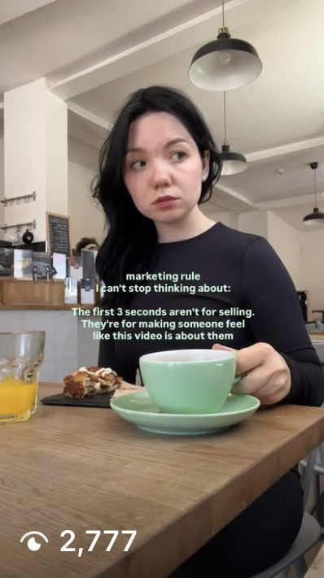
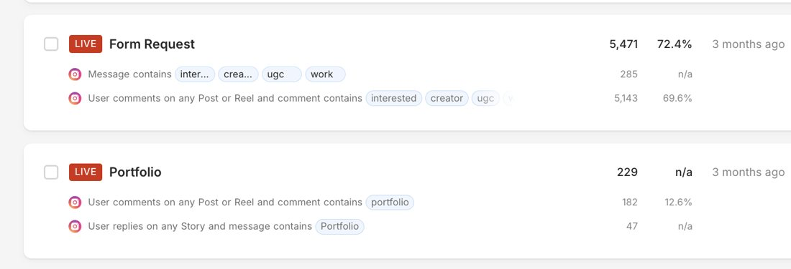
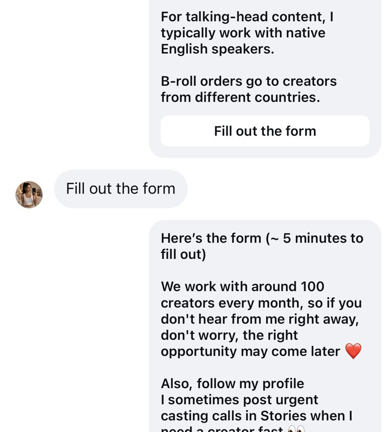

Every brand running paid social has a media buyer. Not every brand has a creative strategist. That gap explains more underperformance than any targeting mistake or budget miscalculation ever will.

The two roles look similar from the outside. Both stare at dashboards. Both talk about ROAS. Both have opinions about which ads are working. But they are solving fundamentally different problems, and confusing their responsibilities — or worse, expecting one person to do both at scale — is how brands plateau.

Here is exactly what each role owns, where they overlap, when to split them, and how they should work together.

## What a Media Buyer Actually Does

The media buyer is the platform operator. Their job is getting the right ads in front of the right people at the right cost.

**Core responsibilities:**

- **Campaign architecture** — structuring campaigns, ad sets, and ads on Meta, TikTok, Google, and other platforms
- **Audience strategy** — building and testing audience segments, lookalikes, retargeting pools, and broad targeting setups
- **Budget allocation** — deciding how much money goes where, shifting spend toward winners, killing underperformers
- **Bid strategy** — choosing between cost caps, bid caps, and lowest-cost bidding depending on the objective and stage
- **Platform mechanics** — understanding each platform's algorithm, learning phase requirements, and auction dynamics
- **Reporting** — tracking ROAS, CPA, CPM, and other efficiency metrics at the campaign and ad set level

The media buyer's question is always: **"Given these ads, how do I spend this budget most efficiently?"**

They do not decide what the ads should say or look like. They decide where the ads run, who sees them, and how much each impression costs.

## The Creative Strategist's Domain

The creative strategist is the person who decides what ads to make and why. Their job is ensuring that every piece of creative exists for a reason — a specific hypothesis about what message, format, or angle will move a specific audience.

**Core responsibilities:**

- **Research** — studying the audience, competitors, reviews, comment sections, and market trends to find messaging angles
- **Creative analysis** — reviewing ad performance data not for campaign efficiency, but for creative patterns. Which hooks hold attention? Which formats convert? Which angles resonate with which segments?
- **Brief writing** — translating insights into actionable briefs for designers, editors, and creators. A good brief specifies the hook, the angle, the format, the audience, and the hypothesis being tested.
- **Testing roadmap** — planning which creative concepts to test, in what order, and what each test is designed to prove
- **Concept development** — generating new creative angles, scripts, and visual approaches based on data and research
- **Performance feedback loops** — analyzing test results and feeding learnings back into the next round of briefs

The creative strategist's question is always: **"What should we make next, and what do we expect it to prove?"**

At [OKAD](https://okad.agency), [Olga Kad](https://www.linkedin.com/in/o-kad) deliberately separated creative strategy from media buying from day one. She had spent years doing both herself — managing budgets and writing briefs for the same campaigns — and knew the moment one role always cannibalizes the other: the week before month-end, when the buyer focuses on hitting ROAS targets and stops requesting new creative. That pattern convinced her to split the functions permanently, which is why every OKAD engagement pairs a dedicated strategist with the client's buyer in a shared weekly cadence that maintains [creative testing velocity](/blog/blog-creative-testing-for-dtc/) without feast-or-famine cycles.

## Where They Overlap (And Where They Do Not)

Both roles look at the same data. The difference is what they see.

| Metric | Media Buyer Reads It As | Creative Strategist Reads It As |
|---|---|---|
| CTR dropping | "Audience fatigue, need new segments" | "Hook is stale, need new opening angles" |
| CPA rising | "Bid strategy needs adjustment" | "The offer or CTA format needs testing" |
| High CPM | "Competition in this audience is up" | "Creative quality score is low, ads are not engaging" |
| Strong ROAS on one ad | "Allocate more budget here" | "What specific element drove this? Can we replicate it?" |
| Video completion rate | "Good for retargeting pool" | "This body works — test new hooks on top of it" |

The media buyer optimizes the delivery system. The creative strategist optimizes the message. Both are necessary. Neither is sufficient alone.

## When to Split the Roles

Most brands start with one person doing both jobs. That works — until it does not.

| Monthly Ad Spend | Recommended Setup | Why |
|---|---|---|
| Under $15K | One person handles both | Volume is low enough that one person can manage platforms and plan creative |
| $15K–$50K | Start separating | Creative velocity becomes the bottleneck. The buyer does not have time to research, brief, and analyze creative on top of platform management |
| $50K–$150K | Dedicated CS required | At this spend, you burn through creative fast. Without a strategist, the buyer recycles old concepts instead of testing new ones |
| $150K+ | CS team + senior buyer | Multiple creative strategists feeding a testing pipeline, with a senior buyer managing budget across campaigns |

The inflection point is usually around $30K–$50K per month. That is when creative fatigue outpaces the buyer's ability to produce new concepts, and performance starts to plateau not because of targeting or budget, but because the ads are stale.

When OKAD works with brands at this stage, the first thing Olga's team does is audit the creative pipeline. The diagnosis is almost always the same: the buyer has been doing double duty, creative testing has slowed to 2-3 new concepts per month, and the account is running on the same winning ad from three months ago. The fix is not more budget — it is a dedicated creative strategist who owns the [brief-to-test pipeline](/blog/blog-ad-creative-strategy/) and ships fresh concepts every week.

## How the Two Roles Should Work Together

The weekly cadence that works at OKAD:

**Monday — Data review.** Buyer and strategist review the previous week together. Buyer reports on campaign-level metrics: spend, ROAS, CPA trends. Strategist reports on creative-level metrics: which hooks performed, which formats won, which angles failed. They identify gaps together.

**Tuesday–Wednesday — Briefs ship.** The strategist writes new creative briefs based on Monday's analysis. Each brief includes the hypothesis, the target angle, the format, and reference material. Briefs go to designers, editors, or [UGC creators](/blog/blog-how-to-create-ugc-ads-that-convert/).

**Thursday–Friday — Production.** Creative team produces new assets. Strategist reviews and approves. Buyer prepares campaign structures for the new creative.

**Following Monday — Launch and repeat.** New ads go live. The cycle restarts.

This cadence means new creative ships every single week. No month-long gaps between tests. No relying on a single winning ad until it burns out. The buyer never has to wonder "what should we test next?" because the strategist has already answered that question.

For [Lookalikey](/cases/lookalikey-ugc-ads/), this cadence revealed a critical insight the buyer alone would have missed: face-swap concepts outperformed standard UGC testimonials by a wide margin. Across 9 videos from 3 creators plus 4 story variations, the strategist identified the winning angle through competitor research and audience analysis, then briefed a series of face-swap variations. The buyer structured campaigns to test each variation against the control with isolated audiences. Neither person could have achieved that result alone — the buyer would have kept running generic UGC, and the strategist would have had no delivery infrastructure to test the hypothesis at speed.

## Why Creative Is Now the Primary Performance Lever

Before Apple's iOS 14 privacy changes, media buyers had precise targeting tools. Custom audiences built from pixel data, detailed interest stacking, and third-party data integrations made it possible to put the right ad in front of the right person through audience selection alone.

That world is gone.

Post-iOS 14, the most effective Meta strategy is broad targeting — minimal audience restrictions, letting the algorithm find buyers. TikTok was always broad by design. Google's Performance Max automates audience selection entirely.

When targeting is broad, the creative does the targeting. A hook that opens with "tired of acne scars?" self-selects people with acne concerns. A format that shows a mom using a product self-selects parents. The visual style, the language, the scenario — these are now the targeting parameters.

This is why the creative strategist's role has become the primary lever for paid social performance. The buyer still matters — budget allocation, bid strategy, and platform expertise are real skills. But the biggest variable in any ad account is now the quality and velocity of creative testing. And that is the strategist's domain.

OKAD saw this shift clearly on the [Canvas Tech campaign](/cases/canvas-tech-ugc-without-new-shoots/) — 5,471 creators coordinated without a single new shoot. The strategist designed the canvas template system that defined what each creator would produce: which angles, which hooks, which format structures. The buyer managed campaign budget across all 5,471 outputs, allocating spend toward the combinations that converted and cutting the rest. Broad targeting with strong, strategist-directed creative outperformed narrow interest-based audiences with generic content — consistently, across every test round.

## The Dysfunction to Watch For

The most common failure mode when both roles exist but do not collaborate:

**The blame cycle.** ROAS drops. The buyer says "creative is not performing." The strategist says "the buyer is targeting wrong." Both are looking at the same data and drawing opposite conclusions because neither sees the other's perspective.

**The fix: shared accountability.** Both roles should own creative velocity metrics together:

- **Concepts tested per week** — are enough new ideas shipping?
- **Win rate** — what percentage of new concepts beat the control?
- **Time to scale** — how quickly do winners get full budget?
- **Time to kill** — how quickly do losers get cut?

When both the buyer and strategist are accountable for these metrics, the blame cycle breaks. The buyer cannot ignore stale creative because concepts-per-week is their metric too. The strategist cannot ignore campaign structure because win rate depends on proper testing setup.

## What to Look for When Hiring Each Role

**Media buyer red flags:**
- Cannot explain their bid strategy beyond "lowest cost"
- No systematic approach to testing — just launching ads and hoping
- Blames creative for everything without suggesting specific improvements
- Has never managed spend above your target level

**Creative strategist red flags:**
- Cannot connect creative decisions to performance data
- Produces "pretty" ads with no hypothesis behind them
- No systematic testing framework — just intuition
- Has never worked on direct-response / performance campaigns

**Green flags for both:**
- Can walk you through their last 3 wins AND last 3 failures
- References specific metrics when discussing creative decisions
- Has a framework they can articulate, not just "I have good taste"
- Asks about your data and current performance before suggesting changes

At OKAD, Olga evaluates potential creative partners the same way: show the last five ads you launched, explain why each one exists, and walk through what the data told you. The answers reveal whether someone is a strategist or just a producer with opinions. Brands that have achieved [organic reach at scale — 1M+ views without ads](/cases/organic-video-content-1m-views/), including one account that generated 127K views from just 485 followers — understand this instinctively: strategic thinking about what content to make matters more than how much you spend distributing it.

## In-House, Freelance, or Agency

How you fill these roles depends on your stage and budget:

**In-house** works best when you have enough volume to keep both roles busy full-time. A full-time media buyer costs $70K-$120K annually. A full-time creative strategist [costs $80K-$140K](/blog/blog-creative-strategist-salary-rates/). The advantage: deep brand knowledge, fast communication, full alignment.

**Freelance** works for brands between $15K-$50K monthly spend. Hire a freelance creative strategist for 10-20 hours per week ($75-$150/hour) while your buyer manages platforms full-time. The strategist produces the testing roadmap and briefs; your in-house team or production partners execute.

**Agency** works when you need both roles plus production capacity. An agency like OKAD provides the strategist, the production pipeline, and the creative analysis in one package. The client's media buyer manages platform spend while the agency handles everything from research to finished assets. This is how OKAD structured the [YourChristianDate campaign](/cases/your-christian-date-broll-content/) — 800K views on one Reel shot as b-roll. The creative strategist chose the format and angle, the buyer optimized delivery and budget pacing across the content pipeline.

The wrong choice: hiring a media buyer and asking them to "also handle creative." It works at low spend. It breaks at scale. And by the time you notice the break, you have already wasted months of ad spend on stale, untested creative.

The hybrid model OKAD uses most often: the client keeps their media buyer in-house (they know the brand, the margins, the unit economics), while OKAD provides the creative strategist, the production team, and the testing infrastructure. The buyer manages the platform. Olga's team manages the creative pipeline. Both share the same dashboard and the same weekly rhythm. This setup gives brands the strategic depth of a dedicated creative function without the $200K+ annual cost of building that team internally.

## Two Roles, One Goal

A media buyer without a creative strategist will eventually run out of ideas. A creative strategist without a media buyer will produce great ads that never get properly tested. You need both — and you need them talking to each other every week.

If you are under $15K per month in ad spend, one strong person can handle both. Once you cross $30K-$50K, split the roles. The investment in a dedicated creative strategist pays for itself within the first month through faster testing, better win rates, and creative that stays fresh instead of fatiguing.

Ask your media buyer one question this week: "What creative do you wish you had right now?" If they can answer in specifics — "a pain-point hook for women 35-45 in a UGC testimonial format" — your buyer already thinks like a strategist and the split is overdue. If they answer in generics — "something fresh" — they need a strategist to translate their campaign data into briefs.

If you are ready to [hire a creative strategist](/blog/blog-how-to-hire-creative-strategist/), our hiring guide covers what to look for and the interview test that separates real strategists from aesthetic thinkers. For brands considering [outsourcing creative strategy to an agency](/blog/blog-outsource-creative-strategy-agency/), our decision framework covers cost models and evaluation criteria. And for the full creative pipeline from research to scale, see our [ad creative strategy guide](/blog/blog-ad-creative-strategy/).
