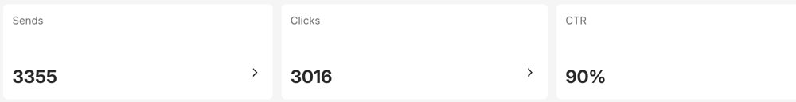
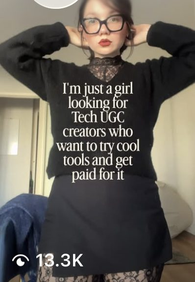
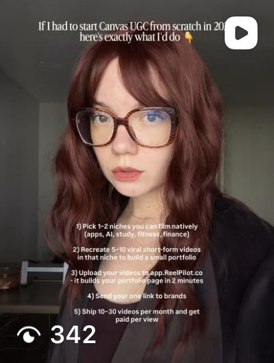
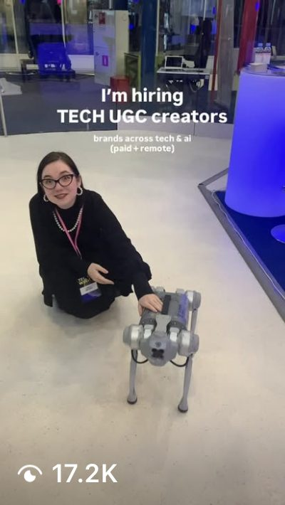
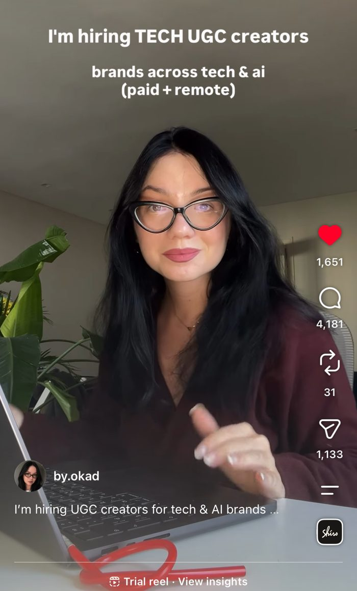
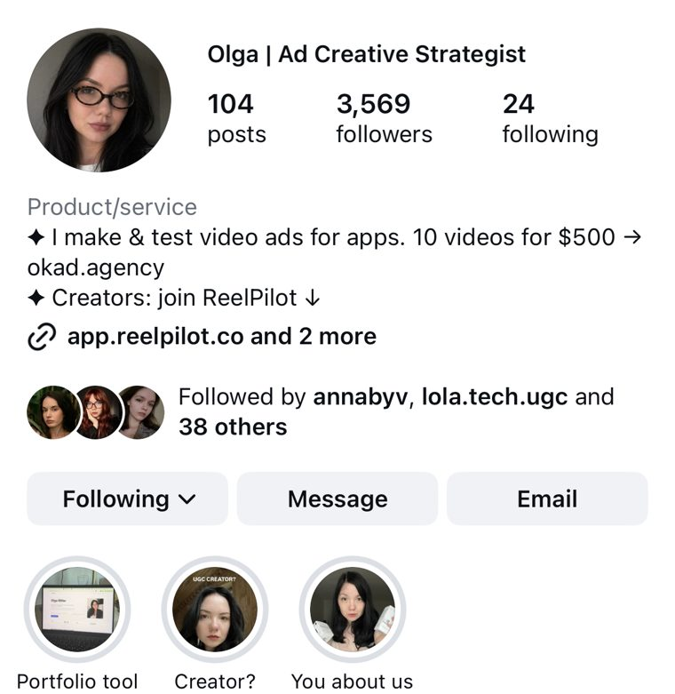

Most brands produce ads by intuition. Someone has an idea, the team builds it, they launch it, and they hope. When it works, nobody knows exactly why. When it fails, nobody knows exactly why either.

The brands that win on paid social — consistently, at scale, month after month — do not operate this way. They run a system. A framework that turns research into angles, angles into briefs, briefs into ads, and ads into data that feeds the next cycle. Every test teaches something. Every winner gets multiplied. Every loser gets autopsied for salvageable parts.

[Olga Kad](https://www.linkedin.com/in/o-kad) built this framework through trial, error, and three years of running ad accounts for her own e-commerce products before founding [OKAD](https://okad.agency). The first version was a Google Doc with five steps. It evolved into the seven-phase system below after running it across 100+ client campaigns — each iteration adding structure where the previous version left room for guesswork. The phases repeat on a 2-week cycle: week 1 is research and briefs, week 2 is production and launch. By week 3, data from the first batch informs the second round of briefs.

Here is how it works, phase by phase.

## Phase 1: Research

Everything starts with research. Not a quick scroll through the competitor's Instagram — real, structured intelligence gathering.

**Competitor ad library analysis:** Pull every active ad from your top 5-10 competitors using Meta Ad Library and TikTok Creative Center. Catalog what formats they use, how long their ads have been running (longevity signals performance), and which hooks they repeat. An ad that has been live for 60+ days is almost certainly profitable.

**Review mining:** Amazon reviews, Reddit threads, TikTok comments, and YouTube comment sections contain the exact language your audience uses to describe their problems. A supplement brand's customer does not say "I need better bioavailability." They say "I'm tired of pills that don't do anything." The second version is your hook.

**Winning format identification:** Which ad structures are working in your category right now? UGC testimonials, problem-solution, before/after, talking head, story ads, demos? Document the top 10 ads in your space and tag each one by format.

The research phase typically takes 2-3 days for a new client and 1 day for ongoing cycles. It is the most skipped phase — and skipping it is why most creative programs produce expensive guesses instead of informed hypotheses.

## Phase 2: Angle Mapping

An angle is the strategic entry point for an ad. It is not the script, the hook, or the format — it is the reason someone should care. Every product has 5-10 viable angles. Most brands only ever test 1-2.

The ten angle categories:

| Angle | Example (Supplement Brand) |
|---|---|
| Pain point | "I was exhausted by 2pm every day" |
| Aspiration | "What would you do with 4 extra hours of energy?" |
| Social proof | "Why 50,000 people switched this year" |
| Urgency | "Your cortisol levels are highest in your 30s" |
| Curiosity | "The ingredient your doctor never mentions" |
| Authority | "What 200 clinical trials actually show" |
| Comparison | "I tried 12 supplements before finding this one" |
| Transformation | "Month 1 vs month 3 — same person, different energy" |
| Fear | "What happens when you ignore chronic fatigue" |
| Humor | "My supplement cabinet looked like a pharmacy" |

Each angle gets its own brief. This is non-negotiable. Mixing angles in one ad dilutes the message and makes test results unreadable. If you cannot isolate which angle resonated, you cannot scale it.

When the OKAD team built [68 ads for a longevity supplement brand](/cases/longevity-supplement-story-ads/), each ad mapped to a single angle. The winning angle — transformation stories with specific timelines — drove a EUR 183 CPA. Without angle isolation, that insight would have been invisible inside a batch of mixed-message ads.

## Phase 3: Format Selection

Not every angle works in every format. A comparison angle works well in a side-by-side demo but poorly in a talking head. An authority angle works in a talking head but falls flat in a fast-cut UGC montage.

The format-angle matching matrix:

| Format | Best Angles | Typical Length |
|---|---|---|
| UGC testimonial | Pain point, transformation, social proof | 15-30s |
| Problem-solution | Pain point, aspiration, comparison | 15-45s |
| Hook swap | Any (hook varies, body stays) | 15-30s |
| Talking head | Authority, curiosity, humor | 30-60s |
| Before/after | Transformation, comparison | 10-20s |
| Listicle | Social proof, authority, comparison | 20-40s |
| Story ad | Pain point, transformation, fear | 30-60s |
| Product demo | Curiosity, comparison, aspiration | 15-30s |

For each angle from Phase 2, select 1-2 formats. A strong angle tested in two formats produces twice the learning at minimal extra cost.

OKAD's [static ad creatives for digital products](/cases/static-ad-creatives-digital-products/) — averaging 2-4M impressions per ad — demonstrated exactly this principle. Each campaign ran systematic format-angle combinations, isolating one variable per test: same angle in two formats, or same format with two angles. Performance differences were attributable to a single change, making every result actionable.

## Phase 4: Brief Writing

The brief is the contract between strategy and production. A vague brief produces generic content. A precise brief produces testable content.

Every brief at OKAD follows this structure:

**1. Audience:** Who is this ad for? Age, situation, awareness level (unaware, problem-aware, solution-aware, product-aware). An ad for someone who has never heard of your category looks nothing like an ad for someone comparing products.

**2. Angle:** One angle per brief. State it as a sentence: "The viewer is exhausted by 2pm and has tried everything."

**3. Format:** UGC testimonial, talking head, problem-solution, etc.

**4. Hook options (3-5):** The first 2-3 seconds. Write multiple hooks for the same body so the production team can shoot them all in one session. Hook variation is the single highest-leverage testing variable — our [guide to hook rates](/blog/blog-hook-rate-explained/) explains why.

**5. Body structure:** Beat-by-beat outline. Not a full script — just the arc. "Hook → problem statement → personal experience → product introduction → specific benefit → CTA."

**6. CTA:** What do you want the viewer to do? Be specific. "Shop now" is different from "Try for $1" is different from "See the reviews."

**7. Reference ads:** 2-3 competitor or internal ads that show the tone, pacing, or format you are targeting. References prevent misinterpretation.

This brief template is the artifact that makes creative strategy transferable. When Olga Kad onboards a new client, the brief format stays identical — only the research inputs change. That consistency is what lets the [OKAD team produce at volume](/blog/blog-high-volume-ugc-production/) without sacrificing strategic precision.

## Phase 5: Production

Production is execution, not strategy. By this phase, every creative decision has already been made. The production team's job is to bring the brief to life, not to reinvent it.

**Creator selection:** Match creators to the audience in the brief. A supplement ad targeting women 35-45 needs a creator in that demographic. For brands running ambassador programs, see our [creator network building guide](/blog/blog-how-to-build-creator-network/).

**Shoot and edit:** Shoot all hook variations for each brief. A 30-minute creator session should yield hooks for 3-5 ads. Edit each variant as a standalone ad with clean sound, pacing, and text overlays.

**AI supplementation:** For static creative, product shots, and supplementary visuals, AI-generated content fills volume gaps at a fraction of traditional production cost. The OKAD team produced [40+ lifestyle images for a baby furniture brand](/cases/baby-furniture-ai-product-visuals/) at under $700 — imagery that would have required a multi-day photo shoot.

**Volume targets by spend level:**

| Monthly Ad Spend | New Ads per 2-Week Cycle | Production Approach |
|---|---|---|
| $5K-$15K | 5-10 concepts | 1-2 creators, minimal AI |
| $15K-$50K | 15-25 concepts | 3-5 creators, AI for static |
| $50K-$200K+ | 30-50+ concepts | Creator team + AI pipeline |

The framework scales from $5K/month ad spend to $200K/month. The system stays the same — only the volume changes.

## Phase 6: Testing

Testing is where most creative programs fail. Not because they don't test — but because they test wrong.

**One variable at a time.** If you change the hook, the body, and the audience simultaneously, you learn nothing. Each test should isolate a single variable: same ad with two different hooks, same hook targeting two different audiences, same angle in two different formats.

**Minimum viable data.** Spend $50-$100 per variant before judging. At typical CPMs ($8-$15 on Meta), that delivers 5,000-12,000 impressions per ad. That is enough to see whether the hook works (thumb-stop rate), whether the audience engages (hold rate, CTR), and whether the ad converts.

**Kill criteria.** Define these before launching:
- **CTR below 1.0%** after $100 spend → kill the hook, test a new one on the same body
- **CPA above 2x target** after $100 spend → kill the variant
- **CPM anomalies** → check targeting, not creative

**Do not optimize too early.** A common mistake is killing ads after $20-$30 of spend. At that point, you have 2,000-3,000 impressions — not enough data to judge anything. Patience in Phase 6 is what separates strategic testing from expensive randomness.

For a deeper breakdown of [structured creative testing for DTC brands](/blog/blog-creative-testing-for-dtc/), including statistical significance thresholds and budget allocation models, see our dedicated guide.

## Phase 7: Iteration

This is where the flywheel spins. Every test produces data. That data feeds the next cycle.

**Winners get multiplied:**
- **Hook swaps (3-5 new hooks):** Keep the proven body and CTA. Replace only the opening. Each swap creates a functionally new ad for the algorithm. The [Skribly campaign](/cases/high-roas-ugc-ads/) scaled through this exact approach — hook swaps and format remixes produced 1,257 video assets in two months — achieving 8%+ retention rates versus the 3-5% industry average — each variation testing a different opening on proven body content.
- **Format remixes (2-3 new formats):** Same message, different structure. A winning UGC testimonial becomes a text-overlay story ad and a before/after comparison. See our guide to [getting 50 ad variations from one shoot](/blog/blog-50-ads-from-one-shoot/).
- **Audience expansion:** Test the winner against new segments, lookalikes, and interest-based audiences.

**Losers get autopsied:**
- Was the hook weak but the body strong? Salvage the body with new hooks.
- Was the angle wrong for the audience? Retire the angle, not the format.
- Was the format wrong for the angle? Retry the angle in a different format.

**The data feeds Phase 1.** Winning angles become permanent fixtures in your angle library. Winning hooks reveal the language that resonates. Losing formats for certain angles get documented so you do not repeat the mistake. Over 3-6 months, this compounding effect turns a brand's creative program from guesswork into a precision engine.

## The 2-Week Cycle in Practice

Here is how the framework looks on a calendar:

| Day | Activity | Owner |
|---|---|---|
| Mon (Week 1) | Research: pull competitor ads, mine reviews | Creative strategist |
| Tue-Wed | Angle mapping + format selection | Creative strategist |
| Thu-Fri | Brief writing (5-10 briefs per cycle) | Creative strategist |
| Mon (Week 2) | Creator shoot / AI production | Production team |
| Tue-Wed | Editing + review | Editor + strategist |
| Thu | Launch test batch | Media buyer + strategist |
| Fri | Initial data review (early signals only) | Strategist |
| Following week | Full data review → feeds next cycle | Strategist |

This cadence works for a single brand. Olga Kad and the OKAD team run this cycle across multiple clients simultaneously, which is why the [structured brief format](/blog/blog-how-to-brief-a-creative-agency/) and production systems exist — without them, multi-client creative strategy at volume would be impossible.

## Common Mistakes

**Testing without a hypothesis.** Every ad in the test batch should answer a specific question: "Does a pain-point angle outperform a social-proof angle for this audience?" Without a hypothesis, you produce data but no insight.

**Changing too many variables.** An ad with a new hook, new body, new format, and new audience teaches you nothing about any individual element. Isolate variables or accept that your test results are unreadable.

**Killing ads too early.** $20 of spend is not a test. It is noise. Wait for $50-$100 per variant before making decisions. Our [creative testing methodology guide](/blog/blog-creative-testing-methodology/) covers kill criteria and budget thresholds in detail.

**Skipping the iteration phase.** Most brands launch, judge, and move on to entirely new concepts. The highest-performing creative programs spend more time iterating on winners than producing new concepts from scratch.

**Confusing creative strategy with creative direction.** A creative strategist decides what to test and why. A creative director decides how it should look and feel. These are complementary but distinct roles — hiring one when you need the other is one of the most expensive mistakes in performance marketing. Read our breakdown of [what a creative strategist actually does](/blog/blog-what-is-creative-strategist/) for the full distinction.

## The System Beats the Single Ad

Winning ads are not lightning strikes. They are the output of a system that turns research into hypotheses, hypotheses into ads, ads into data, and data into better hypotheses. The framework is seven phases, and it repeats on a 2-week cycle.

Print this framework. Pin it to your wall. Run one full cycle — research through iteration — in the next two weeks. After that first cycle, you will have more actionable creative data than most brands generate in a quarter of random launches.

If your ads are underperforming and you want to diagnose what is broken before applying this framework, start with our [ad diagnostic guide](/blog/blog-why-your-ads-are-not-working/). For the career path into creative strategy, see [how to become a creative strategist](/blog/blog-how-to-become-creative-strategist/). And for the full creative lifecycle from brief to scale, read our [ad creative strategy guide](/blog/blog-ad-creative-strategy/).

## Work With OKAD

OKAD delivers creative strategy and ad production as one service — from research and briefs to tested, scaling creatives. No retainer lock-in. Results-based pricing available.

**[See pricing](/pricing)** · Email [olga@okad.agency](mailto:olga@okad.agency) with your monthly ad spend and goals — we reply with a specific plan, not a sales pitch.
