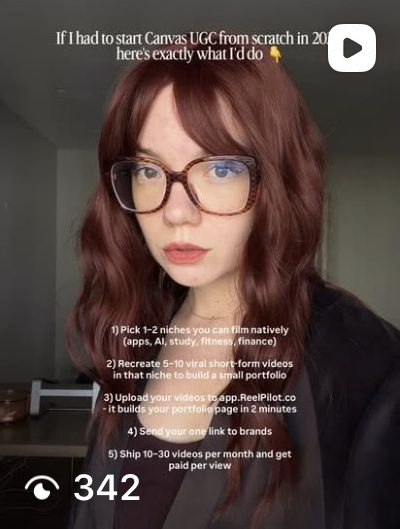
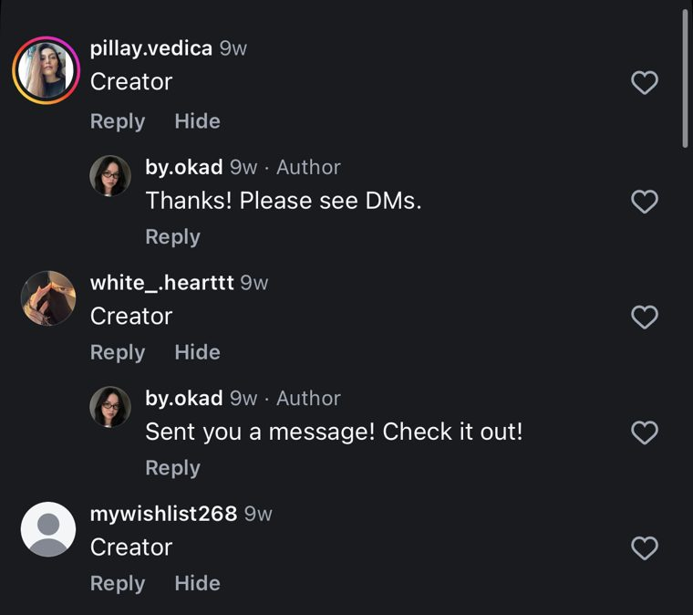
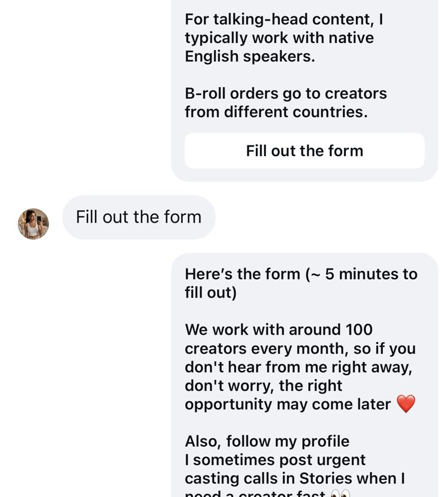

Running three ads and picking the one with the lowest CPA is not a creative test. It is a lottery with extra steps.

Real creative testing has a hypothesis, a control, isolated variables, and kill criteria decided before you spend a dollar. It produces learnings you can apply to the next round — not just a winner you cannot explain.

Most brands skip this. They launch a batch of ads, watch for a week, scale the best one, and start over when it fatigues. They never learn why something worked, so they cannot repeat it. Every campaign restarts from zero.

The methodology below was developed by [Olga Kad](https://www.linkedin.com/in/o-kad) across 200+ campaigns at [OKAD](https://okad.agency) — refined through every test that failed to produce a clean signal. Most of the rules below exist because the team broke them first and wasted budget learning why the rule matters.

## Why Most "Testing" Fails

Three mistakes kill creative tests before they start:

**Testing multiple variables at once.** A new hook, new body, new CTA, different creator, different music — launched as a single ad. If it wins, you have no idea which element drove the result. If it loses, same problem. You learned nothing and spent $200 proving it.

**Killing ads too early.** An ad with 300 impressions and zero purchases is not a failed ad — it is an ad without enough data. Killing it after 24 hours means your test never ran. You need statistical significance, not impatience.

**Not enough volume.** Three ads is not a test. It is a coin flip. You need enough variants to isolate variables and enough budget per variant to reach meaningful data. A "test" with $20 per ad set tells you nothing except that you spent $60.

## The Testing Hierarchy

Not all creative elements are equal. Test them in this order — from highest impact to lowest:

### 1. Angle and Message (Highest Impact)

The angle is the pain point, desire, or motivation you are speaking to. "This serum cleared my hormonal acne" is a different angle from "dermatologists recommend this ingredient." Same product. Completely different audiences and performance profiles.

Test angles first because a brilliant hook on a weak angle still underperforms. When OKAD works with a new brand, the first two weeks are dedicated exclusively to angle testing — no hook optimization, no format experiments. Find the message that resonates, then optimize everything around it.

A good angle test looks like this: 3-5 ads with identical formats, similar hooks, but each speaking to a different pain point or desire. The winner tells you which message your audience responds to. Everything downstream builds on that foundation.

### 2. Format (High Impact)

Format means the structural type of the ad: UGC talking head, product demo, story-driven narrative, before-and-after, listicle, screen recording, or faceless voiceover.

For a [dating app campaign](/cases/datemyage-dating-app-scripts/), OKAD tested 24 scripts across 22 creators in multiple formats — talking head testimonials, story hooks, and direct product demos — producing 48 videos total, including 7 with AI voiceover. The format that won was not the one the client expected. It rarely is. For a [pet supplement brand](/cases/tipaw-dog-supplement-story-ads/), story-format ads tested against product demos revealed that narrative hooks outperformed feature lists for pet supplement buyers — the same message performed differently depending on whether it was delivered as an owner's story or a product walkthrough.

### 3. Hook (High Impact)

The hook — the first 1-3 seconds — determines whether anyone sees the rest of your ad. But only test hooks after you have found a winning angle and format. A hook test without a proven body underneath it is optimizing the front door of an empty building.

OKAD's testing methodology follows a strict variable isolation approach. When the team tested hook variations for a [skincare brand](/cases/breakout-aid-skincare-ugc-ads/), 6 creators produced 15 new ads across 5 formats without new shoots — each ad tested a single hook variation against a proven body. The body and CTA stayed identical; only the first 3 seconds changed. Clean data on what works, no confounding variables.

Test 3-5 hooks per winning body. That is enough for a clear signal without fragmenting budget.

### 4. Body Structure (Medium Impact)

Once you have a winning angle, format, and hook, test body structures: problem-solution flow, testimonial narrative, product demo walkthrough, before-and-after reveal, or feature-benefit breakdown.

Body tests take longer to read because the differences are subtler. Give each variant at least 5 days before evaluating.

### 5. CTA (Lower Impact)

"Shop now" versus "Learn more" versus "Get yours." CTA testing matters, but it accounts for less performance variance than any element above it. Test CTAs last, and expect modest lifts — 5-15% improvements, not 2x swings.

## Test Structure: How to Set Up a Clean Test

A clean creative test has three components:

**A control.** Your current best-performing ad. Every new variant competes against this baseline. Without a control, you are comparing unknowns against unknowns.

**One variable.** Change exactly one element per variant. Same creator, same body, same CTA, same landing page — only the hook differs. Or same hook, same body — only the CTA changes. If you change two things, your data is contaminated.

**Enough budget.** Allocate $50-100 per variant with a 3-day minimum. At lower spend, the algorithm does not have enough signals to distribute impressions meaningfully.

The standard campaign setup:

| Element | Setting |
|---|---|
| Campaign type | CBO (Campaign Budget Optimization) |
| Ad sets | 3-5 (one per variant + control) |
| Budget | $50-100 per ad set per day |
| Duration | Minimum 3 days, target 5-7 days |
| Audience | Identical across all ad sets |
| Placement | Automatic (let Meta optimize) |

## Reading Results: The Diagnostic Framework

Performance metrics tell you which element is failing — if you know how to read them.

| Signal | Diagnosis | Fix |
|---|---|---|
| High CTR + high CPA | Hook works, body or landing page fails | Test new body structures or improve LP |
| Low CTR + low CPA | Niche appeal, high-intent viewers | This might be a winner — scale cautiously |
| Low CTR + high CPA | Nothing works | Kill it. Test a new angle. |
| High CTR + low CPA | Winner | Scale immediately, start hook variants |
| Declining CTR over time | Creative fatigue | Swap hooks, keep the body. See our [ad fatigue prevention guide](/blog/blog-ad-fatigue-prevention/) |

This diagnostic framework runs in OKAD's weekly creative reviews. Every active campaign gets checked against this matrix on Wednesdays, with kills and iterations shipped by Friday.

## The Iteration Cycle

Testing is not a one-time event. It is a loop:

1. **Test** — launch 3-5 variants with one isolated variable
2. **Identify** — find the winner after 3-7 days of data
3. **Extract** — determine which specific element drove the win (the hook phrasing, the story structure, the visual format)
4. **Apply** — use that winning element in new concepts with fresh variables
5. **Repeat** — start the cycle again with new hypotheses

Each cycle compounds your knowledge. After 4-6 cycles, you have a library of proven angles, hooks, formats, and CTAs that you can recombine. This is how [ZenToes produced 60+ variations](/cases/zentoes-walmart-launch-ads/) for their Walmart launch — not by creating 60 random ads, but by iterating through a structured testing process that identified winning elements and recombined them.

The testing cadence at OKAD: new concepts launch Monday, data review Wednesday, kills and iterations Friday. Two-week cycles mean no creative runs longer than 14 days without a performance check.

## Volume Benchmarks by Spend Level

Your testing volume should match your ad spend. Test too little and you cannot learn fast enough. Test too much and each variant gets starved of budget.

| Monthly Ad Spend | New Concepts/Week | Variants per Concept | Total Tests/Week |
|---|---|---|---|
| $5K-$15K | 2-3 | 2-3 | 5-10 |
| $15K-$50K | 5-10 | 3-5 | 15-30 |
| $50K-$150K | 10-20 | 3-5 | 30-60 |
| $150K+ | 20+ | 5+ | 60+ |

At every level, the principle stays the same: isolated variables, sufficient budget per variant, and documented learnings. The [Skribly campaign](/cases/high-roas-ugc-ads/) operated at the higher end — 1,257 video assets in two months through systematic hook and format iteration, hitting 8%+ view-to-25-second retention (versus the 3-5% industry average) and 1.5M total views. That volume was only possible because modular production kept the marginal cost of each new variant near zero. Read our guide on [getting 50 ad variations from one shoot](/blog/blog-50-ads-from-one-shoot/) for the production side of this equation.

## Kill Criteria: When to Stop Spending

Decide your kill criteria before launching. Not after. Emotional decisions during a live test waste budget.

**Hard kills (immediate):**
- CPA exceeds 2x your target after $100 in spend
- CTR below 0.5% after 1,000 impressions
- Zero purchases after spending 3x your target CPA

**Soft kills (monitor for 48 more hours):**
- CPA between 1.5x and 2x target
- CTR between 0.5% and 1% with low conversion
- Inconsistent daily performance (one good day, two bad)

**Never kill:**
- An ad that has been live for less than 24 hours
- A variant with fewer than 500 impressions
- A creative during a platform-wide performance dip (check multiple campaigns first)

## Building a Creative Testing System

The brands that win long-term are not the ones with the best single ad. They are the ones with the best testing system — a repeatable process that produces learnings faster than competitors.

That system has four components:

**A testing calendar.** Plan which variable you are testing each week, at least 4 weeks ahead. Random testing produces random results.

**A results database.** Log every test: the hypothesis, the variable, the control, the results, and the learning. After 3 months, this database is more valuable than any creative brief. OKAD maintains a per-client creative learning log that feeds directly into new briefs — each campaign starts with the accumulated knowledge of every previous test.

**A creative production pipeline.** You cannot test at volume if producing each variant takes a week. Modular production — shooting hooks, bodies, and CTAs as separate components — lets you create variants in hours. Our guide to [creative testing for DTC brands](/blog/blog-creative-testing-for-dtc/) covers the full pipeline.

**A feedback loop.** Test results inform the next brief. The next brief produces new variants. Those variants produce new results. The system accelerates: by month 3, the OKAD team typically has enough data to predict which angles and formats will win for a given client — because the testing system has mapped the audience's response patterns.

## Common Testing Mistakes

**Testing CTA colors instead of messages.** Button color tests produce statistically insignificant results at normal ad budgets. The message matters. The color does not.

**Declaring a winner after one day.** Meta's algorithm needs 3-7 days to optimize delivery. A variant that looks weak on day 1 often wins by day 5 as the algorithm finds the right audience segment.

**Confusing creative fatigue with a bad ad.** A creative that performed well for 3 weeks and then declined is not a testing failure — it is a sign that you need to refresh the hook while keeping the proven body and CTA. See our [ad fatigue prevention guide](/blog/blog-ad-fatigue-prevention/) for refresh strategies.

**Testing without a control.** If every ad in your test is new, you have no baseline. Always include your current best performer as a control. If nothing beats it, that is a valuable finding — your current creative is stronger than you thought.

**Scaling too fast after a win.** A creative that works at $100/day may not work at $1,000/day. Scale in 20-30% increments every 3 days, monitoring CPA at each step.

## Discipline Over Intuition

Creative testing is not complicated. It is disciplined. Isolate one variable, set a control, spend enough per variant, wait long enough for data, and document what you learn. Repeat.

The brands that compound creative knowledge — testing systematically over months and years — build an unfair advantage that no competitor can shortcut. Their ads get cheaper over time because every test adds to their understanding of what works and why.

If your current approach to creative is "make ads, launch them, see what happens" — start with one structured test this week. One variable, one control, $50 per variant, 5 days. The first test teaches you more than a dozen unstructured launches.

If you want to understand the broader system this methodology lives inside, our [creative strategy framework for paid social](/blog/blog-creative-strategy-framework-paid-social/) covers all seven phases from research to iteration. If your ads are already underperforming, start with the [diagnostic guide](/blog/blog-why-your-ads-are-not-working/) to identify what is broken before you test. For the role that owns this process, read [what a creative strategist does](/blog/blog-what-is-creative-strategist/) — or if you want to become one, our [career guide](/blog/blog-how-to-become-creative-strategist/) covers the path.

## Work With OKAD

OKAD delivers creative strategy and ad production as one service — from research and briefs to tested, scaling creatives. No retainer lock-in. Results-based pricing available.

**[See pricing](/pricing)** · Email [olga@okad.agency](mailto:olga@okad.agency) with your monthly ad spend and goals — we reply with a specific plan, not a sales pitch.
