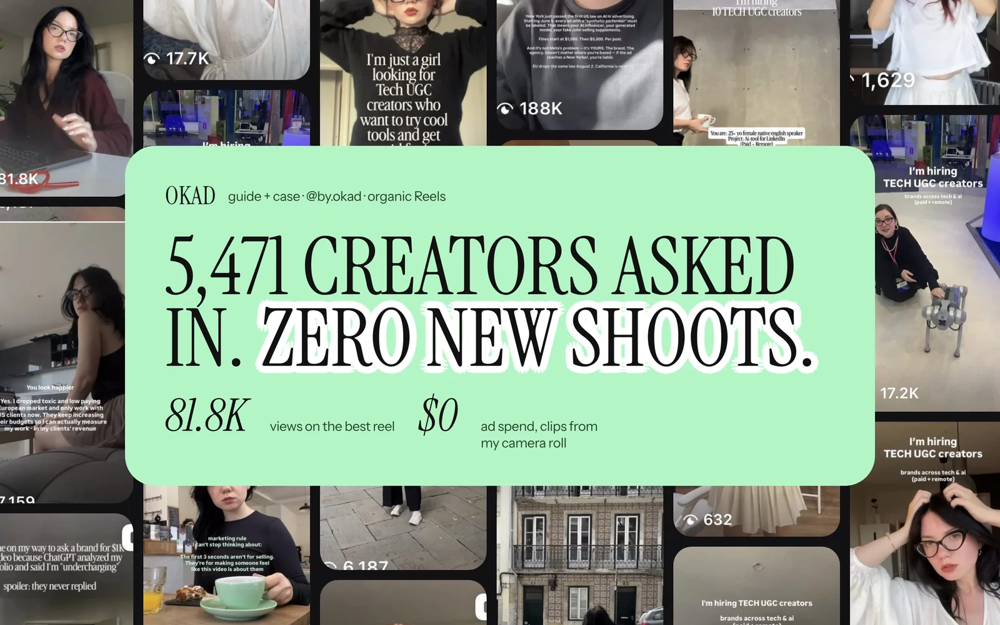

Most brands start their UGC creator search on a platform like Collabstr or Billo, filter by country, and pick whoever looks good in their portfolio. Then the deliverables arrive — and the British creator sounds Australian, the "German" creator lives in Austria and speaks with a dialect the target audience finds jarring, or the Gulf-based creator's content looks nothing like the polished aesthetic that market expects.

Finding UGC creators by country is not a search problem. It is a matching problem. The creator needs to match the target audience on language, accent, appearance, cultural context, and production quality — and the sourcing strategy is different for every market because each market has its own talent pool dynamics, rate structures, and quality expectations.

This guide breaks down the five major non-US markets for UGC creator sourcing, with specific platforms, rate ranges, cultural considerations, and vetting criteria for each.

## Why Local Creators Matter

Before the market-by-market breakdown, here is the data that makes this worth the effort.

Ads featuring creators who match the target audience's demographic — age, ethnicity, accent, and cultural context — outperform mismatched creative by 25-50% on cost per acquisition. This is not a branding preference. It is a performance metric.

The mechanism is trust. A viewer in Birmingham sees a creator who looks and sounds like their neighbor, and the mental barrier between "this is an ad" and "this is a recommendation" drops. A viewer in Dubai sees an American creator talking about a product, and the first reaction is "this is not for me" — regardless of how good the product is.

For brands running international campaigns, creator matching is the single highest-leverage localization decision. It matters more than subtitle translation, more than currency conversion, more than [script adaptation](/blog/blog-localizing-ad-creatives/). Get the face and voice right, and everything else becomes easier.

## United Kingdom

**Talent pool:** Large and mature. The UK has the second-largest UGC creator ecosystem after the US, driven by early TikTok adoption and a strong influencer marketing culture.

**Rates:** £100-300 per video ($125-375). Premium creators with proven ad performance charge £250-400. Rates are 20-30% lower than equivalent US creators.

**Sourcing platforms:**
- **TikTok and Instagram:** Search #UGCCreatorUK, #UGCCreator, #UKCreator. Active creators post their work with these tags
- **Collabstr and Insense:** Both have UK filters with substantial creator pools
- **LinkedIn:** Surprisingly effective for finding UK creators who specialize in B2B or professional products
- **Fiverr and Upwork:** Lower-cost options, quality varies. Best for one-off tests

**Cultural notes:**
- British humor is drier and more understated than American style. Over-enthusiasm reads as fake
- Class awareness matters — the creator's accent and presentation should match the product's positioning
- UK audiences are highly skeptical of overt selling. The best UK UGC feels like a casual recommendation, not a pitch
- Regional accents (Scottish, Northern, Welsh) can add authenticity for certain products but may limit broad appeal

**Quality indicators:** UK creators generally deliver high-quality work because the market is competitive. The main risk is creators who imitate American UGC style instead of adapting to British communication norms.

## European Union (Germany, France, Spain, Nordics)

**Talent pool:** Thinner than the UK, growing rapidly. Germany and France have the largest EU creator pools. Spain and Italy are catching up. Nordic markets have few dedicated UGC creators but high English proficiency.

**Rates:** €100-250 per video ($110-275). German creators charge at the top of this range. Spanish and Italian creators are at the lower end. Nordic creators often command premium rates (€200-350) because supply is limited.

**Sourcing platforms:**
- **Country-specific hashtags:** #UGCDeutschland, #UGCFrance, #CreadoresUGC (Spain)
- **Insense:** Has the best EU coverage among platforms
- **Direct outreach on Instagram/TikTok:** Often more effective than platforms in EU markets because fewer creators are on sourcing platforms
- **Local influencer agencies:** In Germany and France, small agencies specialize in UGC creator management

**Cultural notes by market:**

**Germany:** Precision and credibility matter. German audiences respond to detailed product information, honest assessments, and understated delivery. Avoid superlatives — "the best product ever" reads as untrustworthy. Include specific numbers and features.

**France:** Aesthetics matter more than in any other European market. French UGC needs to look good — lighting, composition, and styling should be a notch above typical UGC. The creator's personal style should feel aspirational but accessible.

**Spain:** Warmth and expressiveness work well. Spanish audiences respond to enthusiastic, genuine recommendations. The delivery can be more animated than in northern European markets.

**Nordics:** High English proficiency means English-language UGC performs reasonably well. For Swedish, Norwegian, and Danish markets, consider English content with local subtitles before investing in native-language creators — the performance gap is smaller than in other EU markets.

**Bilingual strategy:** Many EU creators speak English plus their native language. Briefing a bilingual creator to produce content in both languages from the same shoot cuts production costs by 40-50% compared to sourcing separate creators per market.

## Gulf States (UAE, Saudi Arabia, Qatar)

**Talent pool:** Small but growing. The Gulf UGC market is younger and more concentrated than Western markets. Dubai is the hub — most Gulf creators are based in or can travel to Dubai for shoots.

**Rates:** $200-500 per video. Higher than Western markets due to smaller talent pools and higher production expectations. Premium creators with proven conversion records charge $400-800.

**Sourcing platforms:**
- **Instagram:** The dominant platform for Gulf creator discovery. Search #UAECreator, #DubaiUGC, #SaudiCreator
- **TikTok:** Growing rapidly in Saudi Arabia (largest TikTok market in the Middle East by engagement)
- **Direct outreach:** The most reliable method. Gulf creator communities are tight-knit — one good creator can refer you to others
- **Local agencies:** Dubai-based influencer agencies are the fastest path to vetted talent

**Cultural notes:**
- **Production quality expectations are high.** Gulf audiences expect polished content even in UGC format. Lighting, styling, and backdrop matter more than in Western markets
- **Modesty standards vary by market.** Saudi Arabia has stricter requirements than the UAE. Know the local norms before briefing creators
- **Ramadan is the biggest advertising season.** Plan Ramadan content 6-8 weeks in advance. Ramadan UGC has specific aesthetic and messaging expectations
- **Arabic dialect matters.** Gulf Arabic, Levantine Arabic, and Egyptian Arabic are distinct. A Gulf audience will notice if the creator speaks Egyptian Arabic — it may or may not matter depending on the product
- **Gold and luxury signaling.** Gulf audiences respond well to premium presentation. The same product can perform very differently based on how aspirational the creative feels

## South Asia (India, Pakistan, Sri Lanka, Bangladesh)

**Talent pool:** Enormous. India alone has more active content creators than any other market outside the US and China. The challenge is not finding creators — it is finding quality at scale.

**Rates:** $50-150 per video. The lowest rates among major markets, but quality variance is extreme. Premium Indian creators with brand experience charge $100-300.

**Sourcing platforms:**
- **Instagram and YouTube:** The primary platforms for Indian creators. YouTube Shorts has created a large pool of short-form creators
- **Unboxd and similar local platforms:** India-specific UGC marketplaces are emerging
- **Fiverr and Upwork:** Large Indian creator pools, but vetting is essential
- **Direct outreach:** Effective in metro areas (Mumbai, Delhi, Bangalore)

**Cultural notes:**
- **Language diversity is massive.** India has 22 official languages. Hindi works for north India; Tamil, Telugu, and Kannada are needed for south India. English works for urban, educated demographics
- **Quality control is the main challenge.** The wide rate range reflects extreme quality variance. A $50 video might be unwatchable or surprisingly good — you cannot predict from the portfolio alone. Always request test videos
- **Audio quality is the most common issue.** Many South Asian creators film with phone microphones in noisy environments. Brief explicitly on audio requirements
- **Aspirational vs authentic.** Indian audiences respond to both — but the choice depends on the product category. Beauty and fashion lean aspirational. Tech and finance lean authentic

## Latin America (Brazil, Mexico, Colombia, Argentina)

**Talent pool:** Large and rapidly professionalizing, especially in Brazil and Mexico. The LATAM UGC market in 2026 is roughly where the UK market was in 2023 — lots of talent, still establishing professional norms and pricing.

**Rates:** $50-200 per video. Brazilian creators charge at the top of this range. Mexican and Colombian creators are mid-range. Argentine creators offer strong quality at lower rates due to currency dynamics.

**Sourcing platforms:**
- **TikTok and Instagram:** #CreadoresUGC, #UGCBrasil, #UGCMexico
- **Direct outreach:** The most effective method across LATAM
- **Fiverr:** Growing LATAM creator presence

**Cultural notes:**
- **Portuguese and Spanish are not interchangeable.** Brazilian Portuguese content will not work in Mexico, and Mexican Spanish will not work in Brazil. Treat them as separate markets
- **Warmth and relatability.** LATAM audiences respond strongly to genuine enthusiasm and personal stories. The creator's personality matters more than production polish
- **Music and rhythm.** LATAM content that includes music or has a rhythmic editing style tends to outperform static, talk-to-camera formats

## The Vetting Checklist

Regardless of market, use this checklist before hiring any UGC creator:

| Criteria | What to check | Red flag |
|---|---|---|
| Video quality | Lighting, framing, resolution | Dark or blurry samples, vertical video with horizontal content |
| Audio quality | Clear voice, no background noise | Echo, traffic noise, wind, phone mic distortion |
| Delivery style | Natural, conversational, on-brief | Robotic reading, over-acting, ignoring brief direction |
| Reliability | Response time, deadline track record | Slow replies during negotiation, missed test deadlines |
| Portfolio relevance | Past UGC work for similar products | Only lifestyle content, no direct-response ad experience |
| Rights agreement | Willing to sign usage rights | Resistance to perpetual rights, unclear terms |
| Test video | Willing to produce a paid test | Refuses test, insists on bulk order upfront |

Request 2-3 recent deliverables (not portfolio highlights) and a paid test video ($50-100) before committing to a batch order. The test video reveals everything — speed, quality, brief comprehension, and communication style.

## Building a Multi-Market Creator Roster

For brands running in 3+ markets, here is the roster-building framework:

**Start small:** 2-3 creators per market. Test all of them with the same brief and same product. The performance data tells you which creator drives the best results for that market.

**Keep winners, replace underperformers.** After the first batch, keep the top performer and replace the rest. Add 1-2 new creators to test against your winner. This continuous testing prevents creator fatigue and keeps quality high.

**Rotate on a schedule.** Even the best creator fatigues an audience after 3-5 videos. Plan to rotate new faces every 6-8 weeks in each market. This aligns with the [creator roster strategy](/blog/blog-one-creator-or-many-ugc/) that OKAD runs for all multi-market clients.

**Centralize brief and QA.** The brief should be consistent across markets — same message, same structure, same quality bar. Only the language, cultural references, and creator change. Centralized QA ensures no market gets lower-quality creative. For the full breakdown of what this costs, see our [UGC agency fee guide](/blog/blog-ugc-agency-fee-breakdown/) — rates vary significantly by country. And make sure your contracts cover [usage rights](/blog/blog-ugc-usage-rights-explained/) across all target markets, not just the creator's home country.

## How OKAD Sources Creators Globally

*OKAD manages 626 vetted creators across 40+ countries. For each brief, we match 3-5 based on market, demo, style, and past performance data.*

When [Olga Kad](https://www.linkedin.com/in/o-kad) and the [OKAD](https://okad.agency) team receive a multi-market brief, the sourcing process leverages a pre-built database of vetted creators — eliminating the 2-4 week sourcing phase that most brands face when entering a new market.

Every creator in the database has completed a paid test project, signed a standard rights agreement, and been evaluated on video quality, audio quality, brief adherence, delivery speed, and communication reliability. When a client needs UK creators or Gulf creators, the matching is immediate — not a cold search.

For brands building their own [creator networks](/blog/blog-how-to-build-creator-network/), the framework above works. For brands that want to skip the sourcing phase entirely, OKAD handles creator matching as part of every production engagement. The database includes creators across every market listed in this guide, with new creators added and underperformers removed monthly based on [performance data](/blog/blog-ugc-creator-rates-pricing/).

## Work With OKAD

OKAD sources, vets, and manages UGC creators across 40+ countries as part of a full creative production service. You brief us. We match creators, manage production, handle rights, and deliver tested creative. No sourcing delays. No vetting risk.

**[See pricing and book a call](/pricing)** · Or email [olga@okad.agency](mailto:olga@okad.agency) with your target markets and monthly volume — we reply with a creator matching plan and rate estimate.
