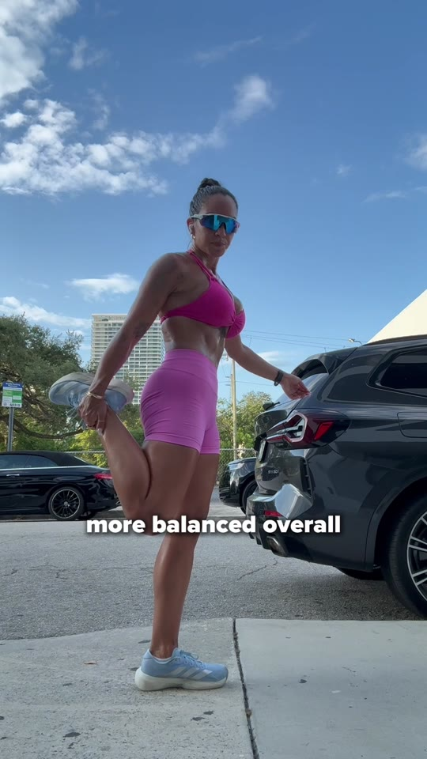

Creative strategy is the single biggest lever in paid social performance. Not targeting. Not bidding. Not budget allocation. The creative — what the audience actually sees — determines whether your ads work or fail. And the person responsible for that creative is your creative strategist.

The problem is that the role is poorly defined across the industry. Some companies hire a creative director and call them a strategist. Others promote a junior designer into the seat. Some hand the job to their media buyer as a side task. The result is that most brands have no idea whether their creative strategist is actually good — or whether they are quietly burning through budget on ads that never had a chance.

Here are 10 signs that separate the two. Five that signal a strategist who is driving results, and five that signal one who is costing you money.

## Five Signs of a Good Creative Strategist

### 1. Every Brief Traces Back to Data

A good creative strategist does not start with inspiration. They start with a spreadsheet. Every new concept they propose connects to a specific performance insight: this hook type outperformed that one by 40%. This pain point drove 3x the click-through rate. This format converts on TikTok but dies on Meta feed.

[Olga Kad](https://www.linkedin.com/in/o-kad) has reviewed over 500 ad accounts across [OKAD](https://okad.agency)'s client base. The pattern is always the same: the difference between brands that scale and brands that plateau comes down to whether their strategist runs on data or instinct. When OKAD onboarded the [Fragstore content factory](/cases/fragstore-content-factory/) account, the first step was analyzing which content styles drove orders — not which ones looked best. The team found that raw, creator-shot footage outperformed polished studio content by 2x on CTR. Every brief that followed was informed by that specific finding.

The test: ask your strategist to walk you through their last 5 briefs and name the data point behind each one. If they cannot, they are guessing.

### 2. They Can Explain WHY Winners Win

Ask a bad strategist why an ad works and you get: "It just resonated with the audience." Ask a good one and you get: "The hook uses a first-person problem statement that matches our highest-converting pain point. The format is a 15-second product demo, which outperforms story ads for this SKU by 2.3x. The CTA uses urgency language that we tested against benefit language last month."

This specificity matters because it is what makes success repeatable. If your strategist cannot decompose a winner into its component parts — [hook type](/blog/blog-hook-rate-explained/), pain point, format, audience angle, CTA structure — they cannot reliably produce the next one.

### 3. They Have a Testing Framework

Good creative strategists do not test randomly. They have a structured system: test angles first, then formats within the winning angle, then hooks within the winning format, then CTAs within the winning hook. Each test isolates one variable and produces a clear learning.

This framework is what turns [ad creative strategy](/blog/blog-ad-creative-strategy/) from an art into a system. At OKAD, testing follows a hierarchy: audience angle, then message, then format, then hook, then production style. Each level narrows the field. By the time you reach production, you already know the winning angle, message, and format — the creative brief practically writes itself.

A strategist without a testing framework produces a lot of creative. A strategist with one produces a lot of winners.

### 4. They Kill Fast and Scale Faster

Emotional attachment to creative is the most expensive bias in advertising. A good strategist launches 10 concepts, identifies the 2-3 that show early promise within 48-72 hours, kills the rest without hesitation, and immediately produces variations of the winners.

When OKAD ran the [supplement UGC ad testing campaign](/cases/supplement-ugc-ad-testing/) — 16 creator videos producing 48 test ads — the goal was never to make 48 good ads. It was to find the 5-8 that performed and build a system to scale them. The underperformers were killed within days — no tweaking, no second chances. The winners got new hooks, new formats, and new CTAs until they stopped performing.

A strategist who fights to keep underperformers alive — "let's just give it more time" or "maybe the audience needs to warm up" — is wasting your spend.

### 5. Their Briefs Are Self-Contained

A brief from a good strategist is a complete instruction set. It includes the target audience, the pain point, the angle, the hook concept, the format, the CTA, reference examples, and do-not-do notes. A creator or editor should be able to execute it without a single clarifying question.

This matters because creative production scales on brief quality. If every brief requires a 30-minute call to explain what the strategist actually wants, your production pipeline bottlenecks at one person. At OKAD, briefs follow a standardized template refined over hundreds of campaigns. When the team produced [60 videos per month for YourChristianDate](/cases/your-christian-date-broll-content/), every brief was self-contained — the creator shot the content from the brief alone, no back-and-forth needed.

The benchmark: a good strategist should produce enough testable concepts to outpace ad fatigue — typically 20 to 40 new ad variations per cycle. If output is consistently low, ask what is slowing them down. It is usually brief quality — they are spending time explaining instead of writing.

## Five Signs of a Bad Creative Strategist

### 6. They Pitch Big Ideas Without Data

"What if we did a cinematic brand film?" "I think we should try something completely different." "This concept is really going to surprise people."

These sentences are red flags. A strategist who leads with subjective conviction instead of performance evidence is operating on taste, not strategy. Taste is valuable for brand campaigns. It is dangerous for performance creative, where the audience — not the strategist — decides what works.

The distinction: a good strategist says "Let's test problem-solution hooks against curiosity hooks — our data shows problem hooks have a 2x higher hold rate." A bad one says "I have a feeling this new direction will really pop."

### 7. They Blame the Media Buyer

When ads underperform, a bad strategist's first instinct is to look outside the creative. "The targeting was wrong." "The budget was too low." "The algorithm didn't pick it up." These may occasionally be true. But if the strategist's default explanation for failure never involves the creative itself, they are not doing their job.

A good strategist treats underperformance as creative feedback. Low CTR means the hook failed. High CTR but low conversion means the body or CTA is misaligned with the promise. Low impressions might mean the creative was flagged or deprioritized by the platform. Each failure mode has a creative response.

### 8. Every Ad Looks the Same

Open their last 20 briefs. If they all follow the same format — same structure, same hook type, same visual approach — your strategist has one move. That move might work for a while, but it will fatigue. And when it does, they will not have alternatives ready because they never tested any.

Variety is not aesthetic preference. It is strategic necessity. Different audiences respond to different formats. A [talking head testimonial](/blog/blog-how-to-create-ugc-ads-that-convert/) converts differently than a product demo, which converts differently than a story ad. A strategist who only produces one type is leaving performance on the table.

### 9. They Cannot Articulate a Testing Roadmap

Ask: "What are we testing this month, and why?" If the answer is vague — "we're trying some new things" or "a few different angles" — your strategist does not have a plan. A testing roadmap should name the specific hypotheses, the variables being isolated, the success metrics, and the timeline for decisions.

Without a roadmap, testing is just producing creative and hoping. With one, every piece of creative has a purpose, every result produces a learning, and the overall direction is compounding toward better performance.

### 10. Briefs Take Weeks

If a brief takes more than 1-2 days to produce, something is broken. Either the strategist is overthinking (treating each brief as a creative masterpiece instead of a testable hypothesis), or they lack the systems to produce at velocity, or they are not actually analyzing performance data and are instead waiting for inspiration.

Speed matters because paid social is a volume game. Platforms need fresh creative constantly. [Ad fatigue](/blog/blog-ad-fatigue-prevention/) sets in within 10-21 days at scale. A strategist who produces 3 briefs per week cannot keep pace with a brand spending $50K+ monthly on paid social.

## The 15-Minute Audit Test

If you want to know immediately whether your creative strategist is good, run this test:

1. Pull your top 5 performing ads and bottom 5 performing ads from the last 90 days
2. Remove all performance data — just show the creative
3. Ask your strategist to rank them from best to worst and explain their reasoning

**What a good strategist does:** They rank them mostly correctly, and their explanations reference specific structural elements — hook strength, pain point clarity, format choice, CTA positioning. They might miss one or two, but their reasoning is sound even when the ranking is slightly off.

**What a bad strategist does:** They rank based on production quality, subjective appeal, or gut feeling. Their explanations sound like "this one feels more professional" or "the edit is cleaner on this one." They confuse looking good with performing well.

This test works because it isolates strategic thinking from execution. A strategist who cannot read creative for performance signals — without seeing the data — does not understand what drives results.

## What to Do If Your Strategist Is Underperforming

Do not fire them immediately. Have a specific conversation first:

1. **Show the gap.** Present the data: here is our creative output, here is our win rate, here is where we need to be. Make the underperformance objective, not personal.
2. **Ask for a testing roadmap.** Give them one week to produce a 30-day testing plan with specific hypotheses and success criteria. If they cannot, they likely lack the skill set — not the motivation.
3. **Evaluate the roadmap.** Does it reference your existing performance data? Does it propose varied formats and angles? Does it isolate variables for clean testing? If it reads like a wish list of creative ideas without data backing, the gap is structural.
4. **Set a 30-day checkpoint.** Implement the roadmap and review results. If the strategist cannot produce measurable improvement in creative performance within 30 days when given clear expectations and data access, the role is not a fit.

## When to Outsource Creative Strategy

Not every brand needs a full-time creative strategist. The decision depends on ad spend and creative volume:

| Monthly Ad Spend | Creative Needs | Best Fit |
|---|---|---|
| Under $10K | 5-10 new ads/month | Founder or media buyer handles strategy |
| $10K-$30K | 10-20 new ads/month | Freelance strategist or agency retainer |
| $30K-$75K | 20-40 new ads/month | Dedicated strategist (freelance or in-house) |
| $75K+ | 40+ new ads/month | In-house strategist + production team or agency |

At OKAD, the creative strategy team works as an embedded extension of the brand's marketing — handling the analysis, brief writing, and testing roadmap while the brand focuses on product and growth. The evaluation criteria above are exactly what OKAD applies when auditing a new client's existing creative program. The first question is always: can the current strategist (or whoever is filling that role) pass the 15-minute audit test? Can they explain why their winners won? Do their briefs trace back to data? If the answer is no on two or more of those, the creative program needs a reset — not more budget. The [Canvas Tech UGC network](/cases/canvas-tech-ugc-without-new-shoots/) scaled to 5,471 creators without new shoots because the strategic layer was sound: every brief had a hypothesis, every test had kill criteria, and every winner got multiplied systematically. This model works particularly well in the $10K-$75K range where a full-time hire is expensive but the creative demands exceed what a media buyer can handle alongside their primary job.

The brands that scale fastest on paid social are the ones that treat creative strategy as a specialized discipline — not a side task, not a creative director's hobby, and not something the intern can figure out. Whether that discipline lives in-house, freelance, or at an agency, the 10 signs above tell you whether the person doing it is actually driving results.

## Related Reading

- [Ad Creative Strategy: Brief to Scale](/blog/blog-ad-creative-strategy/) — the full 6-phase creative lifecycle
- [Hook Rate Explained](/blog/blog-hook-rate-explained/) — the metric that separates winning hooks from losing ones
- [Creative Testing for DTC](/blog/blog-creative-testing-for-dtc/) — structured testing frameworks for paid social
- [How to Scale Ad Creative Without Shoots](/blog/blog-how-to-scale-ad-creative-without-shoots/) — volume production when your strategist identifies winners
