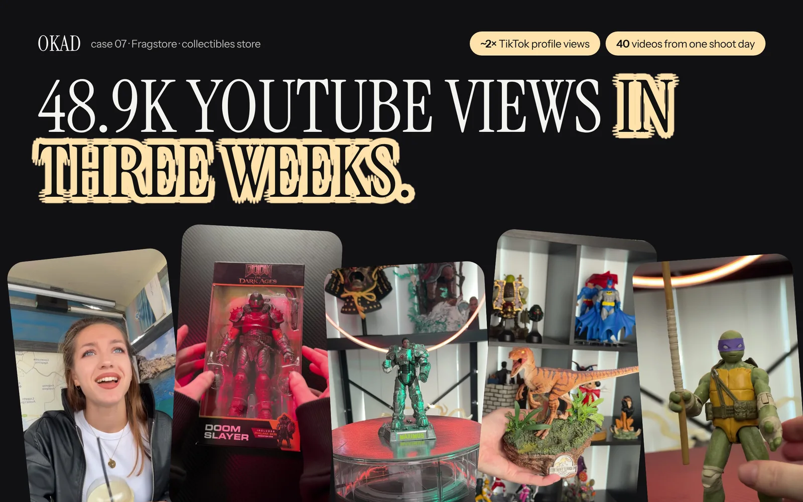

A €30 impulse buy and a €700 considered purchase have nothing in common except that both can be advertised on Meta. The creative strategy, the funnel structure, the video format, and the benchmarks for success are all fundamentally different.

Most brands selling high-ticket products make the same mistake: they produce ads as if they are selling a commodity. Short, punchy, conversion-focused creative that works for €30 skincare does not work for €700 equipment, premium furniture, luxury beauty devices, or professional services. The buyer needs more time, more proof, and more reasons to trust before they spend that kind of money.

Here is the creative framework that works for high-ticket products on Meta — tested across premium retail, professional equipment, luxury goods, and high-end services.

## Why High-Ticket Requires a Different Approach

The fundamental difference: the buyer's risk perception is proportional to the price. A €30 purchase that disappoints is a minor annoyance. A €700 purchase that disappoints is a genuine financial loss. Every element of your advertising needs to reduce perceived risk.

This changes three things about your creative strategy:

**1. The funnel matters more than the ad.** A single video cannot take someone from unaware to buyer at €700. You need different creative for different stages: awareness, consideration, and conversion. Each stage has a different job.

**2. Long-form outperforms short-form for closing.** The data from OKAD campaigns consistently shows that 60-120 second videos drive lower cost per acquisition than 15-30 second clips for products above €500. Short videos generate clicks and awareness, but longer videos generate the confidence that precedes a €700 purchase.

**3. Social proof carries more weight.** Testimonials, case studies, and third-party validation matter more as price increases. A claim without proof is ignorable at €30. At €700, unsubstantiated claims actively repel buyers.

## The High-Ticket Video Funnel

### Stage 1: Awareness — The Problem or Aspiration

**Goal:** Make the viewer recognize a problem they have or an aspiration they want to pursue. Do not mention your product yet.

**Format:** 15-30 second video, hook-driven. Can be UGC or produced.

**Content framework:**
- Open with a relatable scenario or frustration
- Agitate the problem with specifics
- Hint at a category solution (not your product specifically)

**Example hooks:**
- "I was spending €200/month on [inferior solution] and getting nowhere"
- "Three signs your current [category] is costing you more than it should"
- "What €700 actually buys you in [category] — and what €200 does not"

The awareness stage is where short-form video earns its place. Quick, attention-grabbing, pattern-interrupting. The goal is not conversion — it is to build a retargeting audience of people who engaged with the problem.

### Stage 2: Consideration — The Proof

**Goal:** Convince the retargeted audience that your specific product solves the problem better than alternatives.

**Format:** 60-120 second video. This is where long-form earns its ROI.

**Content types that work:**

| Content Type | What It Proves | Best Format |
|---|---|---|
| Customer testimonial | Real results from real buyer | UGC, interview style |
| Comparison | Superiority vs alternatives | Side-by-side, demo |
| Process/craftsmanship | Quality behind the price | B-roll with voiceover |
| Expert endorsement | Authority and credibility | Interview or quote overlay |
| Unboxing/first impression | What the experience feels like | UGC, genuine reaction |

**The testimonial formula for high-ticket:** The creator must be credible — someone who looks, talks, and lives like your target buyer. They should address three things: what they tried before (establishes they are informed), what convinced them to buy (addresses objections), and what specific result they got (proves value). Vague testimonials ("I love it!") do nothing at this price point. Specific testimonials ("I replaced my €200/month subscription and saved €1,400 in the first year") close deals.

### Stage 3: Conversion — The Offer

**Goal:** Give the retargeted, educated audience a reason to buy now.

**Format:** 30-60 second video focused on the offer, urgency, or guarantee.

**Content framework:**
- Restate the core value proposition in one sentence
- Present the specific offer (price, bundle, financing, trial period)
- Address the biggest remaining objection (usually risk — "What if it does not work for me?")
- Add urgency if genuine (limited stock, seasonal offer, price increase)
- Strong CTA: direct to product page, lead form, or booking page

**Risk-reversal elements that work for high-ticket:**
- Money-back guarantee with a specific timeframe
- Free trial or demo period
- Payment plans that reduce the per-month commitment
- "Talk to us first" option — a call with a real person before purchasing

For products above €500, [lead generation ads](/blog/blog-ad-creative-strategy/) often outperform direct-to-purchase ads. The funnel becomes: video ad → lead form → sales call or email sequence → purchase. The human touchpoint between ad and purchase increases conversion rates significantly at high price points.

## Video Production for High-Ticket

Production quality for high-ticket ads sits in a specific zone: better than typical UGC, but not so polished that it feels like a corporate commercial.

**The trust paradox:** Over-produced ads trigger skepticism at high price points. Viewers assume the brand spent heavily on the ad to compensate for a weak product. Under-produced ads signal that the brand cannot afford quality, which undermines the premium positioning. The sweet spot is "elevated UGC" — real people, real environments, but with good lighting, clear audio, and thoughtful composition.

**Production specifications:**

| Element | Awareness Video | Consideration Video | Conversion Video |
|---|---|---|---|
| Length | 15-30 seconds | 60-120 seconds | 30-60 seconds |
| Style | Hook-driven, casual | Interview/demo, elevated | Direct offer, clear |
| Creator | Relatable, not polished | Credible buyer, expert | Brand or creator |
| Lighting | Natural, phone-quality OK | Good natural or ring light | Consistent, clean |
| Audio | Music + text overlay OK | Clear speech essential | Clear speech + CTA |
| Editing | Fast cuts, captions | Slower pace, B-roll inserts | Focused, minimal |

### The Creator Selection Problem

For high-ticket UGC, creator casting is more important than scripting. The wrong creator undermines the entire funnel regardless of what they say.

**Selection criteria for high-ticket:**
- Demographic match to your buyer (age, income signals, lifestyle)
- Natural speaking style — not the fast-talking "influencer voice"
- Ability to discuss specifics and numbers, not just feelings
- Setting that matches your buyer's environment (home office, modern kitchen, professional space)

At OKAD, we match creators to the buyer persona, not the product category. A €700 kitchen appliance needs a creator who looks like they own a nice kitchen, not a 22-year-old content creator filming in a dorm room. The casting IS the creative strategy for high-ticket.

## Retargeting Architecture

High-ticket funnels live or die on their retargeting structure. Without retargeting, you are asking cold audiences to make a €700 decision from a single ad impression. That almost never happens.

**Retargeting audience layers:**

1. **Video viewers (25%+ watched)** → Serve consideration content (testimonials, comparisons)
2. **Video viewers (75%+ watched)** → Serve deeper consideration content (process, expert endorsement)
3. **Website visitors (product page)** → Serve conversion content (offer, guarantee, urgency)
4. **Add-to-cart / lead form started** → Serve reminder content (social proof, limited availability)

Each layer gets different creative. Running the same ad to all retargeting audiences is the most common mistake in high-ticket advertising — and the easiest one to fix.

**Budget allocation for high-ticket:**

| Funnel Stage | % of Ad Budget | Goal |
|---|---|---|
| Awareness (cold) | 40-50% | Build retargeting audience |
| Consideration (warm) | 25-30% | Educate and build trust |
| Conversion (hot) | 20-30% | Drive purchase or lead |

This allocation looks wrong to brands used to DTC math, where 80%+ goes to conversion campaigns. But high-ticket requires the awareness and consideration investment because the audience does not convert without it. Skipping straight to conversion with cold audiences at €700 price points burns budget with near-zero return.

## CPA Benchmarks and ROI Math

Realistic benchmarks for high-ticket products on Meta (€500-€1,000 range):

| Metric | Benchmark Range | Notes |
|---|---|---|
| CPM | €8-€20 | Higher CPMs for affluent audience targeting |
| CPC | €1-€4 | Lower CTR than impulse-buy ads is normal |
| Cost per lead | €30-€100 | Lead form or booking page |
| Cost per purchase | €100-€300 | Direct purchase or post-call close |
| ROAS (first purchase) | 2x-5x | Higher with post-purchase retention |

The ROI math that justifies high CPAs: if your product sells for €700 with a 50% margin, a €150 CPA still delivers a 2.3x ROAS on first purchase. If the average customer buys twice over their lifetime, the effective ROAS doubles.

High-ticket brands that track only first-purchase ROAS consistently underspend on acquisition. The ones that factor in [lifetime value and repeat purchase rates](/blog/blog-creative-testing-for-dtc/) can afford higher CPAs and outbid competitors for the best audiences. Knowing [what counts as a winning ad](/blog/blog-what-counts-as-winning-ad/) at these price points is critical — the metrics look different from DTC impulse buys. And for brands deciding between [one creator or a diverse roster](/blog/blog-one-creator-or-many-ugc/), the high-ticket answer is almost always multiple creators matched to your buyer persona.

*For this premium retailer, OKAD produced longer-form UGC testimonials that addressed buyer objections directly. The result: buyers needed to hear the story behind the price, and the longer format gave them the confidence to purchase. [See the full approach](/cases/fragstore-content-factory/).*

## Work With OKAD

OKAD produces full-funnel video ad creative for high-ticket brands — from awareness hooks to conversion testimonials, with creator casting matched to your buyer persona. Strategy, scripts, production, and [performance tracking](/blog/blog-ugc-video-ads-that-convert/) under one retainer.

**[See pricing and book a call](/pricing)** · Or email [olga@okad.agency](mailto:olga@okad.agency) with your product price point, current ad spend, and target CPA — we will reply with a specific creative plan.
