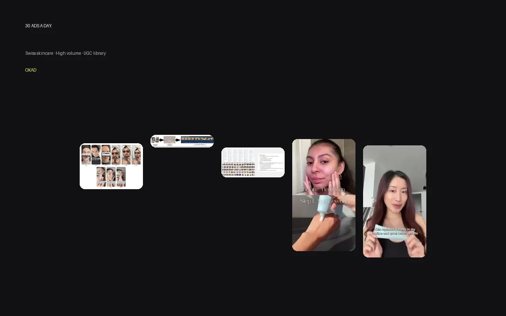

The most common question on every sales call is some version of: "How many videos do we need?"

The honest answer is that it depends on your ad spend, your product, and how fast your ads fatigue. But there is a formula that gets you close — and it is simpler than most agencies make it sound.

## The Creative Volume Formula

Here is the rule of thumb that works across DTC, apps, and service businesses:

**Monthly ad spend ÷ $500 = minimum new creatives per month**

A brand spending $5,000/month needs at least 10 new creatives. A brand spending $30,000/month needs 60+. This is not a vanity number — it comes from the relationship between spend, frequency, and [ad fatigue](/blog/blog-ad-fatigue-prevention/).

Why $500? Because on Meta, a single creative typically exhausts a $500 budget segment in 10-21 days before frequency rises and performance degrades. At that point, the algorithm needs something new to test. The more budget you push through a single creative, the faster it fatigues.

This formula gives you the floor. The brands that scale fastest usually produce 1.5-2x this number because not every creative will be a winner. You need surplus creative to maintain a steady rotation of proven performers.

## Volume by Ad Spend Tier

| Monthly Ad Spend | Min. New Creatives | UGC Videos | Statics | Testing Budget |
|---|---|---|---|---|
| $1,000-$3,000 | 5-10 | 3-5 | 5-10 | $200-$500 for testing |
| $3,000-$10,000 | 10-25 | 5-15 | 10-20 | $500-$1,500 |
| $10,000-$30,000 | 25-50 | 15-30 | 20-40 | $1,500-$3,000 |
| $30,000+ | 50+ | 30+ | 40+ | $3,000+ |

These ranges include both net-new concepts and variations (hook swaps, script overlays, format remixes). A single UGC video shoot can produce 3-5 testable variations through [hook swaps and re-edits](/blog/blog-50-ads-from-one-shoot/), so the raw production volume is lower than the creative count suggests.

## The Testing Math Behind the Numbers

Creative testing is a numbers game. Across hundreds of campaigns, the industry benchmark is roughly **1 in 5 creatives becomes a winner** — meaning it hits your target CPA and can sustain spend for 2+ weeks.

Here is what that means in practice:

- To find **4 winning ads** (enough to sustain ~$10K/month spend for 3 weeks), you need to test **20 creatives**
- To find **8 winners** (enough for $20-30K/month), you need **40 tests**
- To find **12+ winners** (enough for $50K+), you need **60+ tests**

The brands that complain about "not having enough winners" are almost always under-producing. They test 5 creatives, get 1 winner, scale it until it dies, then scramble for the next one. That is a feast-famine cycle, not a system.

The brands that scale smoothly produce creative continuously — testing new concepts every week while scaling proven ones. Their pipeline never runs dry because production runs in parallel with testing, not after it.

For a detailed breakdown of how to structure these tests, see our [creative testing framework for DTC](/blog/blog-creative-testing-for-dtc/).

## Why More Spend Means More Creative

This is counterintuitive for brands used to traditional media. In television, you produce one spot and run it for months. In performance marketing, the opposite is true: more budget requires more creative, not less.

Three forces drive this:

**1. Faster audience saturation.** At $30K/month on Meta, your ads reach your target audience multiple times per week. The same creative shown to the same person four times in a week loses its impact. You need visual diversity to keep the experience fresh across impressions.

**2. Faster algorithmic fatigue.** Meta's delivery system optimizes for engagement. When engagement drops (because the audience has seen the ad too many times), the algorithm deprioritizes the creative and raises your CPM. Fresh creative resets this cycle.

**3. Broader audience testing.** Higher budgets push your ads to broader audiences — people at the edges of your target who may respond to different messages, formats, or creator styles. More creative variations give the algorithm more options to match the right ad to the right person.

This is why the volume formula scales linearly. Doubling your spend roughly doubles your creative need.

## The Format Mix: Video vs Static

Not all creatives need to be full UGC videos. The most efficient production mix depends on your product and platform:

### Video-heavy mix (60% video / 40% static)

Best for:
- Products that need demonstration or explanation
- High-ticket items ($200+) where trust-building matters
- TikTok-first campaigns where video is native
- Brands with complex value propositions (fintech, health tech, B2B)

### Static-heavy mix (40% video / 60% static)

Best for:
- Products with strong visual appeal (fashion, beauty, food)
- Price-driven purchases under $50
- Meta/Instagram-focused campaigns
- Brands in the [creative testing phase](/blog/blog-creative-testing-for-dtc/) where angle discovery matters more than format

### Why statics matter even if video is your primary format

Statics cost 60-80% less to produce than video. A static ad costs $100 on average; a UGC video costs $250-$500. For the same budget, you get 3-5x more static tests than video tests.

This matters because statics are the fastest way to discover winning angles. You can test 10 different benefit claims as statics in a week, find the 2-3 that resonate, and then produce video around those proven angles. This is significantly more efficient than producing 10 videos at $3,000-$5,000 and hoping one works.

The winning angle discovered in a $100 static becomes the script for a $300 video that scales to $50K+ in spend. This test-then-scale sequence is the standard workflow for every OKAD engagement.

## How OKAD Packages Map to Volume

OKAD's monthly packages are designed around the volume formula:

| Package | Monthly Price | Creatives Included | Best For |
|---|---|---|---|
| Test & Learn | $2,500 | 10 creatives | Brands spending $1-5K/month on ads |
| Scale What Works | $3,500 | 20-30 creatives | Brands spending $5-15K/month |
| Always-On | $5,000 | 30+ creatives | Brands spending $15K+/month |

Every package includes strategy, scripting, creator sourcing and management, editing, and revisions. There is no separate strategy fee — it is built into production because creative without strategy is just content.

At higher volumes, the per-creative cost drops significantly. A single creative in the Always-On package costs roughly $130-$170, compared to $250+ per creative at one-off rates. This is because strategy, casting, and project management are amortized across more deliverables.

## The Multiplication Effect

Raw production is only half the equation. Smart post-production multiplies your output without multiplying your costs.

A single UGC video can generate:
- **3-5 hook swap variations** — same body, different opening 2-3 seconds ($15-$30 per swap)
- **2-3 script overlay versions** — same footage, different voiceover or text ($40-$60 each)
- **2 format versions** — square for feed, vertical for Stories/Reels ($20-$30 each)
- **1-2 still frames** pulled as static ads ($10-$15 each)

One $300 video becomes 8-12 testable creatives for under $500 total. This is why the table above separates "new creatives" from "UGC videos" — you do not need to produce 50 separate videos to have 50 creatives in rotation.

For the full breakdown of multiplication methods, see our playbook on [producing 60+ ad variations without new filming](/blog/blog-50-ads-from-one-shoot/).

*Swiss Skincare produces ~30 ads per day from existing footage using hook swaps and script overlays. [See the full case study](/cases/ad-re-edits-five-brands/).*

## When to Increase Volume

Three signals tell you it is time to produce more creative:

**1. Winning ads are fatiguing faster than you can replace them.** If your best ad dies every 10 days and your next batch takes 3 weeks to produce, you have a production gap. Close it by increasing monthly volume or shortening your production cycle.

**2. You are scaling spend but CPA is rising.** This usually means the algorithm is running out of fresh creative to test. More spend on the same ads just means more frequency on the same audience. Add creative before adding budget.

**3. Your win rate is dropping below 15%.** If fewer than 1 in 7 new creatives becomes a winner, your volume is fine but your strategy needs work. Before producing more, audit what is not working — bad hooks, wrong format, mismatched creator, or weak offer. The [creative testing methodology](/blog/blog-creative-testing-methodology/) OKAD uses isolates which variable is underperforming.

## The Bottom Line

There is no magic number of UGC videos that works for every brand. But there is a formula: your ad spend tells you how many creatives you need, your win rate tells you how many to test, and your fatigue rate tells you how fast to replenish.

Start with the table. Calculate your minimum. Build a production pipeline that meets that minimum every month without gaps. And track your numbers — as spend scales, creative volume must scale with it.

The brands that get this right do not run out of ads. They run out of budget to spend on the winners they keep finding.

For a full breakdown of what agencies charge at each volume tier, see our [UGC agency fee breakdown](/blog/blog-ugc-agency-fee-breakdown/). If your per-video costs feel too high for the results, [why paying $500 per UGC video is not working](/blog/blog-paying-500-per-ugc-video-not-working/) diagnoses the common causes. And to understand realistic delivery timelines at each volume level, see our [UGC production timeline guide](/blog/blog-ugc-production-timeline/).

## Work With OKAD

OKAD delivers creative strategy and ad production as one service — from research and briefs to tested, scaling creatives. No per-asset pricing surprises. No retainer lock-in.

**[See pricing and book a call](/pricing)** · Or email [olga@okad.agency](mailto:olga@okad.agency) with your monthly ad spend and goals.
