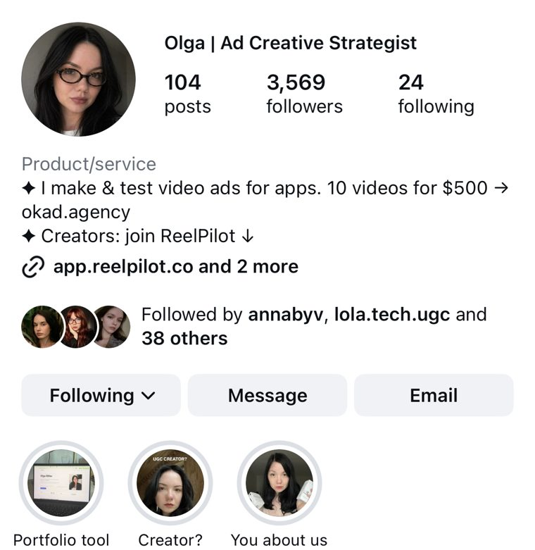
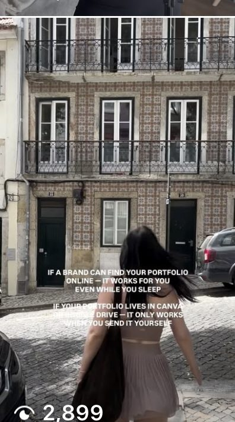
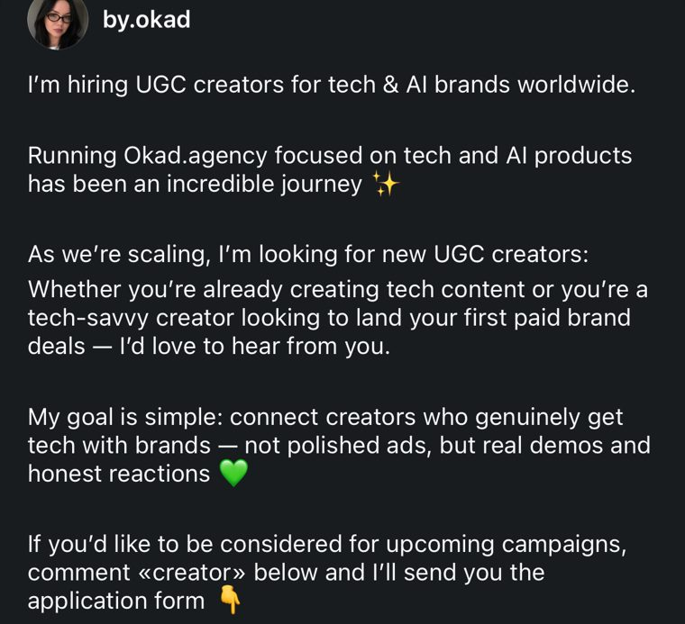
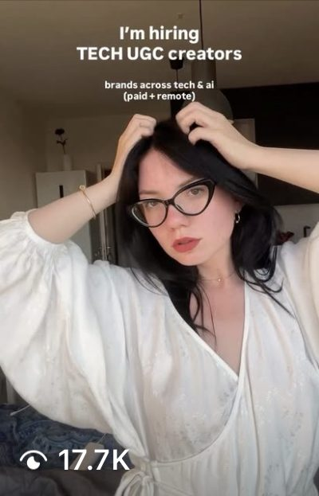

Every brand running paid social in 2026 has the same bottleneck. It is not media buying — broad targeting and automated bidding handle that. It is not production — AI tools and UGC networks have made content cheaper than ever. The bottleneck is creative strategy: deciding what to make, why to make it, and what to test next.

That is the creative strategist's job. And demand for people who can do it well far outstrips supply.

[Olga Kad](https://www.linkedin.com/in/o-kad) started [OKAD](/) as a design studio, making static ad creatives. Clients ordered design, but she did everything — the visuals, the copy, the concepts. Then curiosity took over: what actually happened to those creatives once they launched? She started pulling up ad accounts, analyzing what worked, and suggesting what to make next — before "creative testing" was even a term. She had already been running ads for her own e-commerce products and posting three videos a day on her own blog, so she understood hooks, attention management, and the full funnel from first impression to checkout. When a client asked her to create UGC ads using her own face, that became the pivot. She scaled to working with other creators, landed a major agency client, and realized that the real bottleneck was never production — it was knowing what to produce and why. That intersection of design, copywriting, video editing, ad buying, and funnel understanding became OKAD's creative strategy practice.

Here is how to build that skillset yourself, whether you want to join an agency, go freelance, or work in-house.

## What the Job Looks Like Day to Day

The role sits between the media buyer and the creative team. You do not buy media. You do not design ads. You decide what ads should exist and why. For a full overview, read [what a creative strategist is and why every DTC brand needs one](/blog/blog-what-is-creative-strategist/).

**Daily work includes:**

- Reviewing ad performance data to identify what is working and what is dying
- Researching competitor ads, audience pain points, and market trends
- Writing creative briefs that specify the angle, hook, format, and audience for each new ad
- Directing production — giving feedback on scripts, edits, and final cuts
- Running structured creative tests and interpreting results
- Building a creative testing roadmap: what to test this week, this month, this quarter

At [OKAD](/), the creative strategist role drives every client engagement. When the team built an [organic video strategy that reached 1M+ views without ad spend](/cases/organic-video-content-1m-views/), the strategist determined which content angles resonated organically — and those insights fed directly into paid creative briefs. Understanding what people choose to watch tells you what they will stop scrolling for. The media buyer executed the tests. The production team built the assets. But the strategist set the direction.

## Three Entry Paths

### Path 1: From Media Buying

**What you already have:** Platform literacy, data analysis skills, understanding of metrics and attribution, experience watching ads succeed and fail in real time.

**What you need to build:** Creative instincts — why certain hooks work, how to write a brief that a designer or creator can execute, understanding of visual and narrative structure.

**How to transition:** Start writing the creative briefs yourself instead of relying on the creative team to interpret data. When you see an ad outperform, document why. Build a library of winning patterns. Most media buyers already do half of creative strategy without calling it that.

### Path 2: From Copywriting

**What you already have:** Messaging skills, understanding of persuasion, ability to write hooks and scripts, audience empathy.

**What you need to build:** Data literacy — reading ad dashboards, understanding which metrics matter for which decisions, and translating performance data into creative direction.

**How to transition:** Ask for access to the ad account. Start correlating your copy variations with performance data. Learn what a good hook rate looks like, what hold rate means, and how CTR by placement differs. When you can write a brief that includes both the creative angle and the performance hypothesis, you are a strategist.

### Path 3: From Design or Creative Direction

**What you already have:** Visual literacy, understanding of composition and pacing, production skills, ability to art-direct shoots and edits.

**What you need to build:** Performance mindset — accepting that beautiful ads sometimes fail and ugly ads sometimes scale, and learning to optimize for results rather than aesthetics.

**How to transition:** This is often the hardest shift because it requires letting go of creative control. A creative director asks "is this good?" A creative strategist asks "will this beat the control?" Start by reviewing your past work through a performance lens. Which pieces drove results? Why? The answers will surprise you.

This is exactly how Olga Kad made the transition. She started making static creatives for clients — pure design work. But she had also been running ads for her own e-commerce products, so she could see which of her designs actually converted and which just looked good. That dual perspective — maker and buyer — is the fastest path from design to strategy. If you are a designer who also runs your own ad spend, you already have the raw ingredients.

## Core Skills to Build

**1. Creative Analytics**

Learn to read and interpret:
- **Hook rate** — percentage of viewers who watch past the first 3 seconds
- **Hold rate** — how long viewers stay through the video
- **CTR by creative element** — which hook, body, or CTA drives the click
- **Thumb-stop ratio** — how often your ad stops the scroll relative to impressions

These metrics tell you which part of an ad is working and which part is failing. A high hook rate with low CTR means the opening is strong but the offer or CTA is weak. A low hook rate with high conversion among remaining viewers means the body converts but you need a better opening. Learn to read these patterns — they are the foundation of everything. For a deep dive, see our [hook rate explainer](/blog/blog-hook-rate-explained/).

**2. Brief Writing**

A creative brief is the strategist's primary output. A good brief specifies:
- Target audience and their current awareness level
- The angle or messaging hypothesis being tested
- The format (UGC talking head, product demo, story ad, static)
- The hook concept (first 3 seconds)
- Reference examples of what good looks like
- What success means (the metric and the threshold)

At OKAD, every brief follows this structure. When we produced [24 scripts for DateMyAge](/cases/datemyage-dating-app-scripts/) — 48 videos total across 22 creators, including 7 with AI voiceover — each script started as a brief with a specific hypothesis: this audience, this pain point, this format, this hook angle. The scripts were the execution. The briefs were the strategy.

**3. Competitor Research**

Spend 30 minutes daily in Meta Ad Library and TikTok Creative Center. Study what brands in your category are running. Notice which ads have been running for months — that means they are profitable. Notice which ads appear once and disappear — that means they failed the test.

Build a swipe file. Categorize by format, hook type, and angle. When you need to brief a new concept, pull from patterns that are working in the market rather than inventing from scratch.

**4. Testing Methodology**

Creative testing is not random experimentation. It is structured hypothesis testing:
- **Variable isolation** — change one element per test (hook, body, format, or audience)
- **Statistical significance** — know when you have enough data to make a decision
- **Testing hierarchy** — test concepts first, then angles within winning concepts, then executions within winning angles

Our [creative testing guide](/blog/blog-creative-testing-for-dtc/) walks through the full methodology.

## Tools of the Trade

| Tool | Purpose | Cost |
|---|---|---|
| Meta Ad Library | Competitor research (free) | Free |
| TikTok Creative Center | Trending formats and ads | Free |
| Motion | Creative analytics and reporting | Paid |
| Foreplay | Ad swipe file and brief builder | Paid |
| Triple Whale / Northbeam | Attribution and ROAS tracking | Paid |
| Figma | Visual brief mockups | Free tier available |

You do not need all of these on day one. Start with the free tools — Meta Ad Library and TikTok Creative Center — and add paid tools as your budget or employer allows.

## Building a Portfolio Without Clients

No one will hire you as a creative strategist without proof you can think like one. Here is how to build that proof:

**The Spec Audit Method:**

1. Pick 3 DTC brands you admire
2. Pull their last 30 days of ads from Meta Ad Library
3. Analyze what they are testing: hooks, formats, angles, audiences
4. Identify gaps — what are they not testing that they should be?
5. Write 3-5 creative briefs for ads you would test next
6. Explain your reasoning: why this angle, why this format, why now

Document this as a case study. Post it on LinkedIn or your personal site. This demonstrates the exact thinking process hiring managers look for.

OKAD regularly evaluates strategist candidates based on this kind of thinking. A polished portfolio of hypothetical briefs with clear reasoning beats a resume full of job titles every time. When you are ready to apply, our guide on [how to hire a creative strategist](/blog/blog-how-to-hire-creative-strategist/) explains what hiring managers actually test for — use it to prepare from the other side.

## Where to Find Your First Role

**Agency-side ($60,000-$80,000)**

Performance creative agencies hire the most creative strategists. The pay is lower than in-house, but the learning curve is steeper — you will work across multiple brands, categories, and budgets simultaneously. This is the fastest path to building pattern recognition.

**In-house DTC brand ($70,000-$100,000)**

Brands spending $50K+/month on paid social increasingly hire dedicated creative strategists. The pay is higher, the scope is narrower, and the work is deeper. You will own the entire creative pipeline for one brand.

**Freelance ($50-$150/hour)**

Freelance creative strategy is growing fast. Brands that cannot afford a full-time hire need strategic direction without the overhead. Start at $50-$75/hour and raise rates as your track record builds. Some freelance strategists earn $150,000-$250,000 annually working with 3-5 clients.

## Career Progression

| Level | Typical Title | Salary Range (US) | Experience |
|---|---|---|---|
| Entry | Junior Creative Strategist | $60K-$80K | 0-2 years |
| Mid | Creative Strategist | $80K-$120K | 2-5 years |
| Senior | Senior Creative Strategist | $120K-$150K | 5-8 years |
| Lead | Head of Creative Strategy | $140K-$200K | 7-12 years |
| Executive | VP of Creative / Founder | $180K-$300K+ | 10+ years |

The ceiling is high because the role is scarce. Brands spending millions on ads need someone who can direct that spend toward creative that works. That person commands a premium. For a complete breakdown by market and engagement model, see our [creative strategist salary and rates guide](/blog/blog-creative-strategist-salary-rates/).

## The AI Advantage

AI does not replace creative strategists. It makes them more dangerous.

A creative strategist in 2026 who uses AI effectively can:
- Research competitors 3x faster using AI-assisted ad analysis
- Generate first-draft briefs and scripts in minutes instead of hours
- Produce rough concepts and mockups without waiting for a designer
- Analyze performance data with natural language queries instead of spreadsheets

At OKAD, AI tools are embedded throughout the creative workflow — from [AI-generated product visuals](/cases/baby-furniture-ai-product-visuals/) (40+ lifestyle images at under $700, replacing a multi-day photo shoot) to AI-assisted [video production](/blog/blog-how-to-make-ai-video-ads/). But every AI output is directed by a human strategist who decided what to make and why.

The strategists who thrive in 2026 are not the ones who fear AI. They are the ones who use it to multiply their output while keeping the strategic thinking human. Our guide to [AI creative workflows](/blog/blog-ai-creative-workflow/) shows how this works in practice.

## The OKAD Approach

OKAD's creative strategy framework is built on a simple loop:

1. **Research** — Analyze what is working in the market and for the client
2. **Hypothesize** — Write briefs based on data-driven creative angles
3. **Produce** — Direct production toward the brief's specifications
4. **Test** — Launch structured tests with isolated variables
5. **Learn** — Analyze results, document patterns, feed insights back into step 1

This loop runs continuously. For a dating app, this system generated [48 videos from 24 scripts](/cases/datemyage-dating-app-scripts/) across 22 creators. For another dating brand, it produced [60 videos per month](/cases/your-christian-date-broll-content/) from b-roll footage across multiple creator accounts. For an [alcohol brand](/cases/alcohol-ugc-content/), the same framework drove 900K views per post. The volume varies by client. The system stays the same.

If you want to see the system behind the role, our [creative strategy framework for paid social](/blog/blog-creative-strategy-framework-paid-social/) breaks down the seven-phase process that repeats every two weeks. And for the full creative lifecycle from brief to scale, start with our [ad creative strategy guide](/blog/blog-ad-creative-strategy/).

## Start This Week

You do not need permission to start building creative strategy skills. This week:

1. **Monday** — Open Meta Ad Library. Pick one brand. Pull every ad they launched in the last 30 days.
2. **Tuesday** — Categorize: which are hook tests? Format tests? Angle tests? What patterns emerge?
3. **Wednesday** — Identify the brand's top-performing ad (longest-running = most profitable). Analyze why it works.
4. **Thursday** — Write 3 briefs for ads you would test next for this brand. Include the hypothesis, format, hook, and success metric.
5. **Friday** — Post your analysis on LinkedIn. Tag the brand. Explain your reasoning.

Repeat for a new brand next week. Within a month, you will have a portfolio of strategic thinking that most candidates cannot match. Within three months, you will be thinking like a creative strategist — because you will be doing the work.
