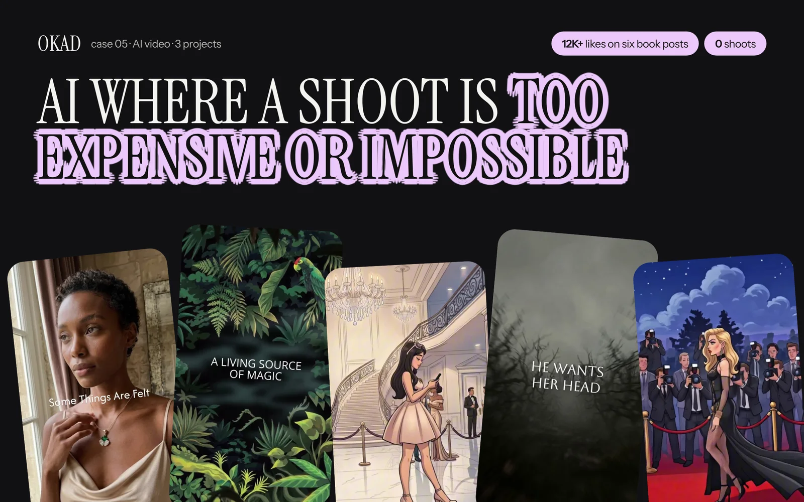
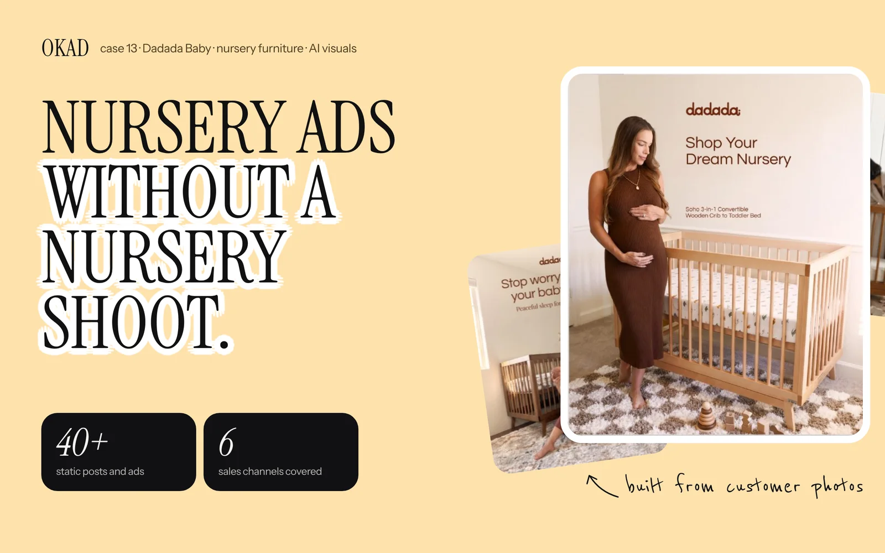

Every brand exploring [illustrated ad creatives](/blog/blog-ai-cartoon-ads/) asks the same question first: what does this actually cost? The answer depends on who does the work and what level of quality you need.

AI tools have made the raw production nearly free. Generating an illustrated scene costs pennies. Animating it costs a few dollars. But the gap between "generated an image" and "produced a tested, converting ad creative" is where the real costs live — in strategy, iteration, editing, and testing.

Here is the full cost breakdown by production model, from DIY to agency to traditional studio, with the math on what drives costs up and down.

## AI Tool Credits: The Raw Material Cost

Before discussing production models, here is what the AI tools themselves cost. These are the credits you burn to generate images, animate them, and add voiceover — the raw material of illustrated ad production.

| Tool | What It Does | Monthly Plan | Per-Ad Cost |
|---|---|---|---|
| Midjourney (Standard) | Character and scene generation | $30/mo | $1-3 per image |
| Flux (via API) | Image generation (API-based) | Pay-per-use | $0.03-0.10 per image |
| Runway Gen-4 | Animation, camera movement | $12-76/mo | $2-8 per clip |
| Kling 2.0 | Character animation | $5.99-33/mo | $1-5 per clip |
| Pika 2.0 | Simple motion, loops | $8-58/mo | $0.50-3 per clip |
| ElevenLabs | AI voiceover | $5-22/mo | $0.50-2 per voiceover |
| CapCut Pro / Premiere | Editing and assembly | $10-23/mo | Included in subscription |

**What these numbers mean in practice:**

- One illustrated static ad: **$3-15** in credits
- One animated video ad (15-30 seconds): **$10-40** in credits
- A batch of 10 statics in different [illustration styles](/blog/blog-illustration-styles-for-ads/) (the approach brands like Hollow Alpaca Socks use to test visual diversity): **$30-150** in credits alone
- API-based generation (Flux, Replicate) costs 10x less per image than GUI subscriptions — at scale, this difference compounds

These numbers are seductive. Ten illustrated ads for $30 sounds like the end of expensive creative production. But credits are the smallest line item in the actual cost of producing illustrated ads that convert.

## The Four Production Models

### Tier 1: DIY (Founder or Marketer)

You buy the AI tool subscriptions, write prompts, generate images, animate clips, edit the final ad, and launch it yourself.

**Cost per ad:** $3-15 (static) / $10-40 (animated video) — credits only

**The hidden cost:** 4-8 hours of your time per ad. Prompt iteration (getting the image you actually want takes 10-30 attempts, not 1), character consistency (making the same character look the same across scenes), editing (combining clips, adding text overlays, syncing voiceover), and export (correct aspect ratios for each placement).

**Quality:** Inconsistent, especially in the first 20-30 ads. Character faces drift between scenes. Animation has artifacts. Text overlays look amateur. The learning curve is real — after a month of daily practice, quality improves dramatically, but that month costs you 80-160 hours.

**Best for:** Testing whether illustration works for your product before investing in professional production. If you generate 5 illustrated statics in an afternoon and one of them outperforms your current UGC, you have a signal worth acting on — but the acting should involve professional production, not more DIY.

### Tier 2: Freelance Illustrator + AI Tools

You hire a freelancer who uses AI tools for generation but brings art direction, style consistency, and professional editing to the output.

**Cost per ad:** $50-200 (static) / $200-500 (animated video)

**What you get:** An art-directed result where someone with visual taste is curating the AI output — selecting the best generations, maintaining character consistency, editing professionally, and delivering final files in the correct formats. The freelancer absorbs the iteration time that makes DIY slow.

**Quality:** Good to excellent, depending on the freelancer. The best AI-native illustrators produce work indistinguishable from studio output. The worst ones ship raw AI generations with minimal curation.

**Best for:** Brands that need occasional illustrated ads — a seasonal campaign, a product launch, a specific test — but do not need ongoing creative volume. At 5-10 ads per month, freelancer rates are cost-effective. Above 15 ads per month, coordination overhead starts eating into the savings.

### Tier 3: Creative Strategy Agency

You hire an agency that provides illustrated ad production as part of a complete creative strategy service — research, briefs, production, testing, and iteration in one engagement.

**Cost:** $5,000-15,000/month (retainer) depending on volume and scope

**Effective per-concept cost:** $100-300 including strategy, production, and testing

**What you get:** A strategist decides which [illustration styles to test](/blog/blog-illustration-styles-for-ads/) based on competitor analysis and audience data. The production team creates the illustrations and animations. The testing framework launches them, analyzes performance, and feeds learnings back into the next round. You pay for the outcome — tested, iterated creative that improves over time — not for a fixed number of assets.

[Olga Kad](https://www.linkedin.com/in/o-kad) built [OKAD](https://okad.agency) around this integrated model because the most expensive mistake in creative production is making the wrong ads efficiently. A freelancer who produces 20 beautiful illustrated ads that test random hypotheses wastes more money than an agency that produces 10 strategically chosen concepts and iterates on the winners.

**Best for:** Brands spending $10K+ per month on ads that need ongoing creative volume and strategic direction. The agency model is most cost-effective when you need both the creative and the strategy behind it — deciding what to test, not just producing what you request.

### Tier 4: Traditional Animation Studio

You commission a studio to produce hand-animated or studio-rendered ad creatives with custom illustration, frame-by-frame animation, and professional sound design.

**Cost:** $3,000-15,000 per 30-second animated spot / $500-1,000 per illustrated static

**Timeline:** 4-8 weeks from brief to delivery

**What you get:** The highest production quality available. Custom illustration styles that are fully ownable. Frame-perfect animation. Professional sound design and music.

**Best for:** TV commercials, high-end brand campaigns, and contexts where production quality is scrutinized frame-by-frame. For social media ads viewed on phone screens in a feed, this level of investment rarely delivers proportional returns.

## Cost Comparison: Side by Side

| What You Need | DIY | Freelancer | Agency (OKAD) | Studio |
|---|---|---|---|---|
| 1 illustrated static | $5-15 | $50-150 | ~$100* | $500-1,000 |
| 5 style variations (same text) | $25-75 | $200-500 | ~$300* | $2,000-4,000 |
| 10 animated video ads | $100-400 | $2,000-5,000 | ~$1,500* | $30,000-100,000 |
| Monthly program (20+ concepts) | $200-600 + your time | $3,000-8,000 | $5,000-10,000 | $50,000+ |

*Effective per-concept cost within a creative strategy retainer that includes research, briefing, production, and testing.

The column that matters most is not the cheapest one. It is the one where the cost-per-winning-ad is lowest. If DIY produces 20 ads and 1 converts, your cost per winner is $100-300 plus 160 hours of your time. If an agency produces 20 strategically tested concepts and 4-5 convert, your cost per winner is $1,000-2,500 with zero hours of your time.

## What Drives Cost Up

**Character consistency.** Maintaining the same character across 10+ scenes requires more iteration — 30-40% of AI generations will not match the reference closely enough. Each rejected generation costs time and credits.

**Animation complexity.** Simple motion effects (zoom, pan, subtle movement) cost $1-3 per clip. Full character animation with gesture and expression changes costs $5-15 per clip. Lip-synced character animation is the most expensive and least reliable with current AI tools.

**Style variation testing.** Testing 8 [illustration styles](/blog/blog-illustration-styles-for-ads/) costs more upfront than committing to one style. But testing is how you find the style that resonates — and the [Andromeda algorithm rewards visual diversity](/blog/blog-illustrated-ads-meta-andromeda/). The upfront cost of style testing pays for itself in better ad distribution.

**Revision rounds.** Every round of client feedback adds $50-200 to the per-ad cost. Clear creative briefs that specify style, tone, and references upfront reduce revisions from 3-4 rounds to 1-2.

**Voiceover and sound design.** AI voiceover adds $0.50-2 per ad. Custom music or sound effects add $20-100. Professional human voiceover adds $100-500. For most social ads, AI voiceover is indistinguishable from human recording.

## What Drives Cost Down

**Reusing established characters.** The first ad with a new character costs 2-3x more than subsequent ads with the same character. Character design is a one-time investment — once the reference sheet exists, every future scene starts from a consistent base.

**Static over animated.** An illustrated static ad costs 70-80% less than an animated one and performs equally well for many product categories. Start with static testing and only animate concepts that prove themselves as statics first.

**Batch production.** Producing 10 ads in one session costs 30-50% less per ad than producing 10 ads in separate sessions. Batching lets the producer maintain style consistency, reuse character references, and amortize setup time.

**API over GUI.** Flux via API costs $0.03-0.10 per image versus Midjourney at $1-3 per image. At 100+ images per month, API-based generation saves $100-300 per month in credits alone. For a deeper comparison of [AI animation tools and their pricing tiers](/blog/blog-best-ai-animation-tools/), see our tool guide.

**Clear briefs.** A brief that specifies the exact style reference, character pose, headline text, and color palette produces usable output in 3-5 generations. A vague brief requires 20-30 iterations. At $0.10-3 per generation, brief quality directly impacts production cost. Our [creative testing methodology](/blog/blog-creative-testing-methodology/) covers how to write briefs that minimize wasted production.

## The ROI Math

Cost per ad is meaningless without revenue context. Here is the math that matters:

An illustrated static ad costs $5-100 to produce (depending on the model). If it runs profitably for 9-40 days at $50-200 per day in ad spend, it generates $450-8,000 in revenue at a 3x ROAS. One winning illustrated ad pays for 50-100 tests.

The real question is not "how much does one illustrated ad cost?" It is "how many illustrated ads do I need to test before finding a winner?" Industry benchmarks for [creative testing](/blog/blog-creative-testing-methodology/) show a 10-20% creative win rate — meaning 1 in 5 to 1 in 10 concepts outperform the control.

At a 15% win rate with agency production:
- 20 illustrated concepts tested at ~$200 each = $4,000
- 3 winners emerge, each running profitably for 2-4 weeks
- At $100/day ad spend per winner, that is $4,200-8,400 in profitable ad spend per winner
- Total revenue generated: $12,600-25,200 at 3x ROAS
- ROI on creative production: 3-6x before the winning concepts are even iterated

The cost of not testing illustrated formats is the missed audience segments that respond to visual diversity. After Meta's [Andromeda update](/blog/blog-illustrated-ads-meta-andromeda/), the algorithm groups visually similar ads together — brands that only run photo-based UGC are effectively running fewer ads than they think. Adding illustration opens genuinely new visual territory that the algorithm treats as distinct creative.

## How OKAD Prices Illustrated Ad Production

OKAD does not sell illustrated ads as one-off assets. Illustration is one production method inside a broader [creative strategy](/blog/blog-ad-creative-strategy/) service.

**What the retainer covers:**

- **Strategy:** Competitive research identifies which illustration styles competitors are testing, which visual formats are saturated, and which represent untapped opportunities. The [creative strategy framework](/blog/blog-creative-strategy-framework-paid-social/) guides what to produce and in what order.
- **Production:** The team produces illustrated statics, animated videos, and hybrid formats (photo + illustration carousels) using the styles and concepts the strategy identifies.
- **Testing:** Ads launch with structured [testing methodology](/blog/blog-creative-testing-methodology/) — one variable at a time, kill criteria defined in advance, minimum spend thresholds before judging.
- **Iteration:** Winners get hook swaps, style variations, and format remixes. Losers get diagnosed — was the style wrong, the angle wrong, or the audience wrong?

The client pays for the cycle, not the assets. Whether that cycle produces 15 illustrated statics, 8 animated videos, or a mix of both depends on what the strategy calls for. The effective per-concept cost within the retainer — including strategy, production, and testing — runs $100-300.

This is the difference between "buy 10 illustrations" and "buy a creative testing program that includes illustration as one of its production methods." The first gives you assets. The second gives you data about what works and a pipeline that keeps producing it.

For brands comparing agency pricing to other models, our [creative agency pricing guide](/blog/blog-creative-agency-pricing-guide/) covers retainer structures, project-based pricing, and how to evaluate whether an agency's rates match the value they deliver.

*AI illustration at production scale — cartoon characters, scene generation, and animated content. [See the full case study](/cases/case-5public/).*

*AI-generated lifestyle imagery for DaDaDa Baby — 40+ product images across 6 retail channels, no photographer needed. [See the case study](/cases/case-13-ai-nursery-lifestyle-images/).*

## Work With OKAD

OKAD produces illustrated and animated ad creatives as part of a full creative strategy service — research, briefs, production, and testing in one retainer. No per-asset pricing. No retainer lock-in.

**[See pricing and book a call](/pricing)** · Or email [olga@okad.agency](mailto:olga@okad.agency) with your monthly ad spend and goals.
