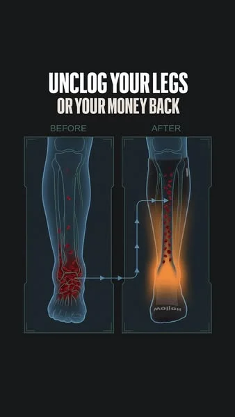
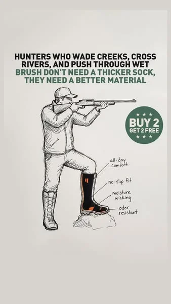
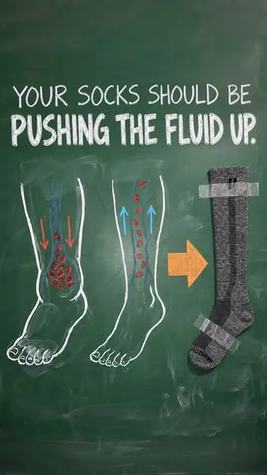
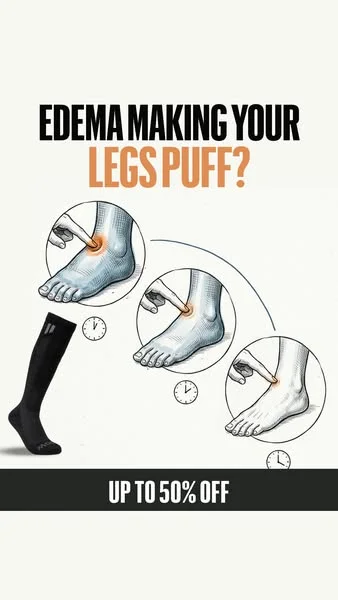
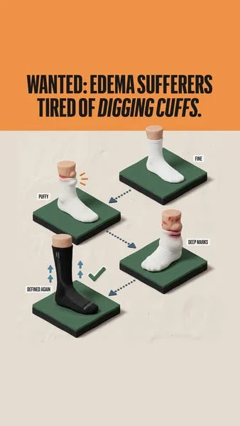
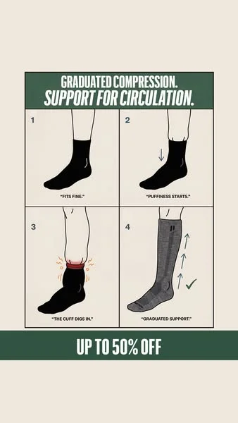
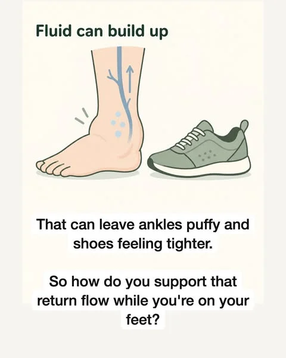
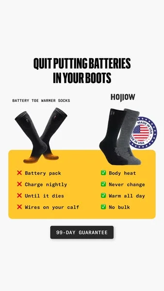
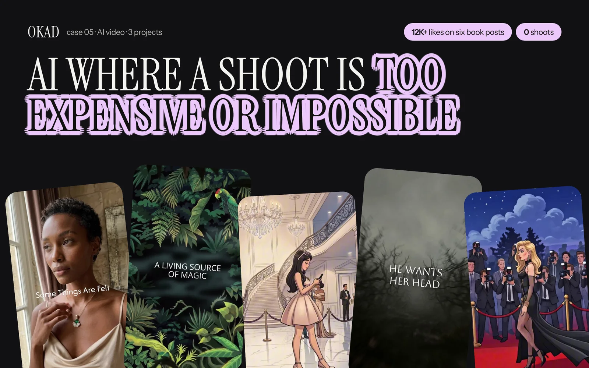

In October 2026, Hollow Alpaca Socks launched roughly 15 illustrated statics on Meta. Same product, same ad copy, same offer — but each ad used a completely different illustration style. Anatomy diagrams next to chalkboard sketches next to 3D claymation renders. The visual range looked like it came from five different agencies.

It did not. It came from one creative strategy insight: Meta's Andromeda algorithm treats visually similar ads as a single ad for delivery purposes. Ten product photos with the same composition, lighting, and layout get grouped together. The algorithm sees one ad shown ten times, not ten different ads. Illustration styles break this pattern. Each style looks fundamentally different to the algorithm, which means each variant gets independent distribution, independent testing, and independent performance data.

This is why illustration diversity — not just illustration — is the actual competitive advantage. One style is a creative choice. Eight styles is a testing system.

[Olga Kad](https://www.linkedin.com/in/o-kad) tracks this pattern across every client category at [OKAD](https://okad.agency). The brands testing multiple illustration styles are generating 3-5x more creative variants from the same messaging than brands locked into one visual approach. Here are the eight illustration styles that work in ad creative, what each communicates, and how to choose the right ones for your product.

## Why Style Diversity Matters More Than Ever

Before Meta's Andromeda update, creative diversity meant different messages. After Andromeda, it means different visuals for the same message.

The algorithm now groups ads by visual and thematic similarity. A December 2025 Meta post on creative diversification confirmed that the system clusters ads with shared visual traits and learns from them as a group. Ten variations of a product photo — different angle, different background color, different text placement — register as variations of one creative, not ten independent tests.

Illustration breaks this clustering. A pencil sketch of a sock and a 3D claymation render of the same sock share no visual DNA. The algorithm treats them as separate creatives, gives each its own delivery optimization, and produces independent performance data. This is the fastest way to get a genuinely new visual type into rotation without changing your message, your offer, or your audience.

The cost barrier that used to prevent this approach is gone. AI tools generate a new illustration style for a few dollars per image. The constraint is no longer budget — it is knowing which styles to test and when each works best.

## The 8 Styles

### 1. Anatomy and Blood Flow Diagrams

**What it looks like:** Medical-poster-style illustrations showing internal body mechanics — veins, blood flow direction, graduated pressure zones, cross-sections of tissue. Clean lines, warm-to-cool color gradients indicating flow direction, anatomical accuracy without the gore of actual medical photography.

**What it communicates:** Scientific credibility. The viewer sees a diagram that looks like it belongs in a medical textbook, which frames the product as a clinical solution rather than a consumer purchase. The style says "this is how your body works" before it says "buy this product."

**Best for:** Compression wear, orthopedic products, supplements that affect circulation or inflammation, skincare with ingredient-penetration claims, fitness recovery gear.

**Why it works:** You cannot photograph blood flow. You cannot photograph compression gradients. You cannot photograph what happens inside a joint when you wear a brace. But you can illustrate it — and the illustration makes the invisible mechanism visible. For products whose value proposition is an internal physiological effect, anatomy diagrams are the only format that shows the product actually working.

Moderation is another advantage. Real photos of varicose veins, swelling, or skin conditions get flagged or repulse viewers. An illustrated ankle with arrows showing fluid movement conveys the same medical information without the visceral reaction.

**Typical headlines:** "Your socks should be pushing the fluid up," "Graduated compression helps blood flow back up," "Unclog your legs or your money back."

### 2. Pencil and Textbook Sketch

**What it looks like:** Crosshatched line drawings with an engraving or woodcut aesthetic. Black-and-white or sepia tones. The visual language of old anatomy textbooks, scientific journals, and field guides.

**What it communicates:** Expertise and heritage. The style triggers associations with academic authority — this looks like something a professor drew on a blackboard, not something a marketing team produced. It reads as education, not advertising.

**Best for:** Products with a heritage angle, outdoor and hunting gear, artisanal goods, natural ingredients, anything targeting an audience that values tradition and craftsmanship over novelty.

**Why it works:** The pencil sketch style is the longest-running illustration format in competitive ad libraries. Hollow's hunting-line sketch ad ran for 40 days — more than double the average for their illustrated statics. The style's longevity likely comes from its distance from typical ad aesthetics. It does not look like an ad, so it does not trigger the automatic skip reflex that banner-blindness research has documented for decades.

The crosshatching and line work also create visual texture that photographs lack. In a feed dominated by smooth, high-resolution images, a sketch with visible pen strokes stands out the same way a hand-written sign stands out in a street of printed billboards.

**Typical headlines:** "Graduated pressure helps veins move blood up," product benefit claims paired with detailed anatomical or mechanical illustrations.

### 3. Chalkboard Drawing

**What it looks like:** Green or dark chalkboard background with white and colored chalk illustrations. Arrows, labels, simple diagrams explaining a mechanism. The visual language of a teacher explaining something on a school blackboard.

**What it communicates:** "Let me explain this simply." The chalkboard format is inherently educational — the viewer's brain shifts into learning mode. This primes them to absorb information rather than resist a sales pitch.

**Best for:** Products that require explanation — how a mechanism works, why an ingredient matters, how a feature differs from competitors. Any product where the buyer needs to understand a concept before they value the solution.

**Why it works:** The explanatory framing changes the viewer's relationship with the ad. Instead of "someone is trying to sell me something," the frame becomes "someone is teaching me something." The same compression sock diagram that reads as a sales pitch in a product photo reads as a mini-lesson on a chalkboard. The information is identical — the psychological frame changes how it is received.

The format also supports a clean one-thought-per-frame structure. One headline, one diagram, one mechanism, one offer badge. No competing visual elements. This clarity is why chalkboard-style ads consistently perform in categories where the product mechanism needs explaining.

**Typical headlines:** "Your socks should be pushing the fluid up" with directional arrows showing the compression mechanism, and a product image plus offer as the resolution.

### 4. Flat Cartoon People and Feet

**What it looks like:** Simplified cartoon figures — bold outlines, flat colors, exaggerated proportions. Often used in 3-4 frame progression sequences: swollen ankle → treatment → normal ankle. Clean, friendly, instantly readable at thumbnail size.

**What it communicates:** Accessibility and relatability. The cartoon style strips away the intimidation of medical imagery and makes health conditions feel approachable. Swelling becomes a visual problem you can see and understand, not a diagnosis you need a doctor to explain.

**Best for:** Health and wellness products targeting mainstream audiences (not medical professionals), products addressing embarrassing or sensitive conditions (foot problems, skin issues, digestive health), children's health products.

**Why it works:** The flat cartoon progression sequence is one of the most effective formats for before-and-after messaging. Real before-and-after photos face two problems: they trigger moderation reviews, and they can repulse viewers whose condition is not as severe as the photo. A cartoon progression shows the same transformation — swelling to normal, pain to relief — without either risk.

The format's simplicity also makes it one of the easiest to A/B test. Each frame is a standalone concept that can be rearranged, recolored, or relabeled without redrawing the entire illustration. Swap the headline and the CTA badge, and you have a new variant in minutes.

**Typical headlines:** "Your socks should help your legs feel lighter," "Edema making your legs puff?", "Get better support for edema."

### 5. 3D Claymation and Toy Scenes

**What it looks like:** Volumetric objects on display stands, in glass cases, or on pedestals. Soft studio lighting, clean shadows, pastel or muted backgrounds. The aesthetic of expensive product photography, but everything is rendered in a 3D illustrative style — as if the product exists in a Pixar short film.

**What it communicates:** Premium quality. The 3D render aesthetic signals that this brand invested in its presentation. The display-case framing positions the product as something worth examining closely, not scrolling past.

**Best for:** Consumer products where perceived quality matters — apparel, footwear, accessories, home goods, beauty packaging. Products that compete on materials, craftsmanship, or design rather than just function.

**Why it works:** The 3D claymation style occupies a visual niche that almost no competitor uses. UGC photos, lifestyle shots, and flat design are everywhere. A product floating on a soft-lit pedestal with volumetric shadows breaks the pattern entirely. It also allows creative flexibility impossible in photography — you can show cross-sections, exploded views, or impossible angles that reveal product features.

**Typical headlines:** "Wanted: edema sufferers tired of digging cuffs," "Bye bye edema."

### 6. Four-Panel Comic Strip

**What it looks like:** A 2x2 or 1x4 grid of sequential panels telling a micro-story. Each panel advances the narrative: problem → worsening → discovery → solution. Panel borders, numbered sequence, brief text per panel.

**What it communicates:** Story structure. The comic strip format creates a narrative arc in a single static image. The viewer reads it like a story — which means they process all four panels instead of glancing at a single image and scrolling on.

**Best for:** Products where the use case has multiple steps or a progression over time. Fitness programs, subscription products, skincare routines, any product where results accumulate.

**Why it works:** Four-panel comics exploit a cognitive bias: the brain wants to complete a sequence. When a viewer sees panels 1 and 2 showing a problem getting worse, they feel compelled to see panels 3 and 4 to find the resolution. This is the same mechanism that makes carousel ads outperform single images on engagement — sequential content holds attention longer.

**Typical headlines:** "Graduated compression. Support for circulation." with numbered panels showing: regular socks dig in → swelling worsens → graduated compression applies → proper circulation restored.

### 7. Photo and Illustration Hybrid Carousel

**What it looks like:** A multi-slide carousel where most slides are real photos (a person's story, lifestyle shots, product in use) but 2-3 middle slides switch to illustrated diagrams explaining the mechanism. The effect is a personal story interrupted by a quick science lesson, then returning to the personal narrative.

**What it communicates:** "This is a real person's experience, and here is the science behind why it works." The hybrid format combines UGC-level trust (real face, real story) with illustration-level explanation (mechanisms, diagrams, data).

**Best for:** Products that need both social proof and technical explanation. The hybrid format lets you tell a relatable story and explain the mechanism in one ad unit, without either element feeling forced.

**Why it works:** Each format covers the other's weakness. Photos alone cannot show internal mechanisms. Illustrations alone cannot provide social proof. The hybrid carousel delivers both in a single swipe sequence. The format shift from photo to illustration also creates a pattern interrupt mid-carousel that recaptures attention if the viewer started to disengage.

**Typical structure:** Slides 1-3 (photo): "I thought puffy ankles were just part of getting older." Slides 4-5 (illustration): "Fluid can build up / That can leave ankles puffy / Here is how compression supports return flow." Slides 6-9 (photo): Product, testimonial, offer.

### 8. Product Schematics and Cross-Sections

**What it looks like:** Technical drawings showing the product's construction — materials, zones, reinforcement points, layer breakdowns. The visual language of engineering blueprints or product spec sheets. Often includes comparison graphics: the old way vs. the new way.

**What it communicates:** Engineering rigor. The schematic style tells the viewer that this product was designed, not just manufactured. Every labeled zone and material callout reinforces the impression that someone thought carefully about every detail.

**Best for:** Products competing on construction quality, materials, or engineering — footwear, outdoor gear, tech accessories, cookware, tools, furniture. Any product where the materials or build quality is the differentiator.

**Why it works:** Schematics answer the question "why does this cost more?" without the viewer having to ask it. A cross-section showing reinforced heel, rib zone, and compression gradient justifies the premium through visual evidence. The format also works as a comparison tool — "batteries in boots" vs. "alpaca insulation" is an argument that lands in a single image.

**Typical headlines:** "Quit putting batteries in your boots" with a side-by-side comparison, cross-section diagrams showing sock zones and reinforcement points.

## How to Test Styles: The Same-Text Method

The most efficient way to test illustration styles is the method brands like Hollow use: identical copy across multiple visual styles.

**Step 1: Lock one message.** Write a single headline, body, and CTA. This becomes your control copy.

**Step 2: Produce that message in 4-6 styles.** Using AI tools (Midjourney, Flux, or Ideogram for text-heavy layouts), generate the same ad in anatomy, sketch, flat cartoon, 3D, and schematic styles. Keep text placement and offer badges identical.

**Step 3: Launch all variants simultaneously.** Same budget per variant, same audience, same placement. Run for 3-5 days or until each variant has $50-$100 in spend.

**Step 4: Read the data.** The winning style tells you how your audience wants to receive information visually. The losing styles are not failures — they are data that prevents you from guessing next month.

**Step 5: Iterate within the winning style.** Once you know which visual language resonates, test copy variations, layout changes, and offer positioning within that style. Now you are optimizing the message, not the format.

This approach produces 4-6x more visual diversity from a single copywriting effort. For brands running [structured creative testing](/blog/blog-creative-testing-methodology/), it multiplies every copy test by the number of styles in rotation.

## Choosing Styles for Your Product

Not every style works for every product. Here is a quick matching guide:

| Product Category | Primary Styles | Secondary Styles |
|---|---|---|
| Compression / orthopedic | Anatomy, flat cartoon | Chalkboard, schematic |
| Supplements / wellness | Anatomy, flat cartoon | Pencil sketch, comic strip |
| Outdoor / hunting gear | Pencil sketch, schematic | 3D claymation |
| Apps / SaaS | Flat cartoon, comic strip | Chalkboard, hybrid carousel |
| Beauty / skincare | Flat cartoon, 3D | Hybrid carousel |
| Home goods / furniture | 3D claymation, schematic | Pencil sketch |
| Fitness / recovery | Anatomy, flat cartoon | Comic strip, chalkboard |
| Food / beverage | 3D claymation, pencil sketch | Comic strip |

The general principle: if your product's value is invisible (internal mechanisms, long-term effects, ingredient quality), lead with styles that make the invisible visible — anatomy, chalkboard, schematic. If your product's value is visible but benefits from personality, lead with styles that add character — flat cartoon, comic strip, 3D.

## The Video Extension: Pixar-Style Animated Characters

Illustration styles are not limited to static ads. The same visual logic extends to animated video.

Hollow runs Pixar-style animated videos featuring a grandmother character — "Women over 55" — targeting an older female audience. The character is relatable (looks like the viewer), brand-safe (no real person to manage), and infinitely reusable across different scripts and scenarios. The style works because it combines the pattern interrupt of animation with the relatability of a character the audience sees themselves in.

For brands exploring animated ad production, this is the natural next step after finding a winning illustration style in static format. Take the style that performed best and extend it into motion. A winning anatomy diagram becomes an animated blood flow video. A winning flat cartoon becomes a character-driven testimonial. The visual language carries over — only the medium changes.

For a detailed production guide on turning illustration concepts into animated ads, see our guide to [AI cartoon ad production](/blog/blog-ai-cartoon-ads/).

## The Strategic Takeaway

Illustration styles are not decorative choices. They are targeting tools. Each style primes the viewer to receive your message in a specific psychological frame — scientific authority, accessible education, premium quality, relatable story. Choosing the right frame for your audience and product is a strategic decision, not an aesthetic one.

The brands producing one illustration style are leaving performance on the table. The brands testing eight styles with the same copy are generating eight independent data points per message — and the algorithm rewards them with eight independent distribution paths.

The production cost of testing multiple styles has collapsed. AI tools generate a new style in minutes. The only remaining bottleneck is knowing which styles exist, what each communicates, and which matches your product. This guide is the map. The testing is up to you.

For the [full creative strategy framework](/blog/blog-ad-creative-strategy/) behind systematic ad testing, see our complete guide.

## Testing Multiple Styles Without Multiple Vendors

Testing 8 illustration styles through separate freelancers means managing 8 relationships — 8 briefing sessions, 8 revision cycles, 8 invoices, and 8 different interpretations of "flat cartoon" or "medical diagram." By style number 4, most marketing managers give up and ship whatever arrived first.

At OKAD, the same AI production team generates all 8 styles from a single creative brief. One strategy session defines the product mechanism, the headline, and the offer. The production team then generates the full style matrix — anatomy, sketch, chalk, flat cartoon, 3D, comic, hybrid, and schematic — in a single production sprint. The output: 8 visually distinct ads ready for testing, produced in days rather than weeks.

The advantage compounds in the testing phase. When the data comes back showing that anatomy diagrams and flat cartoons outperform the other 6 styles, OKAD's team immediately produces 10-15 variations within those winning styles — different layouts, different headline placements, different offer badges — without switching vendors or re-briefing anyone. The same team that produced the test batch produces the scale batch. No context loss. No ramp-up time. One retainer covers strategy, production, and iteration across all [illustration styles](/blog/blog-illustrated-ads-meta-andromeda/) and [animated formats](/blog/blog-ai-cartoon-ads/).

*OKAD generates all 8 illustration styles from a single creative brief — one team, one retainer, full style matrix ready for testing. [See the full case study](/cases/case-5public/).*

## Work With OKAD

OKAD produces illustrated and animated ad creatives as part of a full creative strategy service — research, briefs, production, and testing in one retainer. No per-asset pricing. No retainer lock-in.

**[See pricing and book a call](/pricing)** · Or email [olga@okad.agency](mailto:olga@okad.agency) with your monthly ad spend and goals.
