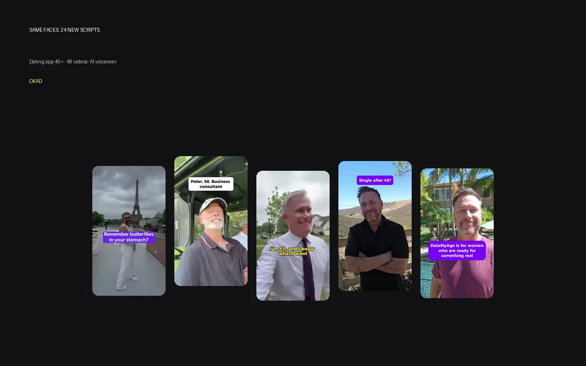

You have a winning ad in English. It converts. The CPA is dialed in. The natural next step is to duplicate the campaign, point it at Germany or France or the UAE, and watch the results roll in.

Then the results come in — and CPA is 40% higher than your English campaign. The creative that dominates in the US barely registers in non-English markets. The issue is not the product or the audience. It is the creative. Running English ads in non-English markets works, but it works at a significant performance penalty.

Localization closes that gap. The question is not whether to localize — it is how much localization your budget and scale justify. Here are four levels, ranked by investment and performance impact, with a framework for deciding which level makes sense for each market you operate in.

## Level 1: Subtitle Translation

The simplest and cheapest form of localization. Take your existing video ad, translate the spoken content into subtitles in the target language, and run it.

**Cost:** $10-30 per video
**Turnaround:** Same day
**Performance lift:** 10-20% CPA improvement over English-only in non-English markets

**Why it works:** 80%+ of social media users watch video with sound off. Subtitles are often the primary way viewers consume your ad's message. Translating those subtitles removes the language barrier for the majority of your audience without changing anything else about the creative.

**Limitations:** The spoken audio is still in English. Viewers who watch with sound on hear a foreign language, which creates a disconnect. The creator's body language, setting, and cultural context are still clearly non-local.

**Best for:** European markets (where subtitle culture is strong), initial market testing, limited budgets.

### Subtitle production tips

- Translate the meaning, not the words. Ad copy in German should sound like German ad copy, not like translated English
- Keep subtitle timing synced with the visual beats — a benefit claim should appear on screen when the relevant product feature is shown
- Use a native speaker for QA. Machine translation catches the words but misses the idiom. "Works like magic" translated literally into French sounds bizarre
- Match font size to platform. TikTok needs larger text than Instagram feed

## Level 2: AI Voiceover Dubbing

Replace the English voiceover with an AI-generated voice in the target language. The video stays the same — only the audio track changes.

**Cost:** $30-80 per video
**Turnaround:** 2-4 hours with current tools
**Performance lift:** 15-30% CPA improvement over English-only

**Why it works:** The ad sounds native. Viewers who watch with sound on hear their own language, which dramatically increases engagement and comprehension. Combined with translated subtitles, the ad feels localized even though the visual content is unchanged.

**Current tools:** ElevenLabs, Rask.ai, and HeyGen all offer multi-language dubbing with lip-sync capabilities. Quality has improved significantly in 2025-2026 — for informational or product-focused content, AI dubbing is now indistinguishable from human voiceover for most viewers.

**Limitations:** AI dubbing works best when the original audio is a voiceover (not direct-to-camera speech). Lip-sync technology exists but is imperfect — close-up talking-head shots reveal the mismatch. Emotional nuance is weaker than human performance.

**Best for:** Screen recordings, product demos, voiceover-driven ads, markets where you are spending $2-5K per month.

### When AI dubbing falls short

For ads built around a creator's personality — their humor, their delivery, their emotional authenticity — AI dubbing strips away the performance that made the ad work. If the creator's charisma is why the ad converts, dubbing replaces the thing that matters most. In those cases, skip to Level 3 or 4.

## Level 3: Script Adaptation

Rewrite the ad script for the target market's cultural context, then have the original creator (or a similar one) perform the adapted script. The message is the same, but the framing, references, and tone match local expectations.

**Cost:** $100-200 per market per ad
**Turnaround:** 3-5 days
**Performance lift:** 25-35% CPA improvement over English-only

**Why it works:** Cultural context matters more than language. A US ad that opens with "Black Friday deal" means nothing in the Middle East. A UK ad referencing "the school run" does not resonate in Spain. Script adaptation rewrites these cultural touchpoints while preserving the winning message structure.

**What changes in adaptation:**
- Currency and pricing (dollars to euros, pounds, dirhams)
- Cultural references and seasonal hooks
- Humor style (American sarcasm does not travel well to most Asian markets)
- Social proof framing (number of users vs expert endorsement vs celebrity association)
- Compliance language (health claims, financial disclaimers vary by jurisdiction)

**Best for:** Markets where you are spending $5K+ per month, products with cultural sensitivity (food, beauty, health, finance), high-ticket items where trust matters.

## Level 4: Full Local Creator Reshoot

Cast a local creator who matches the target market's demographic, film fresh content in the local language with culturally relevant settings and context. This is the gold standard of localization.

**Cost:** $200-500 per market per ad
**Turnaround:** 1-2 weeks
**Performance lift:** 30-50% CPA improvement over English-only

**Why it works:** Everything is native — the face, the voice, the setting, the cultural context. The viewer sees someone who looks like them, speaks like them, and lives in a context they recognize. This eliminates every friction point that localized-but-foreign content creates.

**When it is worth the investment:** In markets where you are spending $10K+ per month and the product has local competition. If a local competitor is running local-creator content and you are running dubbed American UGC, you will lose on trust every time.

## Localization Level Comparison

| Level | Cost per video | Turnaround | CPA improvement | Best for |
|---|---|---|---|---|
| Subtitle translation | $10-30 | Same day | 10-20% | EU, initial testing, low budget |
| AI voiceover dubbing | $30-80 | 2-4 hours | 15-30% | Product demos, screen recordings |
| Script adaptation | $100-200/market | 3-5 days | 25-35% | Cultural products, $5K+/month markets |
| Full local reshoot | $200-500/market | 1-2 weeks | 30-50% | Core markets, $10K+/month spend |

## The Testing Framework

Do not localize everything at once. Use a progressive approach that invests more as you validate each market.

### Phase 1: Validate with subtitles ($100 budget per market)

Take your top 5 performing English ads. Add subtitles in the target language. Run them for 2 weeks at $50-100 per ad. If CPA is within 30% of your English baseline, the market has potential.

### Phase 2: Test AI dubbing on winners ($200-400 per market)

Take the 2-3 ads that performed best with subtitles. Produce AI-dubbed versions. Run a head-to-head test: subtitled vs dubbed, same budget, same audience. If dubbed outperforms by 15%+, the market justifies deeper investment.

### Phase 3: Adapt scripts for top markets ($500-1,000 per market)

For markets where dubbed content performs well, rewrite the top 2-3 scripts for local context. Test adapted vs dubbed versions. The performance gap tells you whether cultural adaptation matters for your product in that specific market.

### Phase 4: Local creators for core markets ($1,000-2,500 per market)

Only for your top 2-3 international markets where you are spending $10K+ per month. Cast local creators, produce fully native content, and run it alongside your adapted versions. This is where you compete with local brands on equal terms.

## Visual Localization Beyond Language

Language is the obvious localization layer, but visual elements matter just as much:

**Currency and pricing.** If the ad shows a price, show it in local currency. $29.99 means nothing to someone in Germany — show €27.99.

**Product context.** Lifestyle shots should reflect local reality. Kitchens, streets, clothing, and weather should match the target market. A UGC ad filmed in a sunny California kitchen does not resonate with someone in Manchester.

**Text overlays.** Every piece of on-screen text needs translation — headlines, bullet points, CTAs, disclaimers. Missing even one creates a jarring bilingual experience.

**Models and demographics.** The person in the ad should reflect the target audience. This intersects with our [guide to finding UGC creators by country](/blog/blog-find-ugc-creators-by-country/) — matching the creator to the market is the most impactful localization decision you make.

## Multi-Market Campaign Architecture

Two approaches work for multi-market campaigns:

**Approach 1: One global campaign, local ad sets.** A single campaign targeting multiple countries with different ad sets per market. Each ad set contains the localized version of your winning creatives. Meta's algorithm optimizes spend across markets based on performance. Simpler to manage, harder to control per-market budgets.

**Approach 2: Separate campaigns per market.** Each market gets its own campaign with its own budget, its own creative, and its own optimization targets. More work to manage, but gives you full control over spend allocation and allows market-specific CPA targets.

For most brands, Approach 1 works until you are spending $10K+ per month in a single market. At that point, breaking the market into its own campaign gives you better control and cleaner data.

## How OKAD Handles Multi-Market Creative

*DateMyAge runs across 6 markets. OKAD produces base creative in English, then localizes with native subtitles and market-specific hooks. Localized versions outperform English-only by 25-40% in non-English markets.*

When [Olga Kad](https://www.linkedin.com/in/o-kad) and the [OKAD](https://okad.agency) team manage multi-market campaigns, the localization strategy is built into the production process from day one. Every creator brief includes a localization plan — which markets will receive which level of adaptation, and which raw assets need to be captured for future localization.

This is why [usage rights](/blog/blog-ugc-creator-rates-pricing/) and raw file access matter: when you own the raw footage with perpetual rights, localizing a winning ad for a new market costs $30-200 instead of $300-500 for a full reshoot. OKAD includes perpetual rights and raw files by default for exactly this reason.

For brands scaling across markets, our [high-volume UGC production](/blog/blog-high-volume-ugc-production/) process is designed to handle localization as a production step, not an afterthought.

## Work With OKAD

OKAD produces and localizes ad creative across markets — from subtitle translation to full local creator shoots — as part of a creative strategy retainer. We handle creator sourcing in 40+ countries, script adaptation, dubbing, and testing. One team, all markets.

**[See pricing and book a call](/pricing)** · Or email [olga@okad.agency](mailto:olga@okad.agency) with your current markets, monthly spend per market, and creative volume — we reply with a localization plan.
