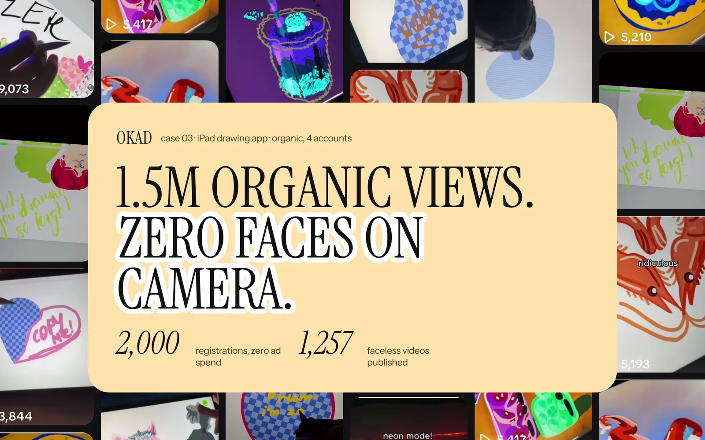

Mobile game advertising is the most creative-intensive paid media environment that exists. E-commerce brands test 20 creatives per month and consider that aggressive. Game studios test 100 per week and consider that baseline. The difference is not ambition — it is math. When a single winning creative can drive millions of installs before it fatigues in five days, the entire business model depends on finding the next winner before the current one dies.

The challenge is not production — AI tools have collapsed the cost of generating game ad variations to near zero. The challenge is knowing what to test, how to evaluate results at scale, and how to build a creative system that produces winners consistently rather than accidentally.

## Why CPI Is the Only Metric That Matters

In mobile game advertising, cost per install is the metric that determines whether a creative lives or dies. Not impressions. Not click-through rate. Not video views. CPI.

A creative with a 5% CTR and a $3 CPI is worse than a creative with a 2% CTR and a $1 CPI. The algorithm optimizes for installs, and your budget is measured in installs, so the only creative performance metric worth tracking is the cost of acquiring each one.

This creates a very specific creative discipline. Every decision — the opening frame, the gameplay moment shown, the text overlay, the call to action — is evaluated against one question: does this lower CPI?

## Four Ad Formats That Lower CPI

### 1. Gameplay Footage: The Core Loop in 3 Seconds

The highest-performing game ads show the most satisfying or addictive mechanic in the first three seconds. Not a cinematic intro. Not a logo reveal. The actual gameplay that makes the game worth playing.

For a puzzle game, that is a chain reaction solving half the board. For a builder, it is a satisfying construction sequence. For an idle game, it is the numbers going up. The viewer should understand what playing this game feels like within the first swipe of their thumb.

**Production tip:** Record the most visually satisfying 10 seconds of gameplay, then cut it to start at the peak moment. The buildup happens in the viewer's imagination — they see the payoff and want to experience the setup themselves.

### 2. "I Can't Stop Playing" UGC

A creator plays the game on camera. The format is simple: split-screen or picture-in-picture showing both the creator's face and the gameplay. The value is in the genuine reactions — frustration at a near-miss, excitement at a high score, the visible compulsion to try "just one more time."

This format works because it borrows the trust mechanics of [UGC advertising](/blog/blog-ugc-video-ads-that-convert/) while showcasing actual gameplay. The creator's reaction tells the viewer: this game is genuinely fun, not just well-marketed. It consistently beats polished animated ads on CPI for casual and mid-core titles.

**Best for:** casual games, puzzle games, any title with a visible addiction loop.

### 3. Fail/Win Compilations

A rapid sequence of gameplay moments — near-misses, spectacular failures, and satisfying wins. The format triggers the "I could do better" response, which is one of the strongest install motivators in gaming.

Structure: 3 to 4 fail moments (building tension and frustration), then 1 big win (the payoff). Total length: 15 to 20 seconds. The viewer watches someone struggle, imagines themselves succeeding, and installs to prove it.

**Best for:** skill-based games, runners, shooters, platformers.

### 4. Expected vs Reality / Level Progression

Side-by-side or sequential comparison showing early-game versus late-game, or what the player expected versus what actually happened. This format works on curiosity — the gap between the two states makes the viewer want to experience the progression themselves.

The "Level 1 vs Level 100" variant is particularly effective because it shows the aspiration state. The viewer sees a basic character or base, then a massively upgraded version, and wants to experience that growth arc.

**Best for:** RPGs, strategy games, base builders, any game with visible progression.

## Testing at Game-Industry Scale

The fundamental difference between game creative testing and e-commerce creative testing is volume. Here is what the numbers look like:

| Metric | E-commerce | Mobile Games |
|---|---|---|
| New creatives tested per month | 20-50 | 50-200+ |
| Expected hit rate | 15-20% | 1-5% |
| Winner lifespan | 2-4 weeks | 3-7 days |
| Test budget per creative | $50-100 | $20-50 |
| Kill criteria | 48h, 2x CPA target | 24-48h, CPI above genre benchmark |
| Scaling timeline | 5-7 days | 1-3 days |

The low hit rate is not a failure — it is the natural consequence of testing at the frontier of what works. If your hit rate is above 10%, you are probably not testing creative that is different enough from what you already know works. The breakthroughs come from the unexpected winners in the 1-3% range.

### The Testing Cadence

**Daily:** Launch 3 to 5 new creatives. Monitor CPI against genre benchmarks after 1,000 impressions.

**48-hour checkpoint:** Kill any creative with CPI above 1.5x your target. Promote anything below target to a scaling campaign.

**Weekly:** Review the top 5 performers. Identify the common elements — hook type, gameplay moment, format, pacing — and brief the next batch based on those patterns.

**Monthly:** Full creative audit. Which formats are trending down? Which audiences respond to which styles? Adjust the production mix for the next month.

## Creative Fatigue in Gaming: 3 to 7 Days

[Ad fatigue](/blog/blog-ad-fatigue-prevention/) hits game ads faster than any other category. A winning creative that delivers $0.50 CPI on Monday can be at $2.00 by Friday. The reason: game advertisers target relatively narrow audiences (people who install similar games) at high frequency. Once the most responsive users have seen the ad 3 to 4 times, the novelty is gone and CPI spikes.

This creates a relentless creative treadmill. You need a new winner every 3 to 7 days, which means your testing pipeline must produce at least one winner per week to sustain performance. At a 2% hit rate, that requires testing 50 new creatives per week.

The solution is not to work harder. It is to work systematically:

**Variation production.** When a creative wins, immediately produce 10 to 20 variations: different opening frames, different text overlays, different gameplay moments in the same format, different aspect ratios. Each variation resets the fatigue clock while preserving the winning concept.

**Format rotation.** Alternate between UGC, gameplay footage, fail compilations, and progression comparisons. When one format fatigues across the account, the other formats are still fresh to the audience.

**Audience expansion.** As a creative fatigues with your core audience, shift it to lookalike or broader audiences where it has not yet been seen. The creative is not dead — it is just exhausted with one group of people.

## AI-Assisted Creative Production

AI tools have transformed game creative production from a bottleneck to a commodity. The cost per variation has dropped from $50 to $100 (designer time) to under $5 (AI generation plus human QA).

Where AI delivers the most value in game advertising:

**Visual variations.** Take a winning creative concept and generate 20 visual variants — different character skins, different color palettes, different background environments. Each variant is distinct enough that the algorithm treats it as a new creative.

**Text overlay testing.** AI generates dozens of headline and CTA variations for the same visual. "Play now" versus "Can you beat Level 50?" versus "97% of players can't pass this level" — each triggers a different psychological response.

**Thumbnail optimization.** AI generates multiple thumbnail options for the same video, testing which static frame drives the highest click-through from the feed.

**Format conversion.** Turn a winning 30-second video into 15-second and 6-second cuts, vertical and square aspect ratios, and static frames for display placements. One winning concept becomes 10 to 15 platform-optimized variations.

The human role shifts from production to strategy and quality control. The creative director's job is not to make the ads — it is to define what to test, evaluate results, and direct the AI pipeline toward the patterns that are working.

## CPI Benchmarks by Genre (2026)

| Genre | Typical CPI (US, Meta) | Creative Volume Needed | Dominant Format |
|---|---|---|---|
| Hyper-casual | $0.10-$0.50 | 100+/month | Gameplay footage |
| Casual (puzzle, match) | $0.50-$2.00 | 50-100/month | Fail/win + UGC |
| Mid-core | $2.00-$8.00 | 30-60/month | UGC + progression |
| Strategy / 4X | $5.00-$15.00 | 20-40/month | Cinematic + progression |
| RPG | $5.00-$12.00 | 30-50/month | Character showcase + UGC |

These benchmarks assume US targeting on Meta. TikTok CPIs tend to be 20 to 40% lower for casual and hyper-casual. Non-US markets (Southeast Asia, Latin America) can be 50 to 80% lower.

*OKAD produced faceless UGC content for a drawing app — the satisfying creation process became the hook, driving 60% lower CPI than polished brand ads. [See the full case study](/cases/drawing-app-faceless-ugc/).*

## The Creative System, Not the Creative

The studios winning in mobile game advertising in 2026 are not the ones with the best individual ads. They are the ones with the best creative systems — the pipeline that produces, tests, evaluates, and iterates at the speed the market demands.

A single brilliant creative is worth 3 to 7 days of good performance. A creative system that produces one winner per week is worth an entire year of sustained growth. Build the system, and the winners take care of themselves.

For brands applying [creative testing methodology](/blog/blog-creative-testing-methodology/) from other industries to gaming, the principles are the same — test systematically, kill fast, scale winners, replace before fatigue. The only difference is speed. Everything in gaming happens 5 to 10x faster than in e-commerce. For app-specific creative formats, our [app demo UGC ads guide](/blog/blog-app-demo-ugc-ads/) covers screen recording, hands-on, and split-screen formats. And understanding [why winning ads stop working](/blog/blog-why-winning-ads-stop-working/) helps you plan replacement creative before fatigue hits.

## Work With OKAD

OKAD produces ad creative and runs structured testing programs for apps, games, and DTC brands — from strategy and scripts to production and performance reporting. No per-asset pricing. No retainer lock-in.

**[See pricing and book a call](/pricing)** · Or email [olga@okad.agency](mailto:olga@okad.agency) with your monthly ad spend and goals.
