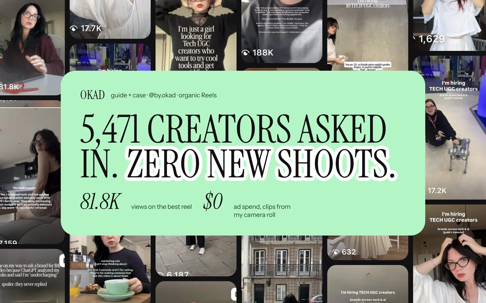

Every brand eventually faces this question: should we invest deeply in one or two great creators, or spread the budget across many?

The instinct is to find one perfect creator and build around them. They know your product, they deliver consistently, and the relationship is easy to manage. But the data consistently shows that creator diversity outperforms creator loyalty — sometimes dramatically.

Here is why, and how to build a creator roster that scales with your ad spend.

## Why the Algorithm Rewards Multiple Creators

Meta's ad delivery system treats ads with the same visual elements as variations of the same creative. A single creator filming 10 videos in the same room with the same lighting produces content that the algorithm clusters together — it looks like one ad, not ten.

Multiple creators solve this mechanically. Different faces, different environments, different speaking styles — each combination registers as a genuinely new creative. The algorithm gets more signals to test. Your audience sees more variety. And your effective creative volume is higher even if the total number of videos is the same.

This is the same principle behind [visual diversity in illustrated ads](/blog/blog-illustrated-ads-meta-andromeda/), applied to creator content. The algorithm rewards novelty. Multiple creators are the simplest way to produce it.

## The 3-5 Video Sweet Spot

How many videos should you order from a single creator? The answer is **3-5 per brief cycle**, and the reasoning comes from two sides:

**Fewer than 3 wastes onboarding.** Every new creator relationship has a fixed cost — casting, vetting, briefing, feedback, revision management. Whether the creator films 1 video or 5, you pay that cost once. Spreading it across 3-5 deliverables brings the per-video management cost down significantly.

**More than 5 risks fatigue.** When the same face appears in 6+ ads running simultaneously, audiences in your retargeting pool see that person repeatedly. The UGC format works because it feels like a real recommendation from a real person. Overexposure on the same face breaks that illusion — it starts feeling like a paid spokesperson, not organic content.

The exception is founder-led brands where the founder IS the creator. In that case, the face is the brand, and frequent exposure builds recognition rather than fatigue. But for hired UGC creators, 3-5 is the range that maximizes output per creator without diminishing returns.

## When One Creator Is Enough

A single-creator strategy makes sense in specific situations:

- **Founder-led brands** where the founder's face is the brand identity
- **Personal brands** selling courses, coaching, or expertise
- **Micro brands** spending under $2,000/month on ads where production budget is tight
- **Brands with a celebrity or influencer partnership** where exclusivity is part of the deal

In these cases, the creator's personal relationship with the audience is the asset. Swapping in a new face would undermine the connection that drives performance.

But for most DTC, app, and service brands — where the product is the star and the creator is the messenger — multiple creators outperform a single voice.

## How to Build a Roster: The Practical System

### Month 1: Cast Wide, Test Fast

Start with **3-5 creators** from different demographics. If your product targets women 25-45, cast:

- One creator in their mid-20s with an energetic, unboxing-style delivery
- One creator in their mid-30s with a relatable, day-in-my-life style
- One creator in their 40s with a more authoritative, review-style approach

Brief all three with the same core message and offer. Run their content as ads with identical budgets. The performance data tells you which creator style resonates with YOUR audience — not which creator you personally prefer.

### Month 2: Keep Winners, Add New

After 2-3 weeks of data:

- **Keep the 1-2 top-performing creators.** Order 3-5 new videos from each with refined scripts based on what worked.
- **Pause the underperformers.** Do not cut them permanently — they may work for different angles or seasonal content later.
- **Add 2-3 new creators.** This maintains diversity and gives you fresh faces to test against the proven performers.

### Ongoing: Rotate Consistently

The long-term rhythm is:

- **Active roster: 5-10 creators** at any given time
- **New additions: 2-3 per month** to replace fatigued faces and test new demographics
- **Graduation: 1-2 per quarter** become long-term partners based on consistent performance

This rotation means you always have fresh creative entering the pipeline while maintaining a core of proven performers.

## Creator Fatigue: The Signal to Rotate

The clearest signal that a creator has fatigued is **rising CPA on their specific content** while other creators' content holds steady.

When you see a creator's ads climbing from a $15 CPA to $22 over 2-3 weeks while the account average stays at $16, that creator's face has saturated your target audience. The content itself may still be strong — the audience has just seen it too many times.

The fix is not to stop running that creator entirely. Instead:

1. **Reduce spend** on their current ads to slow frequency buildup
2. **Introduce a new creator** to the same audience segment
3. **Rest the fatigued creator** for 4-6 weeks, then reintroduce with fresh scripts

This rotation pattern is the same [ad fatigue prevention](/blog/blog-ad-fatigue-prevention/) framework applied at the creator level rather than the creative level.

## Matching Creators to Markets

Six out of ten brands that come to OKAD need creators from specific countries or demographics. The reason is straightforward: audiences trust people who look and sound like them.

| Target Market | Creator Requirements | Sourcing Approach |
|---|---|---|
| United States | English-speaking, diverse demo | Largest pool — platforms and databases |
| United Kingdom | British accent, UK setting | Smaller pool — agency databases preferred |
| European Union | Local language or English with local look | Country-specific casting, dubbing for multi-market |
| Gulf States (UAE, Saudi) | Arabic-speaking, culturally appropriate | Specialized agency networks |
| South Asia (India, Pakistan) | Local language, regional appearance | Direct outreach + local agency partners |
| Australia/NZ | Australian/NZ accent | Small but growing pool on platforms |

For brands running ads in multiple markets — which is increasingly common as Meta's Advantage+ campaigns expand targeting automatically — you need creators that match each market. A British creator selling to a UK audience converts better than an American creator, even with the same script.

OKAD maintains a network of vetted creators across 40+ countries. For each brief, we match 3-5 creators based on target demographic, content style, and platform. This eliminates the sourcing bottleneck that slows down multi-market campaigns.

## Roster Size by Budget

| Monthly Ad Spend | Active Creators | New Per Month | Videos Per Creator |
|---|---|---|---|
| $1,000-$3,000 | 2-3 | 1-2 | 2-3 |
| $3,000-$10,000 | 4-8 | 2-3 | 3-5 |
| $10,000-$30,000 | 8-15 | 3-5 | 3-5 |
| $30,000+ | 15+ | 5+ | 3-5 |

Notice that the videos-per-creator column stays constant at 3-5 regardless of budget. What scales is the number of creators, not the depth per creator. This is the key insight: scaling UGC production means widening your creator roster, not squeezing more content from the same faces.

For brands that need high volume without expanding their creator roster, [AI-generated and faceless UGC formats](/blog/blog-faceless-ugc-for-brands/) can supplement human creator content — but they serve different functions in the ad account.

## The Cost of Getting This Wrong

The most expensive mistake in UGC is not hiring bad creators — it is hiring one good creator and depending on them entirely.

When your single creator gets sick, takes a vacation, raises their rates, or simply fatigues with your audience, your entire creative pipeline stops. There is no backup. There is no diversity. And rebuilding from zero takes weeks.

Brands that invest in a 5-10 creator roster from the start never face this problem. If one creator drops out, the other four keep producing. If one fatigues, two new ones are already in the pipeline. The system is resilient because it does not depend on any single person.

This is the same principle behind hiring a team instead of relying on a freelancer. Individuals are unreliable at scale. Systems are not.

*OKAD matches creators from a vetted database of 5,471+ across 40+ countries. [See the full case study](/cases/by-okad-camera-roll-creators/).*

## How OKAD Handles Creator Sourcing

When [Olga Kad](https://www.linkedin.com/in/o-kad) onboards a new client, the first step is always a creator brief:

- **Who is the target audience?** Age, gender, location, lifestyle
- **What creator style fits?** Talking head, lifestyle, ASMR, unboxing, tutorial
- **What markets are we targeting?** US only, UK, EU, multi-market
- **What existing creator content has worked or failed?**

From there, we pull 5-10 candidates from our network, present options, and cast the first batch within 3-5 business days. The client approves the creators, we handle briefing and management, and the first content delivers within 2 weeks.

For [building your own creator network](/blog/blog-how-to-build-creator-network/) without agency support, the process takes longer — typically 4-6 weeks of sourcing, vetting, and test-filming — but follows the same roster-building principles.

## The Bottom Line

One creator is a person. Multiple creators are a system. And systems scale.

Start with 3-5 diverse creators. Order 3-5 videos from each. Test, measure, keep the winners, rotate the rest. Add 2-3 new creators every month. Never let your entire pipeline depend on a single face.

The brands that scale their [UGC programs](/blog/blog-ugc-video-ads-that-convert/) to $20K, $50K, $100K+ per month in ad spend all arrive at the same conclusion: creator diversity is not a nice-to-have, it is infrastructure.

## Work With OKAD

OKAD sources, briefs, and manages UGC creators as part of every production package. One retainer covers strategy, creator matching, filming coordination, editing, and delivery. No per-creator markups. No sourcing fees.

**[See pricing and book a call](/pricing)** · Or email [olga@okad.agency](mailto:olga@okad.agency) with your monthly ad spend and goals.
