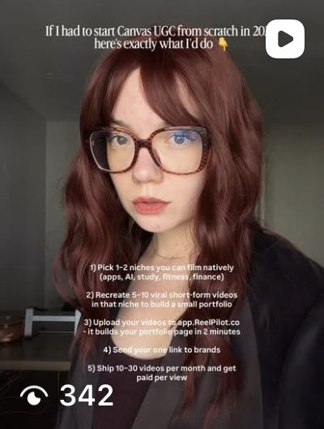
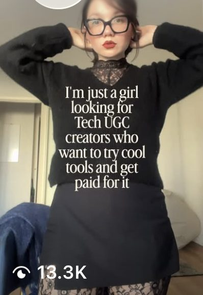

Every brand scaling paid social hits the same inflection point: the founder or marketing manager who has been writing ad briefs and reviewing creative cannot keep up. Performance is slipping because the ads are not evolving fast enough. The question becomes whether to hire a creative strategist or hand the problem to an agency.

The answer depends on your ad spend, your internal capacity, and what you actually need — strategy alone, or strategy plus the production muscle to execute it.

## The Three Models

### Model 1: In-House Creative Strategist

You [hire a full-time creative strategist](/blog/blog-how-to-hire-creative-strategist/) whose job is to research, brief, test, and iterate on ad creative. They sit in your office (or your Slack), attend every meeting, and live inside your brand.

**What it costs:**

| Line Item | Annual Cost |
|---|---|
| Base salary (mid-level, US) | $80,000-$120,000 |
| Benefits, taxes, overhead | $20,000-$30,000 |
| Tools (Motion, Foreplay, ad libraries) | $5,000-$10,000 |
| Management time | $10,000-$20,000 |
| **Total** | **$115,000-$180,000** |

That gets you one person. They write briefs and analyze data, but they do not shoot video, edit ads, write scripts, or manage creators. You still need production — either internal designers and editors or external freelancers. Add another $50K-$150K annually for production capacity.

**When this works:** You spend $200K+ per month on ads. Your product is complex enough that an outsider would need months to understand it. Your creative cycle is so fast that daily, real-time collaboration is essential.

### Model 2: Agency

You hire an agency that provides creative strategy and production as a combined service. The agency audits your account, develops a testing roadmap, writes briefs, produces the creative, and iterates based on performance data.

**What it costs:**

| Service Level | Monthly | Annual |
|---|---|---|
| Lightweight (strategy + 10-15 concepts/month) | $5,000-$7,000 | $60,000-$84,000 |
| Standard (strategy + 20-30 concepts/month) | $7,000-$10,000 | $84,000-$120,000 |
| High-volume (strategy + 40+ concepts/month) | $10,000-$15,000 | $120,000-$180,000 |

For roughly the same annual cost as one in-house strategist, you get strategy, production, editing, and a testing framework — a full team, not a single hire.

[Olga Kad](https://www.linkedin.com/in/o-kad) built [OKAD](https://okad.agency) after watching brands overpay for creative strategy by hiring one person and then discovering they also needed editors, creators, and a production manager. The agency model was born from a simple observation: strategy without production is a document nobody acts on. The [Canvas Tech UGC network](/cases/canvas-tech-ugc-without-new-shoots/) project coordinated 5,471 creators without a single new shoot — the best Reel hit 81.8K views on zero ad spend, a velocity no single hire could match, and the kind of scale that only an integrated strategy-plus-production team delivers.

**When this works:** You spend $10K-$100K per month on ads. You need both strategy and production. You want proven frameworks without the 6-12 month learning curve of a new hire figuring things out on your budget. For a deeper comparison of the AI-specific trade-offs, see our [in-house vs agency AI creative](/blog/blog-inhouse-vs-agency-ai-creative/) breakdown.

### Model 3: Hybrid

You keep an in-house marketing manager or media buyer who handles day-to-day campaign management and brand context. An agency handles creative strategy, production, and testing.

**What it costs:** $40K-$80K (in-house coordinator) + $60K-$120K (agency) = $100K-$200K annually. Comparable to Model 1 plus production, but you get agency-level creative volume and an internal person who maintains brand continuity.

**When this works:** You spend $50K-$200K per month. You want institutional knowledge in-house but do not want to build a full creative team. This is the model most scaling DTC brands should use.

## The Decision Framework

| Factor | In-House | Agency | Hybrid |
|---|---|---|---|
| Monthly ad spend | $200K+ | $10K-$100K | $50K-$200K |
| Creative concepts needed/month | 40+ | 10-30 | 20-40 |
| Product complexity | Very high | Low to moderate | Moderate |
| Time to first impact | 2-3 months (hiring + ramp) | 2-3 weeks | 3-4 weeks |
| Production included | No (separate budget) | Yes | Yes |
| Institutional knowledge | High | Low (initially) | Medium |

The most common mistake: hiring an in-house creative strategist at $120K when you spend $30K/month on ads. That strategist still needs a production team. At that spend level, an agency delivers more creative volume for less money — and starts producing faster.

## What to Look for in a Creative Strategy Agency

Not all agencies that claim to do creative strategy actually do it. Most do production: they make ads. A creative strategy agency does something different — they decide which ads to make, based on data and testing methodology. Our [guide to the best creative strategy agencies](/blog/blog-best-creative-strategy-agencies/) covers what separates the top tier from the rest.

**Five evaluation criteria:**

**1. Performance data in case studies.** If an agency shows you a portfolio of beautiful ads but no performance metrics, they are a production house, not a strategy partner. Ask for CTR improvements, ROAS data, or cost-per-acquisition numbers. When we present [high-ROAS UGC results for Skribly](/cases/high-roas-ugc-ads/), we show the testing framework, the 1,257 video variants, the 8%+ retention rate (versus the 3-5% industry average), and the 1.5M views — not just the finished ads.

**2. Testing methodology.** Ask: "How do you decide what to test next?" A strong agency will describe a structured process — audience research, angle identification, hook variations, format testing, and iteration cycles. A weak agency will say "we try different things and see what works."

**3. Creative velocity.** How many concepts can they ship per week? OKAD's production cycles deliver 20-40 testable ads per cycle — enough to stay ahead of fatigue on accounts spending $20K+/month. If an agency promises 4-6 ads per month, they cannot keep up with ad fatigue on any meaningful budget.

**4. Speed to first delivery.** A good agency delivers first creative in 2-3 weeks. The onboarding at OKAD follows a specific timeline: week 1 is account audit and competitor research, week 2 is brief development and first production, week 3 the first batch goes live. Agencies that quote 4-6 weeks before any creative ships are over-processing.

**5. Process transparency.** You should see the briefs before production starts. You should understand why each concept is being tested. You should receive performance reports that explain what worked, what did not, and what changes next. If the agency treats their process as a black box, you are paying for faith, not strategy.

## Red Flags When Hiring an Agency

**No performance metrics anywhere.** Their website shows logos and pretty ads but zero numbers. This means they either do not track performance or do not want you to see it.

**One-size-fits-all packages.** "We create 10 videos per month for $5,000." Every brand's needs are different. A good agency scopes based on your ad spend, your channels, your audience, and your testing velocity. A bad one sells you a fixed package regardless of context.

**They do not ask for your data.** If an agency does not ask for access to your ad account, your best-performing ads, and your audience data before pitching a strategy, they are guessing. Olga's first step with every new client is a deep audit of what has and has not worked — the strategy comes from data, not assumptions.

**Long production timelines.** If first creative takes more than 3 weeks, the agency either lacks capacity or has too many approval layers. Both problems get worse, not better, over time.

**No iteration process.** The agency delivers a batch of creative and considers the job done until next month. Creative strategy is a continuous loop: test, analyze, iterate, repeat. If there is no plan for what happens after the first batch performs, you are buying one-off production, not strategy.

## How to Onboard With an Agency

What a good creative strategy agency needs from you on day one:

- **Ad account access** (read-only is fine initially) — to audit current performance
- **Top 5-10 best-performing ads** — the agency needs to understand what already works
- **Brand guidelines** — logo, colors, fonts, tone of voice, do-nots
- **Product information** — what you sell, key differentiators, pricing, target customer
- **Competitor list** — who you compete with for the same customer attention
- **Landing pages** — where ad traffic goes, because creative and landing page must align
- **Goals and constraints** — target CPA, ROAS floor, budget range, compliance restrictions

The faster you provide these, the faster the agency produces. When clients give OKAD everything in week 1, we consistently deliver first creative by the end of week 2. When onboarding drags because assets and access trickle in, so does the timeline.

## The Coordination Tax

One argument for agencies over freelancers: coordination overhead. You can hire a freelance creative strategist ($60-$100/hour) and freelance video editors and scriptwriters separately. On paper, this costs less. In practice, you become the project manager.

With separate freelancers, you are responsible for:

- Briefing the strategist, then translating their output into production briefs
- Managing editor timelines and revision cycles
- Ensuring consistency across all creative
- Tracking performance and feeding insights back to the strategist
- Replacing freelancers who become unavailable

This coordination tax is invisible in budget spreadsheets but consumes 10-15 hours per week of someone's time. At a marketing manager's loaded cost, that is $30K-$50K per year in hidden expense — which often closes the gap between the freelance model and an agency that handles coordination internally.

When DateMyAge needed [24 scripts across 22 creators for 48 videos — including 7 with AI voiceover](/cases/datemyage-dating-app-scripts/), the entire pipeline — strategy, scripting, creator management, production — ran through one team. No coordination tax. No scripts sitting in someone's inbox waiting for feedback. The same volume through freelancers would have required a full-time producer just to manage the workflow.

## When to Switch Models

**From agency to in-house:** Your ad spend passes $200K/month consistently for 6+ months. You have enough data and institutional knowledge to build internal frameworks. You are ready to hire not just a strategist but also editors, designers, and a creative operations manager.

**From in-house to agency:** Your single strategist is overwhelmed. Creative velocity has dropped. New concepts are not beating controls. You need a reset — fresh perspective plus production capacity to test at a higher velocity. Brands that produced [80 ads from existing footage across five brands](/cases/ad-re-edits-five-brands/) through an agency achieved creative volume that would have required 3-4 internal hires.

**From freelancers to agency:** You are spending more time managing freelancers than reviewing creative. Deadlines slip. Quality is inconsistent. The coordination tax has become your biggest bottleneck.

## Common Questions Brands Ask Before Outsourcing

**"Will an agency understand my brand as well as an internal person?"**

Not on day one. But a good agency closes the gap within 2-3 weeks through structured onboarding. The misconception is that understanding a brand requires months of immersion. In practice, it requires access to performance data, customer research, and existing creative — plus a framework for turning that into briefs. OKAD runs the same structured research process for every new client: competitive audit, top-performer analysis, audience signal mapping, and message testing hierarchy. By the end of week 2, the strategy is informed by data, not guesswork.

**"What if the agency's creative does not perform?"**

This is actually the wrong question. No one — in-house or agency — produces only winners. The right question is: "How fast does the agency iterate when something does not work?" A strong agency treats underperformers as data, not failures. They diagnose whether the hook, the body, the format, or the angle was the problem, then adjust the next batch accordingly. If an agency delivers one batch and disappears until next month, they are not running a strategy — they are running a production line.

**"Can an agency handle multiple channels?"**

Most brands need creative across Meta, TikTok, YouTube, and sometimes Google and programmatic. An agency that only produces for one platform limits your testing surface. At OKAD, the same creative strategy generates concepts adapted for each platform's format, pacing, and audience behavior. The [dating app scripts project](/cases/datemyage-dating-app-scripts/) produced 48 videos across formats and platforms from a single strategy layer — an efficiency that separate channel-specific freelancers cannot replicate.

**"How do I measure whether the agency is working?"**

Set baselines before the engagement starts: current CPA, ROAS, creative win rate (percentage of new concepts that beat the control), and creative lifespan (days before fatigue). Review these metrics monthly. A good agency moves at least two of these in the right direction within 60 days. If nothing improves after 90 days with full access and cooperation, the relationship is not working.

## The Right Model for Your Stage

The decision is not "do I need creative strategy" — every brand running paid social does. The decision is who executes it and at what cost.

Below $100K/month in ad spend, an agency almost always wins on cost-efficiency and speed. Above $200K/month, in-house starts to make sense if you can build a full team. In between, hybrid is the sweet spot.

Whatever model you choose, the evaluation criteria stay the same: performance data, testing methodology, creative velocity, speed to delivery, and process transparency. Apply those five filters and the right choice becomes obvious.

Here is the simplest decision rule: calculate how many hours per week your team currently spends on creative research, briefing, production coordination, and performance review. If that number exceeds 20 hours and the output is fewer than 15 new concepts per month, an agency will deliver more for less. If the number is under 10 hours, you do not have a creative strategy at all — and the first step is admitting that.

For [creative strategist salary and rate benchmarks](/blog/blog-creative-strategist-salary-rates/) across full-time, freelance, and agency models, see our compensation guide. To understand how creative strategy relates to [media buying](/blog/blog-creative-strategist-vs-media-buyer/), read our role comparison. And to evaluate whether your current strategist is delivering, use the 15-minute audit test in our [good vs bad creative strategist guide](/blog/blog-good-vs-bad-creative-strategist/).

## Work With OKAD

OKAD delivers creative strategy and ad production as one service — from research and briefs to tested, scaling creatives. No retainer lock-in. Results-based pricing available.

**[See pricing](/pricing)** · Email [olga@okad.agency](mailto:olga@okad.agency) with your monthly ad spend and goals — we reply with a specific plan, not a sales pitch.
