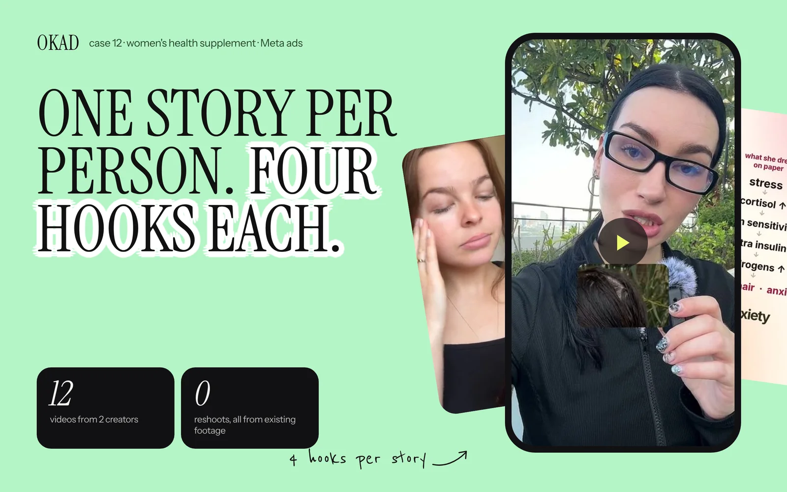

This is the most common problem brands bring to OKAD. The conversation usually starts the same way: "We have been working with creators. The videos look great. But nothing converts. We have spent $2,000 to $4,000 on UGC and have zero winning ads to show for it."

It is frustrating because the videos genuinely are well-produced. The creators are professional, the lighting is good, the editing is clean. By every visual standard, the content is high quality. And yet the ads do not work.

The problem is almost never the creators. It is almost never the production quality. It is the system — or rather, the absence of one. Here are the five reasons expensive UGC fails and the specific fix for each.

## Problem 1: No Creative Strategy

You are paying for production without direction. The brief says something like "make a 30-second video about our product, mention these benefits, keep it authentic." The creator does exactly that. They produce a competent, watchable video that looks like every other UGC video in the feed.

**Why this fails:** The creator is solving for "good video." The algorithm is solving for "ad that makes people act." These are not the same problem. A good video entertains. A good ad changes behavior. Without a creative strategy that defines the specific angle, emotional trigger, and audience segment for each video, you are producing content, not advertising.

**The fix:** Before any creator films anything, define the testing hypothesis. "This video tests whether the pain point of [specific problem] converts better than the aspiration of [specific outcome] for [specific audience]." Every video should test one variable — a hook, an angle, a format. This is what [creative strategy](/blog/blog-ad-creative-strategy/) looks like in practice: not "make a good video" but "test this specific idea against this specific audience."

## Problem 2: The Hook Is Wrong

The first three seconds of a UGC video determine roughly 80% of its performance. If the [hook does not stop the scroll](/blog/blog-hook-rate-explained/), the rest of the video — no matter how persuasive — is invisible. Most UGC creators are not hook specialists. They are good on camera, they can deliver a natural-sounding script, and they create visually appealing content. But writing a hook that competes for attention against everything else in the feed is a specialized skill.

**Why this fails:** The video opens with "Hey guys, I've been using this product for two weeks and..." The viewer has already scrolled past. That opening sounds like every other sponsored post. It does not pattern-interrupt, it does not trigger curiosity, and it does not promise something worth watching.

**The fix:** Write 5 to 10 hooks for every video concept. Film the body of the video once, then film 5 to 10 different openings. Launch each hook as a separate ad. The winning hook might be a bold claim ("I stopped using moisturizer and my skin got better"), a question ("Why is your dermatologist not telling you this?"), or a visual pattern interrupt (starting with the product result, not the product). You do not know which hook will win until you test them. Nobody does.

## Problem 3: One Video, One Shot

You are treating each $500 video as a single bet. It either works or it does not. If it does not, you brief another creator, spend another $500, and hope the next one hits. This is the most expensive way to test creative.

**Why this fails:** The math is brutal. At a 15 to 20% hit rate, you need 5 to 6 creatives to find one winner. At $500 each, that is $2,500 to $3,000 before you have a single profitable ad. And that winner will fatigue in 2 to 4 weeks, at which point you need another $2,500 to $3,000 cycle.

**The fix:** Stop thinking in videos. Start thinking in [modular creative](/blog/blog-modular-creative-production/). One video is not one ad — it is the raw material for 5 to 10 ads. Film the body of the video, then produce multiple hook variations, multiple text overlays, and multiple CTAs. A $500 video that generates 8 testable ad variations costs $62.50 per variation. A $200 video with 5 hook swaps costs $40 per variation. Lower cost per test, more tests, faster learning.

This is what [50+ ads from one shoot](/blog/blog-50-ads-from-one-shoot/) looks like in practice. The value is not in the individual video — it is in the variation system built on top of it.

## Problem 4: Creator Mismatch

Your creator does not match your audience. A 22-year-old lifestyle influencer reviewing a supplement for menopausal women. A Los Angeles creator promoting a product that sells primarily to Midwestern families. A male creator presenting a product that 85% of buyers are women. The video looks fine. The trust signal is wrong.

**Why this fails:** UGC works because viewers see someone like them using the product. When the creator does not match the buyer — in age, gender, ethnicity, accent, lifestyle, or context — the trust signal breaks. The viewer's subconscious says "this person is not like me" and the scroll continues.

**The fix:** Cast creators who match your buyer, not your brand aesthetic. If your top-performing audience on Meta is women 35 to 55, your creator should be a woman who looks and sounds like she is 35 to 55. If you sell in the UK, use creators with British accents. If your product serves a specific community, find creators from that community. The data on this is unambiguous: demographic matching between creator and audience is the single biggest non-hook variable in UGC ad performance. See our guide on [finding UGC creators by country and demographic](/blog/blog-find-ugc-creators-by-country/) for the practical how-to.

## Problem 5: No Testing Methodology

You launch 1 to 2 videos and watch the results. If the numbers are bad, you try a new creator. If the numbers are mediocre, you let it run too long hoping it improves. You do not have kill criteria, you do not have a testing calendar, and you do not know which variable to change next.

**Why this fails:** Without a [testing methodology](/blog/blog-creative-testing-methodology/), every decision is a guess. You change the creator, the hook, the format, and the audience simultaneously — so even when something works, you do not know why. And when something fails, you do not know what to fix.

**The fix:** Implement the simplest possible testing framework:

1. **Define your target CPA** before launching anything
2. **Spend $50 to $100 per creative** before judging — less is not enough data
3. **Kill at 48 hours** if CPA is above 2x your target after spending the test budget
4. **Change one variable at a time** — if the hook fails, write a new hook on the same body, do not reshoot the entire video
5. **Document everything** — which hooks worked, which angles flopped, which creators performed. This data is more valuable than any individual video

## The Real Cost Math

Here is what the numbers actually look like:

| Approach | Monthly Cost | Creatives Produced | Testable Variations | Winners Found (at 15-20% hit rate) |
|---|---|---|---|---|
| $500/video freelancers, 4 videos/month | $2,000 | 4 | 4 | 0-1 |
| $300/video + hook swaps, 6 videos | $1,800 | 6 | 18-24 | 3-5 |
| Agency retainer (OKAD Scale) | $3,500 | 20-30 | 40-60+ | 6-12 |

The $500/video approach produces the fewest tests at the highest cost per test. The agency retainer costs more in absolute terms but produces 10 to 15x more testable variations — and testing surface is what finds winners.

## When DIY UGC Works

To be fair, there are situations where managing creators directly makes sense:

- You have an in-house creative strategist who writes hooks, defines testing angles, and analyzes performance data
- You need fewer than 5 videos per month
- Your product is simple enough that "authentic review" is the only angle you need
- You have the time to manage creator relationships, revisions, and deadlines

If all four are true, direct creator management can save money.

## When You Need an Agency

If any of these sound familiar, the DIY approach is costing more than it saves:

- You do not know what is not working — the videos look good but nothing converts
- You know what to fix but cannot execute fast enough to keep up with fatigue
- You are spending more than $5K/month on ads and testing fewer than 10 new creatives per month
- You have been through 3 or more creators with no consistent winners
- Your ad account is fatiguing faster than you can produce fresh creative

The agency value is not "better creators." It is the strategy, testing system, and production velocity that turns every dollar of creative investment into data that compounds over time. For a transparent breakdown of what agencies actually charge, see our [UGC agency fee guide](/blog/blog-ugc-agency-fee-breakdown/). And if you are comparing platforms, our [Biddyco alternatives comparison](/blog/blog-biddyco-alternatives/) covers the five main options.

*This women's health brand switched from $400/video freelancer content to OKAD's structured testing approach — 4 winners in the first batch of 15 creatives. [See the full case study](/cases/womens-health-supplement-ads/).*

## Work With OKAD

OKAD produces ad creative and runs structured testing programs for brands that have outgrown the "hire a creator and hope" phase. Strategy, scripting, creator matching, production, and testing in one retainer. No per-asset pricing. No retainer lock-in.

**[See pricing and book a call](/pricing)** · Or email [olga@okad.agency](mailto:olga@okad.agency) with your monthly ad spend, how many creatives you test per month, and what is not working.
