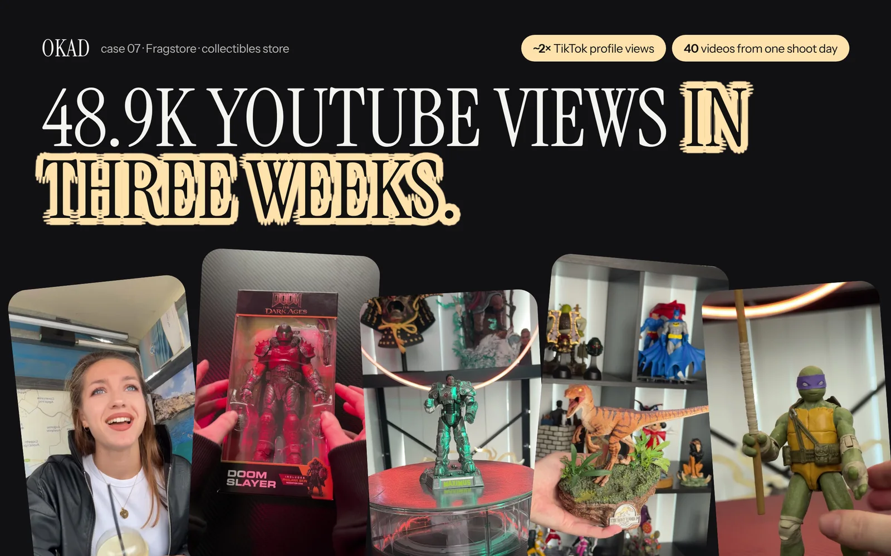

Every restaurant has good food photos somewhere — on the owner's phone, on the website, on an Instagram grid that gets decent engagement. But when those same images run as paid ads on Meta, the orders do not follow. The feed scroll is too fast, the competition for attention too fierce, and a pretty plate of pasta is not enough to stop someone mid-scroll and make them order.

Restaurant advertising on Meta and TikTok is a specific discipline. The targeting is hyperlocal. The creative has to trigger hunger in under two seconds. The testing cycles are fast because menus rotate and promotions change weekly. And most restaurants burn through their ad budget before they figure out what actually works because they skip the testing step entirely.

Here is how to build a creative testing system for QSR, fast-casual, and delivery restaurants — the same methodology OKAD uses across retail and DTC, adapted for food.

## The First-Second Rule: Show the Food Immediately

Every piece of restaurant ad creative must follow one rule: the food appears in the first second.

Not the restaurant exterior. Not the logo. Not a text overlay introducing the brand. The food. Close-up, filling the frame, visually appetizing.

The data behind this is simple. On Meta, the average user decides to keep watching or scroll past within 1.5 seconds. For restaurant ads competing against friends' photos, news, and entertainment, that window is closer to 0.8 seconds. If the viewer does not see something that triggers hunger in that first moment, the ad is invisible.

This means your thumbnail and opening frame need to be the single most appetizing shot you have. Steam rising from a bowl, cheese stretching on a pull, a crispy exterior cracking open. Movement and texture outperform static beauty shots every time.

## Three Ad Formats That Drive Orders

After testing creative across food and retail brands, three formats consistently outperform for restaurants.

### 1. Menu Item Spotlight

A single dish, shot close-up with natural light, occupying at least 80% of the frame. Text overlay: the item name, the price, and one line of copy — either a benefit ("handmade daily") or an urgency trigger ("back for a limited time"). The CTA is direct: "Order now" with a link to the delivery platform or online ordering page.

This format works because it removes all friction. The viewer sees exactly what they are getting, knows the price, and can act immediately. No storytelling required. No brand introduction needed. The food sells itself.

**Best for:** signature dishes, value meals, new menu launches.

### 2. Creator Review: "I Tried [Restaurant]"

A UGC creator visits the restaurant (or orders delivery), films the experience, and gives an honest reaction. The format follows the standard UGC structure: [hook](/blog/blog-hook-rate-explained/) in the first 3 seconds ("I finally tried that place everyone's been talking about"), experience in the middle, verdict at the end.

This format builds trust that polished brand content cannot. A real person's genuine reaction to the food is more convincing than any amount of professional photography. The key is the first-bite moment — the visible reaction when they taste the food. That single second of authentic response is worth more than the entire rest of the video.

**Best for:** new locations, building awareness in a new market, competing against established chains.

### 3. Limited-Time Offer

Urgency-driven creative built around a promotion, seasonal menu item, or holiday special. The format is straightforward: lead with the offer ("$5 combo meal, this week only"), show the food, state the deadline, and provide the ordering path.

Limited-time offers work in restaurant advertising because the decision is inherently time-sensitive — you eat today or you do not. Adding an expiration date to the offer compounds that urgency. The creative does not need to be elaborate. A phone-quality video of the meal being assembled with text overlays performs as well as studio production for this format.

**Best for:** promotions, seasonal menus, holiday specials, reactivating lapsed customers.

## The Testing Framework: 9 Creatives Per Cycle

The fastest way to find winning restaurant creative is a structured test matrix.

| Step | Action | Timeline |
|---|---|---|
| Pick 3 menu items | Choose your highest-margin, most photogenic, or most popular dishes | Day 1 |
| Produce 3 formats per item | Menu spotlight + creator review + limited-time angle = 9 total creatives | Days 2-5 |
| Launch all 9 with equal budget | $20-$50 per creative, same audience, same placement | Day 6 |
| Kill losers at 48 hours | Any creative with [hook rate](/blog/blog-hook-rate-explained/) below 20% or cost-per-order above 2x target | Day 8 |
| Scale winners | Increase budget 20% per day on top performers | Days 9-14 |
| Repeat with new items | Fresh menu items, same 3 formats, new test cycle | Day 15 |

At $30 per creative, a full test cycle costs $270 and takes two weeks. That is less than most restaurants spend on a single "boosted post" that runs without any testing methodology behind it.

## Local Targeting: The Restaurant-Specific Variable

Restaurant advertising has a targeting constraint that most industries do not: geography matters more than demographics. A 35-year-old food lover who lives 20 miles from your restaurant is less valuable than a 19-year-old college student who lives 2 blocks away.

Three targeting rules for restaurants:

**Radius targeting.** Set a delivery radius around each location. For dine-in, 5 to 10 miles in suburban markets, 2 to 5 miles in urban markets. For delivery, match your actual delivery zone exactly — advertising to people you cannot serve wastes money.

**Time-of-day scheduling.** Run lunch creative from 10 AM to 1 PM and dinner creative from 4 PM to 8 PM. Late-night ads from 9 PM to midnight work for delivery-heavy restaurants. Do not run restaurant ads at 3 AM unless you are a 24-hour operation.

**Weather and occasion triggers.** Rainy day? Push delivery ads harder. Friday evening? Lead with group dining or family meal deals. Game day? Promote party platters and bulk ordering. The more contextually relevant the ad, the higher the conversion rate.

## Photography and Production Tips

Restaurant creative does not require a professional studio. Some of the highest-performing food ads are shot on phones in the actual kitchen.

**Natural light wins.** Shoot near a window or outside. Overhead fluorescent lighting makes food look institutional. Natural light makes it look appetizing.

**Get close.** Fill the frame. The viewer should feel like the food is right in front of them. Wide shots of a table setting with plates in the distance do not trigger the hunger response.

**Show movement.** Steam rising, cheese pulling, sauce drizzling, a crispy shell cracking. Movement catches the eye in a scroll and communicates freshness and temperature — two things a static image cannot convey.

**Use real plates.** Stock photography of food is immediately recognizable and immediately ignored. Your actual dishes, on your actual plates, in your actual restaurant. Imperfection is authenticity, and authenticity converts.

## Building a Creative Pipeline for Seasonal Menus

Restaurants face a creative challenge that most brands do not: the product changes constantly. Seasonal menus, weekly specials, holiday promotions, and limited-time offers mean the creative pipeline never stops.

The solution is a repeatable production system, not one-off shoots. Develop templates for each of the three formats. When a new menu item launches, slot it into the existing templates: one spotlight shot, one creator reaction, one promotional angle. Total production time per new item: 2 to 3 hours, not 2 to 3 days.

For multi-location restaurants, centralize creative production. One creative team produces the master assets, then each location adds local elements: the specific address, local delivery platform links, and location-specific promotions. This scales a [creative strategy](/blog/blog-ad-creative-strategy/) across 10 or 100 locations without 10 or 100 separate production efforts.

The same impulse-purchase testing methodology that works for premium retail applies to QSR — fast [creative rotation](/blog/blog-creative-testing-for-dtc/), clear CTAs, strong visuals in the first frame.

*OKAD applies the same structured creative testing methodology across retail and restaurant brands — [see the full case study](/cases/fragstore-content-factory/).*

## Work With OKAD

OKAD produces ad creative and runs structured testing programs for brands across food, DTC, and retail — from strategy and scripts to production and performance reporting. No per-asset pricing. No retainer lock-in.

**[See pricing and book a call](/pricing)** · Or email [olga@okad.agency](mailto:olga@okad.agency) with your monthly ad spend and goals.
