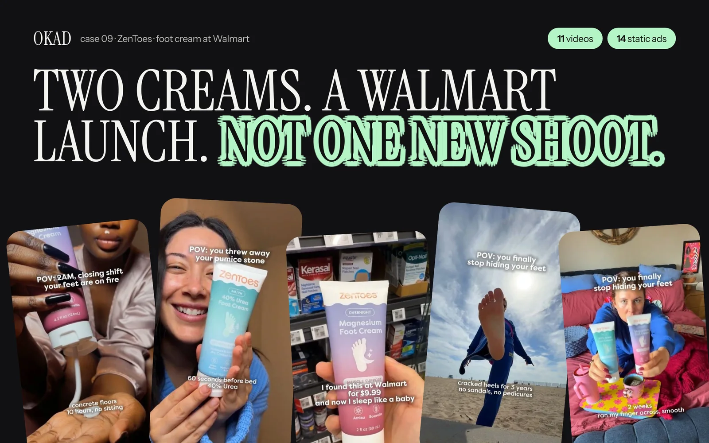
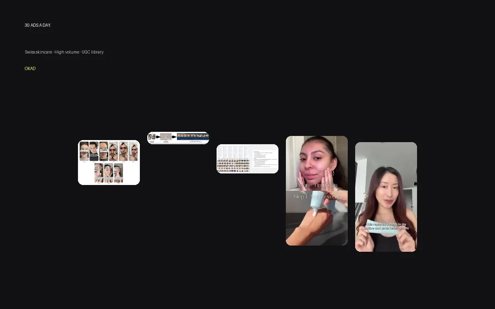

Every brand that books a call with us asks some version of the same question: should we start with video or statics?

The answer is almost always statics first. Not because statics are inherently better — they are not — but because the economics of testing make statics the smarter first move. And the brands that ignore this advice consistently waste their first $2,000-$5,000 on video ads that underperform statics costing a fifth as much.

Here is the data, the logic, and the framework for deciding what to produce and when.

## The Expensive Mistake

A brand comes to us wanting "five UGC videos" for their Meta campaigns. They have a $3,000 production budget and $5,000 in ad spend. They want talking-head testimonials, product demos, and lifestyle footage.

Here is the math on that approach:

- 5 UGC videos at $400-$600 each = $2,500-$3,000 in production
- Each video tests ONE angle, ONE hook, ONE visual approach
- 5 data points from $3,000 in production + $5,000 in ad spend

Now compare the static-first approach with the same total budget:

- 25-30 static ads at $100-$120 each = $3,000 in production
- Each static tests a different angle, hook, or visual concept
- 25-30 data points from $3,000 in production + $5,000 in ad spend

Same budget. Five to six times more learning. The static-first brand knows which angles work before they spend a dollar on video. The video-first brand is guessing.

## When Statics Win

Static ads outperform video in several specific scenarios. These are not edge cases — they describe most brands spending under $10,000 per month on Meta.

**Product-focused messaging.** When the ad is about the product itself — features, ingredients, price, before-and-after — a well-designed static delivers the message instantly. The viewer processes a static in 1-2 seconds. A video takes 5-15 seconds to deliver the same information, and most viewers scroll past before the message lands.

**Benefit-driven headlines.** "Compression socks that actually stay up" works as a text-on-image static. It does not need a 30-second video. When the copy does the selling, the visual just needs to stop the scroll — and a bold, clean static does that as effectively as video.

**Price points under $50.** Low-consideration purchases do not need storytelling. The viewer sees the product, understands the benefit, and clicks. Statics handle this conversion path with less friction than video because there is nothing to watch — just see, understand, act.

**High-volume testing environments.** When you need to test 20+ creative variations per week to [stay ahead of ad fatigue](/blog/blog-ad-fatigue-prevention/), statics are the only format that scales. You cannot produce 20 new videos per week at any reasonable cost. You can produce 20 new statics in a day.

**Meta feed placements.** In the Meta feed, users scroll fast. A static that communicates in the first half-second outperforms a video where the hook takes 2-3 seconds to land. This is especially true on Instagram feed and Facebook feed placements, where autoplay video competes with static content that delivers its message immediately.

## When Video Wins

Video is not worse than statics — it serves a different function and wins in different scenarios.

**Complex value propositions.** If your product requires explanation — how it works, why it is different, what the experience feels like — video communicates that depth in a way statics cannot. Software demos, multi-step skincare routines, and before-and-after transformations all perform better as video because the story takes time to tell.

**High-ticket products.** Items over $100-$200 need more persuasion before the click. Video builds trust through demonstration, social proof, and emotional storytelling. A $700 product (like the premium audio equipment one of our clients sells) benefits from video that shows the unboxing, the build quality, the sound — things a static image cannot convey.

**TikTok-first strategy.** TikTok's algorithm rewards video content and penalizes static images in feed distribution. If TikTok is your primary acquisition channel, video is not optional — it is the native format. Static-first testing still works on TikTok, but you need to be producing video-format content to scale on the platform.

**Retargeting and bottom-funnel.** People who have already visited your site or engaged with your brand respond well to video that provides deeper information — creator testimonials, product demonstrations, founder stories. At the bottom of the funnel, the extra production investment is justified because the audience is already warm.

**Audience education.** When your [ad creative strategy](/blog/blog-ad-creative-strategy/) depends on teaching the viewer something — a new category, a scientific mechanism, a usage method — video is the right format. Trying to educate through a static image results in cluttered visuals and text-heavy layouts that neither inform nor convert.

## The Testing Framework: Static First, Video Second

Here is the framework we use with every new client engagement at OKAD:

### Phase 1: Static Testing (Week 1-2)

Produce 10-15 static ad variations across 3-5 angles. Each angle gets 3-4 visual treatments:

| Angle | Static Variations | Budget Per Variation | Total |
|---|---|---|---|
| Pain point / problem aware | 3-4 statics | $80-$100 | $300-$400 |
| Benefit / outcome focused | 3-4 statics | $80-$100 | $300-$400 |
| Social proof / authority | 3-4 statics | $80-$100 | $300-$400 |
| Price / offer driven | 2-3 statics | $80-$100 | $200-$300 |
| Curiosity / pattern interrupt | 2-3 statics | $80-$100 | $200-$300 |
| **Total** | **13-18 statics** | | **$1,300-$1,800** |

Run each variation with $80-$100 in ad spend for 3-5 days. Kill anything with a [hook rate](/blog/blog-hook-rate-explained/) below 20% or CPA above 2x target after 1,000 impressions.

### Phase 2: Angle Validation (Week 2-3)

Identify the top 2-3 performing angles. For each winning angle, produce 3-5 more static variations to confirm the angle is consistently strong — not just one lucky image.

An angle is validated when 3+ variations of that angle outperform the account average on CPA and CTR.

### Phase 3: Video Production (Week 3-4)

Take your 2-3 validated angles and produce video versions:

- **Talking-head UGC** for social proof angles
- **Product demo** for benefit/outcome angles
- **Problem-solution narrative** for pain point angles

Each video gets 2-3 [hook swaps](/blog/blog-hook-rate-explained/) for further testing. Total video production: 4-9 videos, each built on a proven angle rather than a guess.

### Phase 4: Scale

Run winning statics and winning videos together. The statics handle volume testing and fatigue replacement. The videos handle audience scaling and longer rotation. Together they form a [complete creative testing system](/blog/blog-creative-testing-for-dtc/).

## The Numbers: Static vs Video Head-to-Head

| Metric | Static Ads | Video Ads |
|---|---|---|
| Production cost per ad | $80-$150 | $250-$600 |
| Production time | 1-2 days | 5-14 days |
| Testing velocity | 15-30 per week | 3-5 per week |
| Average rotation before fatigue | 7-14 days | 14-30 days |
| CPA at <$5K/month spend | Often lower | Often higher |
| CPA at >$10K/month spend | Competitive | Often lower |
| Best for | Angle discovery, high volume | Scale, retargeting, complex products |
| [Creative testing](/blog/blog-creative-testing-for-dtc/) strength | Speed to learnings | Depth of engagement |

The pattern is consistent across OKAD campaigns: statics find the winners faster, video scales the winners further. Neither format replaces the other. The question is sequence, not choice.

## Why Brands Get This Wrong

Three common reasons brands default to video first:

**1. "Video looks more professional."** This is a branding instinct, not a performance instinct. In paid social, production quality correlates weakly with performance. A raw, well-angled static with a clear message regularly outperforms a polished $2,000 video with an unclear angle. The algorithm does not care about production value. It cares about engagement signals.

**2. "Our competitors are doing video."** Run a [competitor audit](/blog/blog-ad-creative-strategy/) on Meta Ad Library. Most competitors running video also have statics — they just do not advertise their static testing because it is less impressive in case studies. The statics are doing the angle-finding work behind the scenes.

**3. "We already have footage."** If you have existing footage, great — skip to Phase 3 for those angles. But still run static tests on new angles before producing new video for them. Existing footage is a production shortcut, not a testing shortcut.

## The Hybrid: Static Hooks on Video Bodies

One technique that combines the advantages of both formats: static-style hooks on video content.

The first 1-2 seconds of the ad is a bold text-on-image static (the hook). If the viewer pauses, the static transitions into video content. This approach gets the instant-communication advantage of statics for the hook — the part of the ad that matters most — while delivering the engagement depth of video for viewers who stay.

Many of the highest-performing [ad creative examples](/blog/blog-ai-ad-creatives-examples/) across OKAD campaigns use this hybrid format. It is particularly effective on Instagram Reels and TikTok, where the first frame determines whether the algorithm distributes the ad broadly. For the AI vs human creative decision, see [how AI and human ad creative compare on results](/blog/blog-ai-vs-human-ad-creative-results/) — AI-generated statics are often the fastest way to validate angles before investing in human-produced video. And knowing [why winning ads stop working](/blog/blog-why-winning-ads-stop-working/) helps you plan the static-to-video transition before fatigue kills your winners.

## How OKAD Runs This

*For ZenToes' Walmart launch, we tested 30+ static variations before producing a single video. The winning static angles became the scripts for video that scaled. [See the full case study](/cases/zentoes-walmart-launch-ads/).*

When [Olga Kad](https://www.linkedin.com/in/o-kad) and the [OKAD](https://okad.agency) team onboard a new client, the first production sprint is always static-heavy. Even when clients come in wanting video, we recommend starting with 15-20 statics to validate angles before committing video budget.

The results speak for themselves: clients who follow the static-first framework spend 40-60% less on their first month of creative testing and identify winning angles in half the time.

*Swiss Skincare produces ~30 ads/day using hook swaps on statics — a testing velocity impossible with video production. The static-first approach feeds the algorithm fresh creative constantly.*

## Work With OKAD

OKAD produces both static and video ad creative as part of a full creative strategy service — research, testing, production, and iteration in one retainer. We start with statics to find your winning angles, then scale with video. No guessing, no wasted production budget.

**[See pricing and book a call](/pricing)** · Or email [olga@okad.agency](mailto:olga@okad.agency) with your monthly ad spend and goals.
