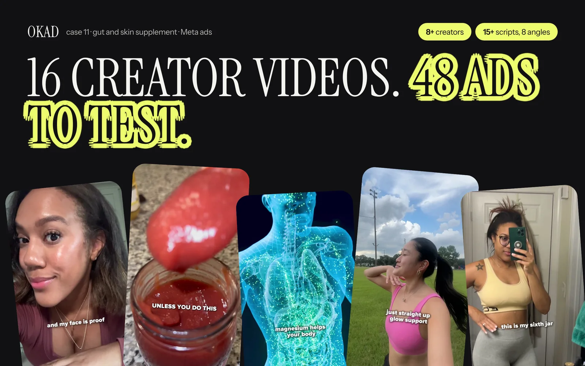

Every brand that has ever spoken to a UGC agency has asked the same question: "Why does this cost $300 when I can find a creator on TikTok who will do it for $150?"

It is a fair question. The answer is not that agencies overcharge. The answer is that the creator fee and the agency fee pay for fundamentally different things — and confusing the two leads to either overpaying for production or underpaying for strategy.

This guide breaks down exactly what each fee covers, when each pricing model makes sense, and how to evaluate quotes so you are comparing equivalent deliverables.

## The Creator Fee: What $50-$500 Buys You

When you hire a UGC creator directly, you are paying for:

- **Their face and voice** — the talent component
- **Their time filming** — typically 1-3 hours for a single video
- **Basic self-editing** — cuts, maybe captions, usually on their phone
- **One round of feedback** — most creators will reshoot or adjust once

That is it. The creator delivers a video file. What you do with it is your problem.

Creator rates vary based on experience and niche:

| Creator Tier | Rate per Video | What You Get |
|---|---|---|
| New creators (0-6 months) | $50-$100 | Raw footage, basic self-edit, 1 revision |
| Mid-tier (6-18 months, proven portfolio) | $100-$250 | Better production quality, follows scripts, 1-2 revisions |
| Experienced (18+ months, brand clients) | $250-$500 | Professional quality, own lighting/equipment, multiple takes |
| Niche specialists (medical, tech, luxury) | $300-$750+ | Industry credibility, compliance awareness, polished delivery |

These rates are for the video itself. They do not include the work of finding the right creator, writing a script that converts, editing the footage for paid ads, or deciding what to test next. That work either falls on you or on an agency. For current creator rate benchmarks, see our [UGC creator rates guide](/blog/blog-ugc-creator-rates-pricing/).

## The Agency Fee: What $200-$500 Per Video Actually Covers

When you pay an agency $300 for a video, roughly $100-$150 goes to the creator. The rest covers a production system that most brands underestimate until they try to build it themselves.

**Before filming:**
- Creative strategy — analyzing your competitors' ads, identifying winning angles, deciding what to test
- Scriptwriting — writing hooks, body copy, and CTAs based on ad performance data, not guesswork
- Creator casting — matching the right face, voice, age, and style to your target audience from a vetted roster
- Briefing — detailed production briefs with shot lists, brand guidelines, and reference examples

**During production:**
- Project management — tracking timelines across 5-15 creators simultaneously
- Quality control — reviewing raw footage before editing, catching issues early
- Communication — managing revision requests, rebriefs, and creator questions

**After filming:**
- Professional editing — cuts, pacing, captions, music, sound design, color correction
- Variations — producing hook swaps, CTA changes, and format versions (9:16, 1:1, 4:5) from one shoot
- Revisions — 2-3 managed rounds with clear turnaround times
- Reporting — tracking which creatives perform and feeding learnings into the next batch

The agency fee is not a markup on the creator. It is the cost of the system that makes creator content perform as paid ads. A [creative strategy framework](/blog/blog-ad-creative-strategy/) is what turns raw creator footage into a testing program — and that framework is what separates a $3 CPA from a $12 CPA.

## Three Pricing Models Compared

Most agencies offer some version of these three structures. The right one depends on your volume and stage.

### Per-Video Pricing ($100-$500)

You pay a fixed rate for each finished asset. No commitment beyond the order.

**Best for:** Testing a new agency. One-off campaigns. Fewer than 10 videos per month. Validating a new product or market.

**Watch out for:** Higher per-unit cost (agencies price in the overhead of context-switching). Add-ons can stack: revisions, rush delivery, usage rights, music licensing. A $200 video with three add-ons costs more than a $350 all-inclusive video.

### Test Packages ($500-$2,000)

A fixed scope designed to produce enough creative for a meaningful test. Typically 5-10 videos with variations.

**Best for:** First engagement with an agency. Proving whether UGC works for your brand. Getting enough data to justify a retainer. Launching a new product.

**What a good test package includes:**
- 5-10 finished videos across 2-3 concepts
- Scripts written by the agency (not just executed by creators)
- 2-3 hook variations per concept
- Professional editing and captions
- Perpetual usage rights

A test package at OKAD starts at $500 for static ads or $2,000-$2,500 for video — with strategy, scripting, and creator management included. No separate strategy fee. The [creative agency pricing guide](/blog/blog-creative-agency-pricing-guide/) covers how these packages compare across the industry.

### Monthly Retainers ($2,500-$10,000+)

Locked-in capacity at a lower per-unit cost. The agency allocates a team to your account on an ongoing basis.

| Retainer Tier | Monthly Cost | What You Get | Per-Video Effective Rate |
|---|---|---|---|
| Test & Learn | $2,500-$3,500 | 10 creatives, strategy, 1 creator sourced, weekly reporting | $250-$350 |
| Scale What Works | $3,500-$5,000 | 20-30 creatives, 1-3 creators, A/B testing, bi-weekly strategy calls | $115-$250 |
| Always-On | $5,000-$10,000+ | 30+ creatives, dedicated strategist, priority turnaround, whitelisting | $165-$330 |

**Best for:** Brands spending $5,000+/month on ads. Teams that need consistent creative volume. Accounts where [ad fatigue](/blog/blog-ad-fatigue-prevention/) is the primary bottleneck.

The breakeven is around 10 videos per month. Below that, per-video or test packages save money. Above that, the retainer's lower per-unit rate and dedicated team attention make it the better deal.

## The Hidden Costs Nobody Mentions

Every agency conversation includes a quoted price. Not every conversation includes these:

| Hidden Cost | How It Hits | How to Avoid It |
|---|---|---|
| Revision fees beyond 2 rounds | $50-$100 per round | Ask what's included upfront. Good briefs reduce revisions. |
| Rush delivery (48h) | +25-50% surcharge | Plan 2 weeks ahead. Retainer clients usually get priority by default. |
| Extended usage rights | $100-$500 per video | Ask for perpetual rights. Some agencies (including OKAD) include them. |
| Music and sound licensing | $50-$200 per video | Ask if royalty-free music is included or if premium tracks cost extra. |
| Whitelisting fees | $100-$300/mo per creator | Negotiate this into the retainer if you plan to run whitelisted ads. |
| Strategy as an add-on | $500-$2,000/mo | Choose agencies that bundle strategy into production. It should not be separate. |
| Platform reformatting | $25-$75 per variation | Ask if 9:16, 1:1, and 4:5 versions are included or billed per format. |

The single biggest hidden cost is not on this list: **hiring an agency that delivers unusable creative.** A $150 video that cannot run as a paid ad because the hook is weak, the pacing is wrong, or the CTA is missing costs more than a $400 video that converts. Cost per usable asset is the metric that matters — not sticker price.

## Why OKAD Bundles Strategy Into Production

Most agencies separate strategy and production into different line items — or worse, different departments. Strategy writes a brief, production executes it, and nobody is responsible for whether the creative actually performs.

At OKAD, strategy and production are the same team. The person who writes the script knows why that hook angle was chosen, which competitor ad it is differentiated against, and what the test is designed to prove. This is not a philosophical choice — it is a structural one that reduces revision cycles and increases the percentage of usable creative per batch.

What this means for pricing: the strategy fee is zero because it is built into every video. You are not paying for a strategist and a production team separately. You are paying for a production team that thinks strategically about every asset.

*We tested 47 creative variations for this supplement brand under one retainer. Strategy, scripts, creator casting, editing, and reporting — no separate line items. [See the full case study](/cases/supplement-brand-ugc-ad-testing/).*

## How to Compare Agency Quotes

When you have two or three quotes, do not compare headline prices. Compare these:

1. **Cost per usable asset.** If Agency A delivers 20 videos with a 40% rejection rate, you are paying for 12 usable videos. If Agency B delivers 15 with a 90% approval rate, you are paying for 13.5. Agency B wins even if their per-video rate is higher.

2. **What is included vs billed separately.** Get an itemized breakdown. Add up the real cost including revisions, rights, reformatting, and strategy.

3. **Revision turnaround.** Fast revisions mean faster testing. An agency that takes 5 days per revision round adds weeks to every campaign launch.

4. **Usage rights.** If perpetual rights are not included, calculate the ongoing cost. A winning ad that expires after 6 months costs you a reshoot — add that to the quote.

5. **Strategy depth.** Ask: "Who decides what we test next?" If the answer is "you do," you are paying for production only. If the answer is "we analyze last month's performance and recommend the next test matrix," you are paying for a system.

For a broader comparison of agency models and pricing structures, our [UGC agency pricing guide](/blog/blog-ugc-agency-pricing/) covers the full landscape.

## The Decision Framework

| If You... | Best Model | Expected Monthly Cost |
|---|---|---|
| Are testing UGC for the first time | Test package (5-10 videos) | $500-$2,000 one-time |
| Need fewer than 10 videos/month | Per-video pricing | $1,000-$3,000 |
| Need 10-30 videos/month consistently | Monthly retainer (Growth) | $3,500-$5,000 |
| Spend $50K+/month on ads and need constant fresh creative | Monthly retainer (Scale) | $5,000-$10,000+ |
| Want to try an agency before committing | Test package first, then retainer | $2,000 initial → $2,500+/mo |

The smartest path for most brands: start with a test package to validate the agency relationship, then upgrade to a retainer once you have data proving the creative converts.

## Work With OKAD

OKAD bundles creative strategy, production, and testing into one retainer — no separate strategy fees, no hidden add-ons, perpetual usage rights included. Start with a test package or go straight to a monthly plan.

**[See pricing and book a call](/pricing)** · Or email [olga@okad.agency](mailto:olga@okad.agency) with your monthly ad spend and goals.
