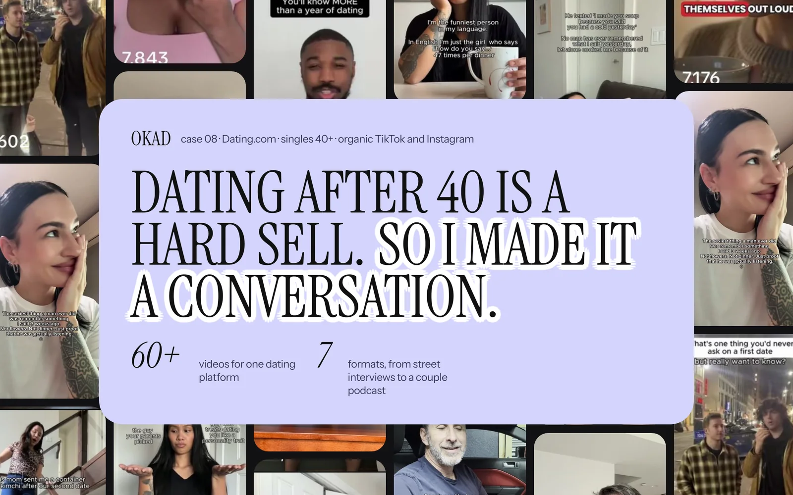

Six out of ten brands that book a call with us ask the same question within the first five minutes: how long does this take?

The honest answer: 2-3 weeks for the first batch of UGC ads. 7-10 days for every batch after that. 5-7 business days for statics only. And 24-48 hours for AI-assisted static content.

But those numbers mean nothing without understanding what happens during each phase, what determines whether your project lands at the fast end or the slow end, and what you can do as a client to keep things moving.

Here is the full timeline, broken down by week and by deliverable type.

## The Standard UGC Timeline: First Batch

The first batch always takes longer than subsequent ones. This is not padding — it is the strategy and setup work that makes every future batch faster.

### Week 1: Strategy, Audit, and Creator Casting

**Days 1-2: Brief and strategy.**
You share your brief — product details, target audience, key messages, existing ads that work, competitive landscape. We turn this into a creative strategy document: which angles to test, what formats to produce, and the [hook concepts](/blog/blog-hook-rate-explained/) that will lead each ad.

If you have existing performance data (winning ads, audience insights, CPA benchmarks), this phase moves faster. If we are starting from zero, we run a [competitor audit](/blog/blog-ad-creative-strategy/) to identify what is already working in your category.

**Days 3-5: Creator casting.**
We match creators to your brand based on demographics, content style, and category experience. This includes reviewing portfolios, checking availability, and confirming rates. For most projects, we cast 2-5 creators from our network of vetted talent.

Creator casting is often the first bottleneck. If a specific ethnicity, location, or look is required — and the [creator pool for that criteria](/blog/blog-how-to-build-creator-network/) is small — this phase can take an extra 2-3 days.

**What you owe at this stage:** Approved brief, product samples shipped to creators, brand assets (logos, fonts, color codes), and approval of the creative strategy document.

### Week 2: Scripting and Filming

**Days 6-8: Script writing and approval.**
We write scripts based on the approved creative strategy. Each script follows the hook-body-CTA structure optimized for paid social. You review and approve — or request changes.

This is the most common delay point. When clients take 3-5 days to approve scripts instead of 1-2 days, the entire timeline shifts by that same amount. Fast approvals are the single biggest accelerator in UGC production.

**Days 8-12: Creator filming.**
Approved scripts go to creators with detailed shot lists, brand guidelines, and reference examples. Creators film and submit raw footage within 3-5 days. Professional creators with established workflows deliver in 2-3 days. Newer creators sometimes need an extra day or two.

**What you owe at this stage:** Script approvals within 24-48 hours. Every day of delayed approval adds a day to the delivery timeline.

### Week 3: Editing, Review, and Delivery

**Days 13-15: First cut editing.**
Raw footage is edited into finished ads: color correction, text overlays, captions, music, sound design, and format optimization for each platform (9:16 for Reels/TikTok, 1:1 for feed, 4:5 for Stories).

**Days 15-17: Client review and revisions.**
You review the first cuts. Most projects include 2 rounds of revisions. Common revision requests: text changes, music swaps, pacing adjustments, alternate hooks. Structural changes (re-shooting, adding new scenes) take longer and may require a revision fee.

**Days 17-18: Final delivery.**
Approved ads are exported in all required formats and delivered via shared drive. Files include finished ads, clean versions (no text overlays), and raw footage if requested.

| Phase | Duration | Key Dependency |
|---|---|---|
| Brief and strategy | 2-3 days | Client provides complete brief |
| Creator casting | 2-4 days | Specific demographic requirements |
| Script writing | 2-3 days | Strategy approval |
| Script approval | 1-2 days (client) | **Biggest variable** |
| Creator filming | 3-5 days | Product samples received |
| Editing (first cut) | 2-3 days | Footage quality |
| Client review | 1-2 days (client) | **Second biggest variable** |
| Revisions + delivery | 1-2 days | Scope of changes |
| **Total (first batch)** | **14-21 business days** | |

## Subsequent Batches: Why They Are Faster

Every batch after the first takes 7-10 business days instead of 14-21. Here is why:

**Strategy is established.** The creative strategy, brand voice, and testing framework from Batch 1 carry forward. We are iterating on proven angles, not starting from zero.

**Creators are cast and vetted.** The creators who performed well in Batch 1 are on retainer. No casting phase needed — scripts go directly to proven talent.

**Brand guidelines are documented.** Editing templates, text styles, music preferences, and format specs are saved from Batch 1. The editing team produces consistent output without re-learning the brand each time.

**Client knows the process.** Approval cycles get faster as clients learn what to look for and how to give actionable feedback. First-batch reviews often take 3-5 days. By Batch 3, most clients approve within 24 hours.

## Timeline by Deliverable Type

Not all content takes the same amount of time. Here is what to expect for each format:

| Deliverable | First Batch | Ongoing | Notes |
|---|---|---|---|
| Static ads (designed) | 5-7 days | 3-5 days | Fastest format, no filming needed |
| AI-generated statics | 1-3 days | 24-48 hours | [AI-assisted workflow](/blog/blog-ai-creative-workflow/) with human direction |
| UGC video (talking head) | 14-21 days | 7-10 days | Standard creator filming + editing |
| UGC video (product demo) | 14-21 days | 7-10 days | Requires product samples at creator |
| Carousel ads | 5-10 days | 3-5 days | Design-based, no filming |
| [AI-generated video](/blog/blog-how-to-make-ai-video-ads/) | 5-7 days | 3-5 days | AI generation + human editing |
| Full campaign launch (mixed formats) | 21-28 days | 10-14 days | Strategy + statics + video + variations |

The fastest path to live ads is always statics. If you need creative running this week, start with 5-10 [static ad variations](/blog/blog-static-ads-vs-video-what-to-test-first/) and layer in video once the statics identify winning angles.

## What Slows Things Down

In three years of [high-volume UGC production](/blog/blog-high-volume-ugc-production/), the same bottlenecks appear on every delayed project:

**1. Slow client approvals.** This is the number one cause of timeline slippage. A 3-day delay on script approval pushes filming back 3 days, which pushes editing back 3 days. What should be a 3-week project becomes a 5-week project with zero production delays — just approval delays.

**2. Unclear briefs.** When the brief is vague ("make it fun and engaging"), the strategy phase takes longer because we need to extract specific direction through back-and-forth. A [detailed creative brief](/blog/blog-how-to-brief-a-creative-agency/) with target audience, key messages, and reference examples cuts the strategy phase in half.

**3. Specific creator requirements.** "We need a male creator, 35-45, British accent, with a dog, who looks like he shops at Waitrose" — requirements like this narrow the casting pool dramatically. Every constraint adds days to the casting phase. Flexibility on non-essential criteria speeds everything up.

**4. Product shipping delays.** Creators cannot film with a product they have not received. International shipping adds 5-10 days. Plan for this — ship samples the day you sign the contract, not after scripts are approved.

**5. Scope changes mid-production.** Adding new deliverables, changing creative direction after filming starts, or requesting re-shoots mid-edit resets the timeline. Define scope clearly upfront and save new ideas for the next batch.

## What Speeds Things Up

Conversely, projects that deliver ahead of schedule share common traits:

**Existing brand assets.** Logos, fonts, color codes, product images, and brand guidelines ready on Day 1 eliminate 1-2 days of asset collection.

**Previous winning ads.** Sharing your top-performing ads gives us a head start on strategy. We reverse-engineer what works and build on it instead of starting from scratch.

**Pre-approved scripts.** Some clients write their own scripts or have internal copywriters draft them. When scripts arrive approved, we skip straight to casting and filming — saving 3-5 days.

**AI-assisted production.** For static ads and some video formats, AI tools compress the production timeline dramatically. What takes a designer 2-3 days to produce manually takes 2-3 hours with AI-assisted workflows. This is why [AI-generated ad content](/blog/blog-ai-creative-workflow/) is the fastest-growing format in our production mix.

**Standing creator relationships.** Retainer clients with established creator teams skip casting entirely. Scripts go directly to creators who already know the brand, have product on hand, and can film within 48 hours of receiving a brief.

## Rush Delivery: When You Need Ads This Week

Sometimes you cannot wait 2-3 weeks. Product launch this Friday. Competitor just launched a campaign you need to respond to. Holiday season starting and the creative pipeline is empty.

Rush delivery compresses the standard timeline to 5-7 business days for video and 2-3 days for statics. Here is how it works:

- **Rush fee:** 25-50% premium on production cost
- **Compressed strategy:** Streamlined brief, no full competitor audit
- **Pre-vetted creators only:** No casting search, immediate assignment from existing network
- **Parallel editing:** Editing begins on first-delivered footage while remaining creators are still filming
- **Single revision round:** One round of changes, 24-hour turnaround

Rush delivery works best when the brand has clear direction and existing assets. It does not work well for brands that need extensive strategy or are producing their first-ever ad campaign.

## How OKAD Manages Timeline

*For Dating.com, we deliver new creator batches every 2 weeks on an ongoing retainer. The first batch took 3 weeks. Every batch since takes 7-10 days because strategy, creators, and brand templates are established. [See the full case study](/cases/dating-com-creator-content/).*

When [Olga Kad](https://www.linkedin.com/in/o-kad) and the [OKAD](https://okad.agency) team onboard a new client, we set timeline expectations on the first call and build the production schedule around the client's approval capacity. If a client can only review creative once a week, we plan around that. If they can approve within 24 hours, we move to a faster cadence.

The [modular production system](/blog/blog-modular-creative-production/) OKAD uses means different deliverables can run in parallel. Statics go live in Week 1 while video is still in production. By Week 3, the client has both formats running — and the statics have already generated performance data that informs the video strategy.

## Work With OKAD

OKAD delivers creative strategy and ad production as one service — from research and briefs to tested, scaling creatives. First batch in 2-3 weeks, ongoing batches every 7-10 days. Statics in as little as 48 hours.

**[See pricing and book a call](/pricing)** · Or email [olga@okad.agency](mailto:olga@okad.agency) with your monthly ad spend and goals.
