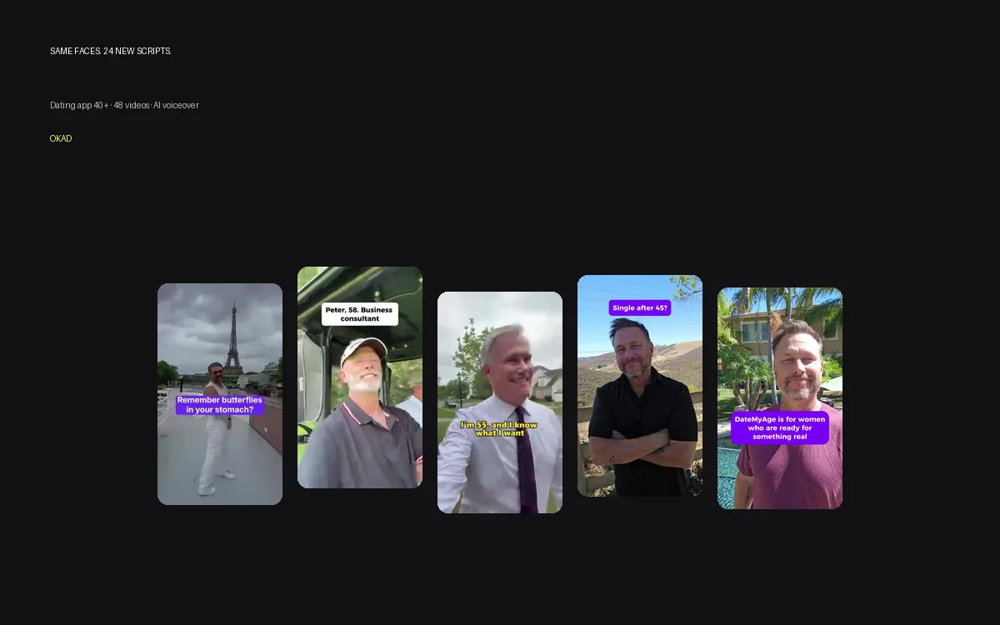

Usage rights are the most expensive mistake in UGC — not because the rights themselves cost too much, but because the brands that skip this conversation pay for it later. A winning ad that expires. A video you cannot run on a second platform. Raw footage locked behind a creator who stopped responding.

Every one of these problems is preventable with a clear contract before production starts. This guide covers what to negotiate, what different terms cost, and how to structure rights so your creative library works for you long-term.

## What Usage Rights Actually Mean

When a creator films a video, they own the copyright by default. The brand does not own the content until the creator grants a license — a legal permission to use it.

A usage rights agreement specifies three things:

1. **Where** you can use the content — which platforms, which formats (organic, paid, email, website, OOH)
2. **How long** you can use it — 3 months, 6 months, 12 months, or perpetual
3. **Exclusivity** — whether the creator can sell or post similar content for competitors

Without a written agreement, the creator retains full copyright. They can ask you to stop running their content, negotiate a higher rate retroactively, or post the same video for a competitor. This is not theoretical — it happens regularly, especially with creators who work with multiple brands simultaneously.

## Time-Limited vs Perpetual Rights

Most creator contracts default to time-limited rights. Here is what each term means in practice:

| Term | Duration | Typical Cost Premium | Best For |
|---|---|---|---|
| Short-term | 3 months | Base rate (no premium) | Seasonal campaigns, one-off tests |
| Standard | 6-12 months | +10-20% over base | Campaign-based work, product launches |
| Perpetual | Unlimited | +20-40% over base | Paid ad creative, evergreen content |
| Buyout | Unlimited + exclusive | +50-100% over base | High-spend campaigns, brand ambassador deals |

**The case for perpetual rights on paid ads:** The average winning UGC ad runs profitably for 30-90 days on Meta. But some winners run for 6 months or longer. If your rights expire at month 6, you face a choice: renegotiate (the creator knows they have leverage, so the price goes up) or lose the asset. At $500-$1,000 in renegotiation fees, the original 20-40% perpetual premium was the cheaper option.

**When short-term rights are fine:** Organic social content with a natural shelf life of 1-2 weeks. Seasonal campaigns that will not be reused. Test content where you are still validating whether UGC works for your product.

## Raw Files: Why You Need Them

Raw files are the unedited footage — everything the creator filmed, without cuts, captions, music, or effects. Most creators and agencies deliver only the finished, edited video by default. The raw footage stays with whoever edited it.

**Three reasons to negotiate raw file access:**

**1. Re-editing for new campaigns.** Your best video from Q1 can become a new ad in Q3 with a different hook, updated CTA, or fresh captions. Without the raw footage, you need a new shoot. With it, a 30-minute editing session produces a new variation at near-zero cost. This is the foundation of [ad variation strategies](/blog/blog-ad-variations-without-new-footage/) that scale creative output without scaling production costs.

**2. Multi-market adaptation.** A UGC video performing in the US market needs voiceover or subtitle changes for UK, EU, or MENA markets. Raw footage makes this possible. Finished videos with baked-in text overlays do not.

**3. Format variations.** A 60-second video works on Meta but needs a 15-second cut for YouTube Shorts and a 30-second version for TikTok. Raw footage gives your editor full control over pacing and composition for each platform.

### Clean Versions Without Text

A related request that brands often forget: ask for a "clean" version of every finished video — the fully edited video without text overlays, captions, or CTAs burned in.

Clean versions let you:
- Add localized text overlays for different markets
- Test different headline/CTA copy on the same visual
- Reuse the visual in contexts where text is not needed (website background, email hero)

Include "clean version delivery" as a line item in the contract. It takes the editor 5 minutes to export and saves you a reshoot when you need the footage without text.

## Platform and Format Rights

Usage rights should specify not just time, but scope — where the content can appear and in what context.

| Right | What It Covers | Watch For |
|---|---|---|
| Organic social | Posting on brand accounts without ad spend | Some contracts limit to specific platforms |
| Paid social (Meta, TikTok) | Running as a paid advertisement | Most expensive component — always negotiate this |
| YouTube / Google Ads | Pre-roll, in-stream, Discovery ads | Often excluded from "social media" rights |
| Website and email | Product pages, landing pages, newsletters | Usually included but confirm in writing |
| Whitelisting / Spark Ads | Running ads from the creator's account | Requires separate creator account access |
| Out-of-home / print | Billboards, in-store displays, packaging | Almost always a separate negotiation |

**The most common mistake:** Negotiating "social media rights" and assuming that includes paid ads. Many creator contracts define "social media" as organic posting only. Paid advertising rights are a separate grant — always confirm in writing.

**Cross-platform recommendation:** Negotiate all-platform, paid-and-organic rights from the start. The cost premium is typically 10-20% over single-platform rights, which is trivially small compared to the cost of renegotiating after you discover your best TikTok ad cannot legally run on Meta.

## Exclusivity: When It Matters

Exclusivity prevents the creator from working with competing brands for a defined period. It is expensive and usually unnecessary.

| Exclusivity Type | Duration | Typical Cost | When It's Worth It |
|---|---|---|---|
| Non-exclusive | None | Included in base rate | 90% of campaigns — this is the default |
| Category exclusive | 3-6 months | +30-50% | The creator's face is central to your campaign and you spend $20K+/month |
| Full exclusive | 6-12 months | +100-200% | Brand ambassador programs, long-term partnerships |

**When exclusivity matters:** If you are running a creator's face as the primary visual in $50K+/month of ad spend, you do not want that face appearing in a competitor's ads. The recognition value decays if the audience sees the same person promoting three different supplement brands.

**When it does not matter:** Most UGC campaigns use 5-15 creators per quarter. No single creator carries the campaign. At this volume, exclusivity is an unnecessary expense.

## What OKAD Includes by Default

Different agencies handle rights differently. Here is how OKAD's standard terms compare to what most agencies offer:

| Component | Typical Agency | OKAD |
|---|---|---|
| Usage rights duration | 6-12 months, renewal negotiable | Perpetual — no expiration |
| Platforms | Specified in contract (often limited) | All platforms, paid and organic |
| Raw files | Available for additional fee ($50-200) | Included on request |
| Clean versions (no text) | Not standard | Included on request |
| Exclusivity | Negotiated per creator | Non-exclusive by default (exclusive available) |
| Whitelisting access | Billed separately ($100-300/mo) | Included in retainer tiers |
| Multi-market adaptation rights | Separate license | Included in perpetual grant |

The pricing philosophy is simple: if you paid for the content, you should be able to use it wherever and whenever it works. Usage restrictions that force you to renegotiate or reshoot winning creative are a hidden cost that OKAD eliminates by default.

*DateMyAge runs these creator videos across 6 markets. Perpetual rights and raw footage access made multi-market adaptation possible without a single reshoot. [See the full case study](/cases/dating-com-creator-content/).*

## The Negotiation Checklist

Before signing any creator or agency contract, confirm these items in writing:

**Rights scope:**
- [ ] Perpetual or time-limited? If time-limited, what is the renewal cost?
- [ ] All platforms or specific platforms listed?
- [ ] Paid advertising rights explicitly granted (not just "social media")?
- [ ] Website, email, and landing page usage included?

**Deliverables:**
- [ ] Raw footage included or available for a fee?
- [ ] Clean versions (no text overlays) included?
- [ ] All format variations (9:16, 1:1, 4:5) included?

**Exclusivity:**
- [ ] Non-exclusive or category exclusive?
- [ ] If exclusive, for how long and at what cost?

**Modifications:**
- [ ] Can you re-edit the footage for new campaigns?
- [ ] Can you add new voiceover, subtitles, or text overlays?
- [ ] Can you use the footage in compilations or mashups with other creators?

Getting these answers before production starts costs nothing. Getting them after a winning ad expires costs everything.

For a detailed breakdown of how [UGC creator rates](/blog/blog-ugc-creator-rates-pricing/) factor in usage rights, and how [whitelisting](/blog/blog-ugc-whitelisting-guide/) works as a rights extension, see those respective guides. If you are using AI tools in your creative pipeline, [who owns AI-generated ads](/blog/blog-who-owns-ai-generated-ads/) covers the copyright and IP questions specific to AI content. And for a full breakdown of what agencies charge and what should be included, see our [UGC agency fee breakdown](/blog/blog-ugc-agency-fee-breakdown/).

## Work With OKAD

OKAD includes perpetual usage rights, all-platform licensing, and raw file access in every engagement. No renewal fees. No platform restrictions. No surprises.

**[See pricing and book a call](/pricing)** · Or email [olga@okad.agency](mailto:olga@okad.agency) with your monthly ad spend and goals.
