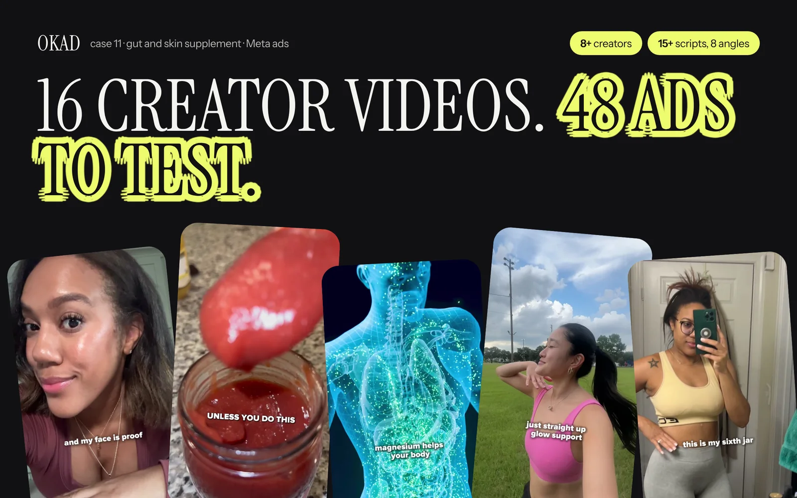

If you ask five marketers what makes a "winning ad," you will get five different answers. One says it is the ad with the highest CTR. Another says ROAS. A third points to the one the CEO liked. None of those are useful definitions when you are spending money every day and need to decide which ads to keep, which to kill, and which to scale.

A winning ad has one definition that matters: **it acquires customers below your target CPA at a spend level that moves the needle for your business.** Everything else — hook rate, CTR, engagement, saves — is either a leading indicator or a vanity metric. The distinction matters because optimizing for the wrong metric wastes budget on ads that look good in dashboards but do not drive revenue.

Here is how to set real benchmarks, understand what hit rates are normal, and know exactly when to scale or cut.

## The Benchmarks That Actually Matter

Not all metrics are created equal. Some tell you whether the creative is working. Others just tell you people saw it.

### Primary metrics: these decide scale or kill

| Metric | What it measures | Good | Great | Kill zone |
|---|---|---|---|---|
| CPA (cost per acquisition) | What you pay per customer | Within 1.5x target | At or below target | Above 3x target for 48+ hours |
| ROAS (return on ad spend) | Revenue per dollar spent | Above breakeven | 2x+ breakeven | Below 0.5x breakeven |
| Outbound CTR | Clicks to your site per impression | Above 0.8% | Above 1.5% | Below 0.4% |

### Secondary metrics: these diagnose problems

| Metric | What it measures | Good | Great | Problem signal |
|---|---|---|---|---|
| [Hook rate](/blog/blog-hook-rate-explained/) | Watched past 3 seconds | Above 30% | Above 45% | Below 20% = weak opening |
| Hold rate | Watched 50%+ of video | Above 15% | Above 25% | Below 10% = boring middle |
| Thumbstop ratio | Stopped scrolling | Above 25% | Above 40% | Below 15% = blends into feed |
| CTR (all) | Any click, including profile | Above 1.5% | Above 3% | Below 0.8% = low interest |

The relationship between these metrics is diagnostic. High hook rate but low outbound CTR means the ad grabs attention but the offer or CTA is weak. Low hook rate but high conversion rate on those who do click means the ad works for a niche — you just need more scroll-stopping hooks.

## The Hit Rate Reality

Here is the number that most brands do not want to hear: **15-20% of your creatives will be winners.** The other 80-85% will lose money in testing. This is normal. This is what success looks like.

If every ad you produce works, you are not testing enough. You are playing it safe with minor variations of proven concepts, which means you are missing the breakout creative that could 3x your account.

The math of a healthy creative program:

| Monthly production | Expected winners (at 17% hit rate) | Winners needed for spend level |
|---|---|---|
| 10 creatives | 1-2 winners | Supports $2,500-5,000/month |
| 20 creatives | 3-4 winners | Supports $5,000-15,000/month |
| 40 creatives | 6-8 winners | Supports $15,000-40,000/month |
| 60+ creatives | 10-12 winners | Supports $40,000+/month |

This is why volume matters more than perfection. A brand producing 10 polished videos per month will almost always lose to a brand producing 30 mixed-quality creatives — because the second brand finds more winners, faster.

The [creative testing methodology](/blog/blog-creative-testing-methodology/) behind this is straightforward: test more, learn faster, scale winners, replace fatigued creative before it drags down the account.

## When to Kill an Ad

Killing underperformers quickly is the highest-leverage habit in paid media. Every dollar spent on a losing ad is a dollar not spent testing the next potential winner.

**Kill criteria:**

1. **48 hours + $50 spent + CPA above 3x target** — The creative does not work for this audience. Kill it.
2. **Hook rate below 15% after 2,000 impressions** — Nobody is stopping to watch. The opening needs to be completely different, not tweaked.
3. **High CTR but zero conversions after $100 spent** — The ad attracts clicks but the landing page or offer is not converting. This is a funnel problem, not a creative problem.
4. **Frequency above 2.5 in a testing campaign** — The same people are seeing the ad multiple times without converting. The audience is too small or the creative is not compelling enough to convert on first or second exposure.

Do not give second chances to creatives that fail on primary metrics. Reviving a dead ad rarely works — the algorithm has already learned it underperforms, and restarting it does not reset that learning.

## When to Scale a Winner

Scaling too early kills ads. Scaling too late leaves money on the table. Here is the progression:

**Day 1-3: Observation phase.** The ad has launched. Do not touch it. Let the algorithm optimize delivery. Watch CPA, hook rate, and outbound CTR, but make no budget changes.

**Day 3-5: Confirmation phase.** If CPA is within 1.5x target for 3 consecutive days, the ad is a confirmed winner. If CPA is volatile — great one day, terrible the next — wait two more days. Volatility at low spend is normal.

**Day 5-7: Initial scale.** Increase daily budget by 15-20%. Move from $50/day to $60-65/day. Monitor for 48 hours. If CPA holds, increase again.

**Day 7-14: Aggressive scale.** Continue 15-20% increases every 48 hours. At this pace, a $50/day ad reaches $150/day within two weeks without shocking the algorithm.

**Day 14+: Maintenance.** The ad is now running at scale. Watch for [fatigue signals](/blog/blog-ad-fatigue-prevention/) — rising frequency, declining CTR, creeping CPA. When CPA rises 30% above its best level, start reducing spend and prepare replacement creative.

The key insight: scaling is not about one ad. It is about scaling the **angle** that won. If a testimonial-style hook from a female creator aged 30-40 outperforms everything else, your next five creatives should be variations on that angle — different creators, different hooks, same fundamental approach. This is the [modular production](/blog/blog-modular-creative-production/) philosophy applied to scaling.

## The Scaling Death Spiral

Every performance marketer has experienced this: an ad crushes it at $100/day. You raise to $500/day. CPA doubles. You panic, cut the budget back, and the ad never recovers its original performance.

This happens because of three overlapping effects:

**Audience expansion.** At $100/day, Meta shows your ad to the most receptive people in your audience. At $500/day, it has to reach deeper — people who are less likely to convert but still technically in your targeting. Your conversion rate drops even though impressions increase.

**Frequency acceleration.** Higher spend on the same audience means more people see the ad multiple times per day. Frequency-driven fatigue compounds faster at higher budgets. An ad that would have lasted 4 weeks at $100/day might fatigue in 10 days at $500/day.

**Bid inflation.** If you are running multiple ad sets targeting overlapping audiences, higher budgets mean you are bidding against yourself. This raises your effective CPM without any improvement in creative performance.

The solution is not a bigger budget on one ad. It is more winning ads running simultaneously across segmented audiences. Five ads spending $100/day each will almost always outperform one ad spending $500/day — because each ad reaches its optimal audience slice without the compounding effects described above.

For a deeper breakdown of the scaling decay problem and specific fixes, see our guide on [why winning ads stop working when you scale](/blog/blog-why-winning-ads-stop-working/). And if you are still deciding between [static ads and video](/blog/blog-static-ads-vs-video-what-to-test-first/), knowing what counts as a winner in each format will change how you allocate your testing budget. For the AI vs human creative debate, see [how AI and human ad creative compare on results](/blog/blog-ai-vs-human-ad-creative-results/).

## How OKAD Tracks Creative Performance

When [Olga Kad](https://www.linkedin.com/in/o-kad) and the [OKAD](https://okad.agency) team run creative programs, every deliverable gets a performance scorecard within the first week of launch. No vanity metrics — just the numbers that determine whether to scale, iterate, or kill.

The weekly creative report includes:

- **Winner/loser classification** for every active creative based on CPA relative to target
- **Hook rate and hold rate** for video ads to diagnose where attention drops
- **Spend distribution** showing what percentage of budget is going to winners vs still-testing vs fatiguing
- **Creative fatigue forecast** predicting when current winners will need replacement based on frequency trends
- **Next-week production brief** driven by what the data says to produce more of

This system means the client never has to ask "is the creative working?" The data answers that question before the meeting starts.

*47 creative variations tested for this supplement brand. 8 became winners — a 17% hit rate that is right in the healthy range. Those 8 winners drove 80% of profitable ad spend for 3 months before needing replacement. [See the full case study](/cases/supplement-brand-ugc-ad-testing/).*

## Work With OKAD

OKAD runs creative testing as a system, not a guessing game. Research, briefs, production, testing, and reporting — in one retainer. No per-asset pricing. No retainer lock-in.

**[See pricing and book a call](/pricing)** · Or email [olga@okad.agency](mailto:olga@okad.agency) with your monthly ad spend and goals.
