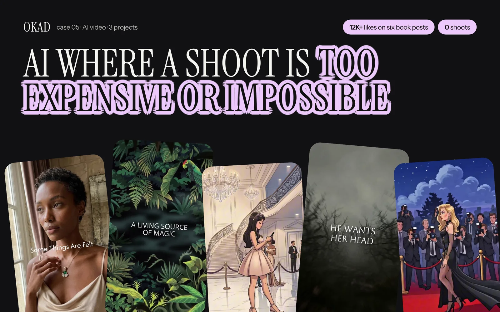

The short answer: you can use AI-generated content in ads. Every major advertising platform allows it. No law prevents commercial use.

The longer answer involves a distinction that most brands overlook: usability is not the same as ownership. You can run AI-generated ads, but you cannot copyright purely AI-generated work — which means you cannot legally prevent a competitor from generating something nearly identical.

This matters for brands investing in AI creative production. Here is what the law actually says, what the platforms require, and how to structure your workflow so your creative is both AI-powered and legally protected.

## The Legal State: Usable, Not Ownable

In 2023, the US Copyright Office issued guidance confirming that AI-generated content without human authorship does not qualify for copyright registration. The Thaler v. Perlmutter ruling reinforced this: works created autonomously by AI lack the human authorship required for copyright protection.

What this means in practice:

**You CAN:**
- Use AI-generated images and videos in commercial advertising
- Sell products using AI-generated marketing materials
- Publish AI-generated content on any platform
- Modify, edit, and combine AI-generated content with other elements

**You CANNOT:**
- Register a purely AI-generated image for copyright protection
- Sue a competitor who generates a similar-looking image with the same AI tool
- Claim exclusive ownership of a prompt output
- Prevent someone else from using the same prompt to get a similar result

This is not a grey area. It is settled policy at the federal level. The US Copyright Office has repeatedly confirmed that "human authorship is a bedrock requirement" and that "works generated by AI without human creative control do not satisfy that requirement."

## Why This Matters for Ad Creative

For most brands running paid ads, the inability to copyright AI-generated content has minimal practical impact. Here is why:

**Ad creative is inherently short-lived.** The average Meta ad runs for 2-8 weeks before fatigue sets in. By the time a competitor could replicate your AI-generated visual, the original has already been replaced. The speed of production matters more than the exclusivity of any single asset.

**Your competitive advantage is the strategy, not the image.** What makes an ad perform is not the specific image — it is the combination of hook, angle, offer, audience targeting, and visual style. A competitor can generate a similar-looking illustration, but they cannot replicate the testing data that told you which illustration style converts for your audience. For more on this strategic layer, see our [creative testing methodology](/blog/blog-creative-testing-methodology/).

**Brand elements are still copyrightable.** Your logo, brand colors, taglines, product photography, and the specific arrangement of elements on the ad — these are all protectable. An AI-generated background combined with your branded overlay, human-written copy, and strategic layout is a copyrightable composition.

The one scenario where ownership matters: if you are creating a character, mascot, or distinctive visual identity intended for long-term use across campaigns. In that case, involve human creative direction from the start so the resulting work qualifies for copyright protection.

## The Solution: Human Direction + AI Generation

The Copyright Office has explicitly stated that works combining AI-generated elements with "sufficient human authorship" can be registered. The key is the degree of human creative control.

**Low human involvement (not copyrightable):**
- Typing a prompt and using the output as-is
- Generating 10 images and picking one without modification
- Using AI to create an entire ad with no human editing

**High human involvement (copyrightable):**
- Providing detailed creative direction (composition, style, mood, specific elements)
- Selecting, arranging, and combining multiple AI outputs
- Editing AI-generated content in Photoshop, After Effects, or Figma
- Adding human-created elements: typography, brand assets, copy, layout
- Iterating through multiple generations with specific creative feedback

The practical workflow that produces copyrightable work:

1. **Creative brief** (human) — define the concept, composition, style, and intended message
2. **AI generation** (tool) — produce raw visual material based on the brief
3. **Selection and curation** (human) — choose and combine elements with creative judgment
4. **Editing and composition** (human) — modify, layer, add brand elements, refine
5. **Final production** (human) — typography, layout, CTA, format for platforms

This is exactly how professional creative production has always worked — a tool produces raw material, and a human with creative judgment turns it into a finished ad. The tool changed (from camera to AI generator), but the workflow remains human-directed.

## What the Ad Platforms Require

Every major advertising platform has published policies on AI-generated content. None prohibit it, but some require disclosure.

| Platform | AI Content Allowed? | Disclosure Required? | Notes |
|---|---|---|---|
| Meta (Facebook, Instagram) | Yes | Yes, for photorealistic deepfakes | Must disclose AI-generated content depicting realistic people or events |
| Google Ads | Yes | Yes, for certain formats | Requires disclosure for synthetic content in election/political ads; recommends for others |
| TikTok | Yes | Yes, for realistic AI content | Must label AI-generated content that could be mistaken for real footage |
| YouTube | Yes | Yes, for realistic content | Creators must disclose altered or synthetic content in upload flow |
| LinkedIn | Yes | No specific requirement | General advertising standards apply |
| Pinterest | Yes | No specific requirement | Must comply with standard creative policies |

**The pattern:** Platforms care about deception, not about AI use. Photorealistic AI content that could mislead viewers into thinking a real event occurred needs disclosure. Stylized illustrations, animated content, AI-enhanced product photos, and obviously creative visuals do not trigger disclosure requirements.

For brands running [AI-generated cartoon or illustrated ads](/blog/blog-ai-cartoon-ads/), disclosure is generally not required because the content is clearly not photorealistic.

## AI-Generated Faces: The Likeness Question

AI image generators can produce photorealistic human faces. These faces do not depict real people and therefore do not require traditional model releases. However, two risks exist:

**Unintended resemblance.** AI models trained on real photos can occasionally generate faces that resemble specific individuals. If someone recognizes themselves in your ad — or if a generated face closely matches a celebrity — you could face right-of-publicity claims. The likelihood is low but nonzero.

**Best practices for AI-generated people in ads:**
- Review every AI-generated face for unintended resemblance to public figures
- Use AI tools that offer "face diversity" or "synthetic face" settings
- Avoid prompts that reference specific real people
- Consider using illustrated or stylized human figures instead of photorealistic ones
- Keep generation records (prompts, seeds, dates) in case of disputes

**The safest approach:** Use AI for environments, products, backgrounds, and abstract visuals. Use real creators for human faces. This combines AI's speed advantage for visual production with real-person authenticity for trust elements — the same hybrid approach described in our [AI vs human creative guide](/blog/blog-hybrid-ai-human-content/).

## AI Voice and Music: Different Rules

AI-generated voiceovers and music follow a similar pattern to images — commercially usable, not copyrightable — but with additional considerations:

**Voice cloning.** Generating a synthetic voice that mimics a specific real person without their consent violates right-of-publicity laws in most US states. Use generic AI voices or voices explicitly licensed for commercial use.

**AI-generated music.** Commercially usable, not copyrightable. If the AI output closely resembles a copyrighted song (melody, lyrics, arrangement), derivative work claims are possible. Use AI music tools that generate original compositions and provide commercial licenses.

**AI voiceover for ads.** Fully legal and widely used. No disclosure required on most platforms for generic AI narration. Just ensure the voice does not clone a recognizable person.

## How OKAD Handles AI Creative Ownership

When [Olga Kad](https://www.linkedin.com/in/o-kad) and the [OKAD](https://okad.agency) team produce AI-generated ad creative, every project follows the high-human-involvement workflow:

1. **Human creative strategy** — research, competitive analysis, concept development
2. **AI-assisted production** — image generation, video creation, animation
3. **Human editing and composition** — Photoshop, After Effects, brand integration
4. **Human art direction** — selection, arrangement, quality control
5. **Client delivery** — perpetual usage rights, all platforms, raw files on request

The result: every deliverable includes enough human creative direction to qualify for copyright protection under current guidelines. The brand owns a copyrightable composition, not just an AI output.

*This AI-generated campaign for a book publisher earned 12K+ likes across six posts. Human creative direction from brief to final edit made the work copyrightable — and commercially successful. [See the full case study](/cases/case-5public/).*

## The Bottom Line

AI-generated content is commercially safe for advertising. Use it freely on every platform. The ownership question only matters if you need to prevent competitors from creating similar visuals — and for most ad creative, production speed matters more than exclusivity.

If you are building long-term brand assets (characters, visual identity, distinctive style), ensure your workflow involves substantial human creative direction at every stage. If you are producing high-volume ad creative for testing, the copyright question is largely academic — your advantage is in the [strategy and testing system](/blog/blog-ai-creative-workflow/), not in any single image.

For brands building [AI creative workflows](/blog/blog-ai-creative-workflow/) or wondering [how to make AI ads look real](/blog/blog-how-to-make-ai-ads-look-real/), the practical takeaway is the same: AI is the production tool, human strategy is the competitive advantage, and proper workflow documentation protects both. For a data-driven comparison of when to use AI vs human-created content, see [AI vs human ad creative results](/blog/blog-ai-vs-human-ad-creative-results/). And for UGC-specific rights questions, our [usage rights guide](/blog/blog-ugc-usage-rights-explained/) covers the contract terms you need.

## Work With OKAD

OKAD produces AI-generated and human-created ad content under one workflow. Every deliverable includes human creative direction, perpetual usage rights, and copyright-eligible compositions. No legal grey areas.

**[See pricing and book a call](/pricing)** · Or email [olga@okad.agency](mailto:olga@okad.agency) with your monthly ad spend and goals.
