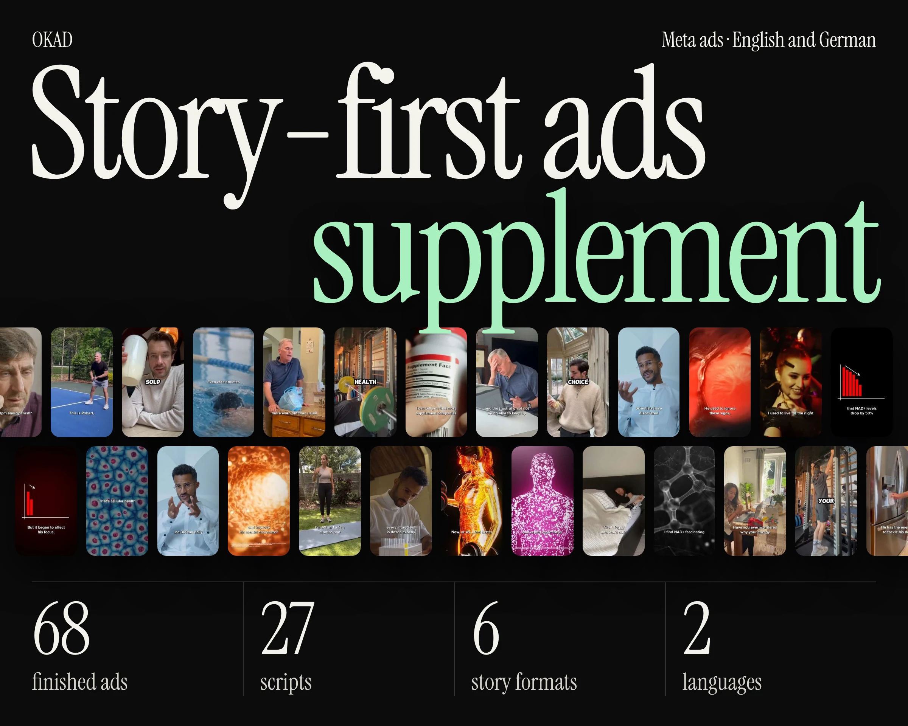

Every paid media manager knows this story. You find an ad that works. CPA is half your target. ROAS is 3x. You tell the team you have found a winner. Then you do the obvious thing: increase the budget.

Within two days, CPA doubles. Within a week, it has tripled. You panic and cut the budget back to the original level. But the ad never returns to its original performance. The winner is dead, and you are back to square one.

This is not a bug in Meta's algorithm. It is a predictable outcome of how ad delivery works at scale. Once you understand the three mechanisms behind it, you can build a system that scales spend without destroying performance.

## The Three Mechanisms That Kill Winning Ads

### 1. Audience exhaustion

At $50-100/day, Meta's algorithm is selective. It finds the 5-10% of your target audience most likely to convert and shows your ad almost exclusively to them. These are the easy conversions — people already in-market, already interested, already primed to buy.

When you raise to $500/day, the algorithm runs out of those easy conversions. It has to reach deeper into your audience to spend the larger budget. The people it reaches at $500/day are less qualified — they match your targeting criteria but are further from a purchase decision. Your impression count goes up, but your conversion rate drops.

This is not a creative problem. The ad has not changed. The audience quality has.

### 2. Frequency buildup

Higher daily spend on the same audience means each person sees the ad more often. At $100/day, the average person in your audience might see the ad once every 4-5 days. At $500/day, they see it every 1-2 days.

[Ad fatigue](/blog/blog-ad-fatigue-prevention/) is a function of frequency multiplied by time. An ad that would have lasted 4 weeks at low frequency fatigues in 10 days at high frequency. The visual becomes familiar, the hook loses its surprise, and the viewer scrolls past without processing the message.

The frequency threshold where most ads start declining: 2.0-2.5 on Meta, 3.0-4.0 on TikTok. Monitor this metric when scaling — it is usually the first signal that fatigue is approaching.

### 3. Bid competition

If you are running multiple ad sets or campaigns targeting overlapping audiences, increasing budget on one ad means you are now bidding against yourself more aggressively. Meta's auction system does not care that both bidders are the same advertiser. Higher bids from your own account inflate your CPM without improving delivery quality.

This is especially common in brands running Advantage+ alongside manual campaigns, or testing multiple audiences that share demographic overlap. The result: you pay more per impression for the same or worse conversion rates.

## The Fix: Scale the Angle, Not the Ad

The instinct when an ad works is to give it more money. The correct move is to give it more **variations**.

A winning ad is evidence that an angle works — a specific combination of hook, message, visual style, and creator type. The angle is the reusable asset. The specific execution is disposable.

### The waterfall strategy

**Step 1: Identify the winning element.** What specifically made this ad work? Was it the hook type (problem-aware, curiosity, social proof)? The creator demo (age, gender, style)? The visual format (talking head, demo, B-roll with text)? The message angle (price, benefit, fear of missing out)?

**Step 2: Produce 5 [hook swaps](/blog/blog-hook-rate-explained/).** Keep the body and CTA identical. Write 5 new opening hooks that test different angles. Each hook swap is a functionally new ad to the algorithm.

**Step 3: Produce 3 format remixes.** Take the winning message and recreate it in different formats: if the original was a talking-head video, make a [static version](/blog/blog-static-ads-vs-video-what-to-test-first/), a carousel version, and a text-on-B-roll version. Same angle, different visual execution.

**Step 4: Produce 2 creator swaps.** Same script, same hook structure, different creator. The algorithm treats each creator as a distinct ad, and different audiences respond to different faces.

**Step 5: Launch the waterfall.** You now have 10+ variations built on a proven angle. Distribute $50-100/day across each. The total spend across the waterfall matches or exceeds what you would have put on the single original ad — but each variation reaches its own optimal audience slice without the compounding fatigue.

This is the [50 ads from one shoot](/blog/blog-50-ads-from-one-shoot/) principle applied to scaling: multiply the winning concept, not the budget on a single execution.

### The math

| Strategy | Total daily spend | Creatives running | CPA behavior |
|---|---|---|---|
| Scale one ad: $50 → $500 | $500 | 1 | CPA doubles within 48 hours |
| Waterfall: 10 variations × $50 | $500 | 10 | CPA stays within 20% of original |

The waterfall approach costs the same in ad spend but requires more production volume. This is where the economics of creative production matter: if each variation costs $300 to produce, 10 variations cost $3,000 — but they sustain $15,000/month in ad spend for 3-4 weeks. The alternative is burning $15,000 on a single ad that fatigues in 10 days.

## Build the Queue Before You Need It

The biggest mistake brands make is waiting until a winner fatigues before starting production on replacements. By the time the new creative is ready, the account has spent 1-2 weeks with declining performance and rising CPA.

The system that works:

**Week 1:** Launch current batch. Start production on next batch.
**Week 2:** Current batch is performing. Next batch enters editing.
**Week 3:** Current batch shows early fatigue signals. Next batch is ready to launch.
**Week 4:** Swap in next batch. Current batch gets deprioritized. Start production on the batch after next.

This rolling pipeline means you never have a production gap. There is always a batch in production, a batch in testing, and a batch at scale. When the scaling batch fatigues, the replacement is already approved and loaded.

For most brands spending $10K+/month, this means producing 15-25 new creatives every month. That volume is only sustainable with a [modular production system](/blog/blog-modular-creative-production/) or an agency partner who builds that pipeline for you.

## How OKAD Prevents the Scaling Death Spiral

When [Olga Kad](https://www.linkedin.com/in/o-kad) and the [OKAD](https://okad.agency) creative team onboard a scaling brand, the first thing we build is not a single winning ad — it is the production system that keeps winners coming.

The approach:

**Phase 1: Find the angle.** Test 15-20 creatives across different hooks, formats, and creator types. Identify the 2-3 angles that consistently beat the CPA target.

**Phase 2: Build the waterfall.** For each winning angle, produce 5-8 variations — hook swaps, creator swaps, format remixes. This gives the account enough creative depth to [scale without fatigue](/blog/blog-how-to-scale-ad-campaigns-roas/).

**Phase 3: Maintain the pipeline.** Deliver new creative batches every 2 weeks. Each batch includes both variations on proven angles (safe volume) and experimental new angles (future winners). The ratio is typically 70% proven, 30% experimental.

*This longevity supplement brand's best ad fatigued after 3 weeks at $500/day. We had 12 variations ready in the pipeline — 3 outperformed the original. No production gap, no CPA spike, no scramble. [See the full case study](/cases/longevity-supplement-story-ads/).*

## Work With OKAD

OKAD builds creative pipelines that scale without the death spiral. Research, briefs, production, testing, and ongoing replacement — all in one retainer. No per-asset pricing. No retainer lock-in.

**[See pricing and book a call](/pricing)** · Or email [olga@okad.agency](mailto:olga@okad.agency) with your monthly ad spend and goals.
