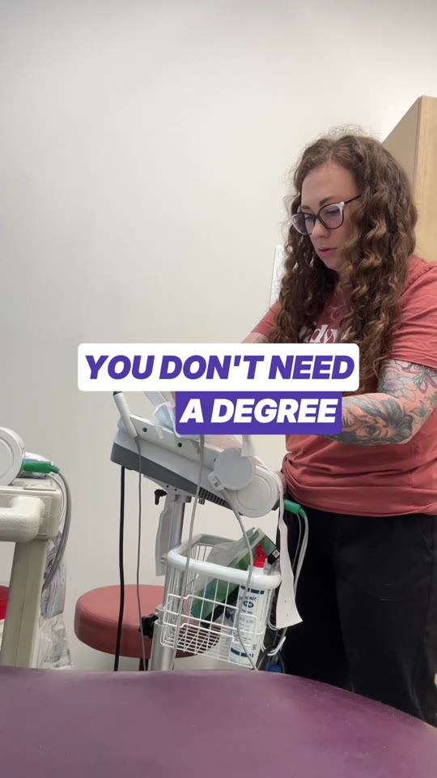
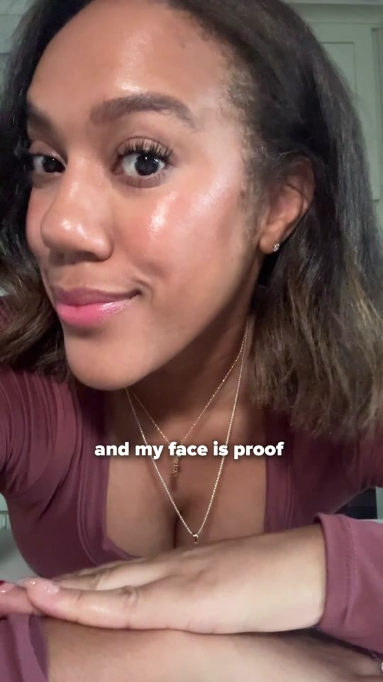
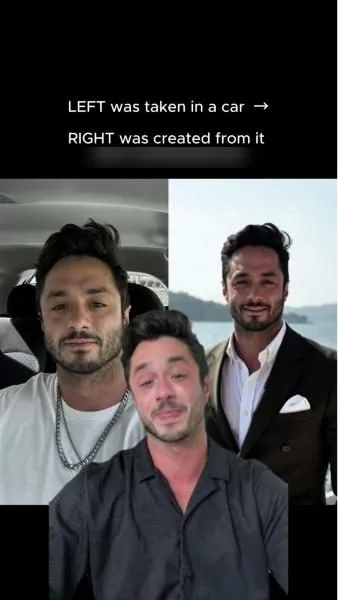

When [Olga Kad](https://www.linkedin.com/in/o-kad) takes over a struggling ad account at [OKAD](https://okad.agency), she does not start by making new ads. She starts by autopsying the dead ones. Every failed ad has a cause of death — a weak hook, a mismatched body, a broken funnel — and finding it takes less time than producing a replacement. After years of diagnosing underperforming accounts across DTC brands, Olga has catalogued every failure pattern this guide covers. The framework below is the result.

Most brands react to underperforming ads by doing one of two things: they rebuild everything from scratch, or they throw more budget at what exists. Both are wrong. The problem is almost never "all the creative is bad." The problem is usually one specific element — a weak hook, a mismatched format, a broken funnel — dragging down an otherwise functional campaign.

This guide is the diagnostic framework OKAD uses with every client. Check the metrics in the right order, identify exactly what is broken, and fix only that.

## The 5-Level Diagnostic Framework

Ad performance breaks down in predictable patterns. Each pattern points to a different root cause. Check them in this order — skipping ahead leads to misdiagnosis.

### Level 1: Low Impressions

**What you see:** The ad is barely being shown. Fewer than 1,000 impressions after 48 hours.

**What it means:** This is not a creative problem. The platform is not distributing the ad, which means your budget is too low, your bid is not competitive, your audience is too narrow, or the ad was rejected by policy review.

**What to fix:** Talk to your media buyer. Check account status, budget allocation, audience size, and policy compliance. Do not touch the creative — it has not been tested yet.

### Level 2: Low CTR (Below 1%)

**What you see:** The ad gets impressions but almost nobody clicks. CTR is under 1% on Meta or under 0.5% on TikTok.

**What it means:** Your hook is not stopping the scroll. The first 1-3 seconds of a video or the primary visual of a static ad is failing to earn attention.

**What to fix:** Test new hooks on the same ad body. The [Hook Swap System](/cases/swiss-skincare-high-volume-ads/) that OKAD built for a Swiss skincare brand was designed for exactly this problem — the brand had strong product demo footage but weak openings. Systematically replacing weak hooks while keeping proven body content intact turned a stalled account into a high-velocity testing machine, each new variant costing $15-30 to edit.

Keep the body and CTA intact. They have not been tested yet because nobody is getting past the hook.

### Level 3: High CTR, Low Conversions

**What you see:** People click or watch. CTR is healthy — 1.5%+ on Meta, 1%+ on TikTok. But conversions are low and CPA is high.

**What it means:** Your creative is working. The ad earns attention, communicates a message, and motivates action. The problem is downstream: landing page, checkout flow, page load speed, offer mismatch, or broken tracking.

**What to fix:** Do not change the ad. Fix the funnel. Check that the landing page delivers on the promise the ad makes. If the ad promises "50% off first order" and the landing page shows full-price products, the disconnect kills conversions regardless of how good the creative is.

### Level 4: Declining CTR Over Time

**What you see:** The ad performed well for 1-3 weeks, then CTR started dropping while impressions stayed stable or increased.

**What it means:** [Ad fatigue](/blog/blog-ad-fatigue-prevention/). The same audience has seen the ad too many times. The creative has not changed — the audience's tolerance for it has.

**What to fix:** Create variations, not replacements. Hook swaps, format remixes, and fresh opening angles extend the life of a proven concept. OKAD's work across [five brands](/cases/ad-re-edits-five-brands/) produced 80 fresh ads from existing footage — zero new shoots — specifically to fight fatigue cycles.

Do not increase budget on a fatigued ad. More spend accelerates the decline by showing the same creative to even more of the same audience even faster.

### Level 5: Everything Declines at Once

**What you see:** Every creative in the account is declining simultaneously. New ads launch and flatline immediately. Nothing works.

**What it means:** Audience exhaustion. You have saturated your target audience. No creative fix helps because the problem is not the message — it is that the audience has heard every version of it.

**What to fix:** Expand targeting. Test new audiences, new platforms, or new geographic markets. Pause and let frequency cool down. Then relaunch with fresh creative to a broader or refreshed audience pool.

## Diagnosing Hook vs Body vs CTA Problems

Once you have identified that creative is the issue (Levels 2 or 4), narrow down which element is failing.

### Hook Problems

**Signal:** Low CTR, low [hook rate](/blog/blog-hook-rate-explained/), viewers drop off in the first 2-3 seconds.

The hook is the single biggest performance variable. OKAD's diagnostic process starts here: export all creatives from the last 90 days, rank by CPA, and identify patterns in the top 20% and bottom 20%. The gap between those patterns is your creative strategy.

**Common hook failures:**
- Generic opening that could belong to any brand ("Are you tired of...")
- Starting with the product instead of the problem
- No tension, curiosity, or pattern interrupt in the first frame
- Text overlays too small to read on mobile

### Body Problems

**Signal:** Good hook rate (viewers stay past 3 seconds) but high drop-off between seconds 5-15. Hold rate collapses mid-video.

The body is not delivering on the promise the hook made. If your hook says "I found the one product that cleared my skin in 3 days" and the body is a generic product demo with no before/after, the viewer feels tricked and leaves.

**Common body failures:**
- Pacing is too slow — does not match the energy of the hook
- No proof or demonstration of the claim made in the hook
- Too many talking points crammed into one ad
- Visual quality drops from hook to body (different lighting, different energy)

### CTA Problems

**Signal:** Strong hook rate, strong hold rate, but low click-through at the end. Viewers watch the full ad but do not take action.

**Common CTA failures:**
- No CTA at all — the ad just ends
- CTA is too vague ("Check us out")
- CTA asks for too much commitment ("Book a free 30-minute consultation" when "See pricing" would convert better)
- CTA does not match the viewer's awareness stage

## The 3-Day Rule

Every new creative deserves 3 days and $50-100 in spend before you judge it.

**Killing too early** means you are reacting to statistical noise. A video ad shown to 500 people tells you almost nothing. The platform needs time to find its audience within your targeting parameters.

**Keeping too long** means you are burning budget on a confirmed underperformer. After 3 days with sufficient spend, the signal is clear enough to act on.

| Metric After 3 Days | Verdict | Action |
|---|---|---|
| CTR above benchmark, CPA in range | Winner | Scale spend gradually |
| CTR above benchmark, CPA high | Funnel issue | Fix landing page, keep the ad |
| CTR below benchmark | Hook failure | Swap the hook, keep the body |
| All metrics flat/zero | Dead creative | Kill it, test a new angle |

OKAD applied this framework during the [gut health brand campaign](/cases/gut-health-brand-story-ads/), testing red-flag messaging hooks against benefit-first hooks. Each variant got its 3-day window before a kill-or-scale decision. The result: clear data on which emotional triggers drove clicks versus which drove conversions — data that would not exist if ads were killed after 24 hours.

## When to Iterate vs When to Start Fresh

This is the decision that separates experienced creative strategists from everyone else.

**Iterate when:**
- The concept resonates but the execution needs refinement
- Hook rate is low but hold rate is high on viewers who stay (the body works, the hook does not)
- One format of the concept works but others do not (the angle is right, the format is wrong)
- The ad worked before and is now fatiguing (proven concept, needs fresh hooks)

**Start fresh when:**
- The entire angle generates no response — not low response, zero response
- Comments are negative or confused ("What is this even advertising?")
- Multiple hook variations on the same concept all fail
- The product or offer has fundamentally changed since the original brief

For the [supplement UGC ad testing](/cases/supplement-ugc-ad-testing/) campaign, 16 creator videos generated 48 ad variations, with iteration as the primary strategy: identify winning angles from initial tests, then produce hook and format variations on those angles. Starting fresh was reserved for testing completely new audience segments where existing angles had no data.

## The Common Creative Mistakes

These show up in almost every account OKAD audits:

**Same format for every ad.** If all your ads are 30-second talking head videos, you are missing the audience segments that respond to static images, carousels, or 15-second cuts. Diversify formats before assuming the message is wrong.

**No hook variety.** One hook per concept means one chance to earn attention. OKAD's standard is 5-10 hook variations per concept — curiosity hooks, problem hooks, social proof hooks, controversy hooks. Each one reaches a different psychological trigger.

**Too polished.** Native-looking content outperforms studio-quality content on TikTok, Reels, and Stories. If your ad looks like a commercial, it gets scrolled past like a commercial. The [faceless UGC approach](/cases/drawing-app-faceless-ugc/) works precisely because it looks like organic content, not advertising.

**Wrong aspect ratio.** A 16:9 video in a 9:16 placement gets cropped, loses its text overlays, and underperforms by 40-60%. Export every creative in the correct dimensions for every placement.

**Audio mismatch.** Trending audio on TikTok, voiceover on Meta, subtitles everywhere. The audio strategy should match the platform and placement, not be an afterthought.

## Building Your Own Diagnostic Habit

Creative diagnosis is not a one-time audit. It is a weekly practice.

Every Monday, pull the last 7 days of data. Sort creatives by CPA. Ask three questions:

1. **What won, and why?** Identify the hook style, format, and angle of your top 3 performers.
2. **What lost, and why?** Identify which element failed in your bottom 3.
3. **What should we test next?** The gap between winners and losers tells you exactly what variable to test.

This is the [creative strategy lifecycle](/blog/blog-ad-creative-strategy/) that OKAD runs with every client: research, brief, test, diagnose, iterate. The diagnosis step is where most teams skip — and where the most valuable insights live.

The brands that scale creative profitably are not the ones with the biggest budgets or the best designers. They are the ones that diagnose fast, fix precisely, and never rebuild what is already working.
